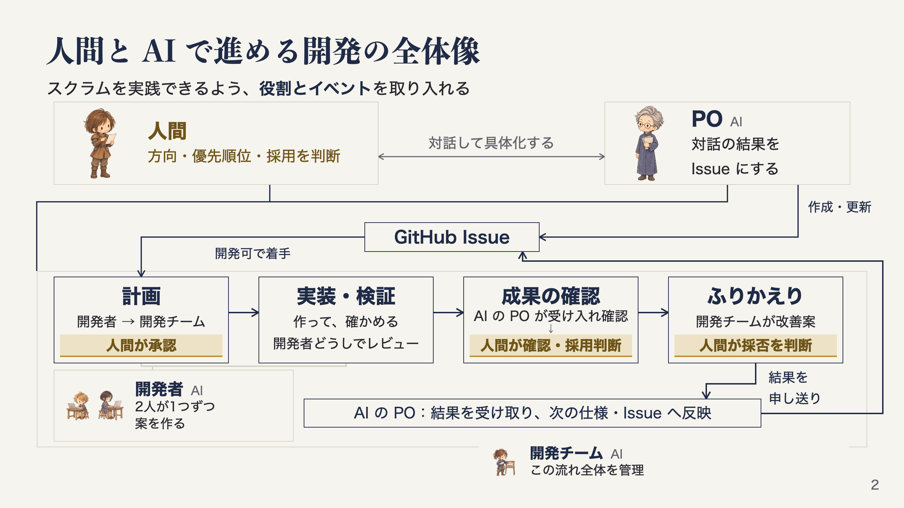

# 人間と AI で開発を進めるために、役割と手順を決めた

[agent-dev-template](https://github.com/dyamada-jaki/agent-dev-template) という、AI エージェントと開発を進めるためのテンプレートを作っています。作りたいものを仕様にまとめ、GitHub の Issue に作業を切り出して、計画、実装、レビュー、ふりかえりまで進めるためのものです。

このプロセスを作るときに考えていたのは、スクラムの役割とイベントを可能な限り取り入れることでした。作る方向や優先順位、計画、成果、改善には人間が関わり、AI がそれを具体的な作業にして進める形にしています。

ここでは、Claude Code と Codex が同じ Issue からそれぞれ案を作る進め方を紹介します。どの担当が何を受け取り、何を判断して次へ渡すのかを、順に説明します。

## AI に持たせた役割

AI エージェントには、PO、開発チーム、開発者という役割を持たせています。PO はプロダクトオーナーの略です。人間と相談しながら、作りたいものの仕様を整理し、作業の単位となる Issue を書きます。成果ができたときには、仕様や受け入れ条件に合っているかも確かめます。

開発チームは、Issue ごとの進行を管理するコーディネーターです。開発者へ作業を依頼し、計画や確認事項を人間へ渡します。成果がそろえば案とレビュー結果を比べて推薦し、採用後の取り込みやふりかえりまで進めます。ここでの「開発チーム」は、この調整を担う AI の役割名です。実際に計画を立て、実装と検証をする開発者とは分けています。

開発チームをスクラムマスターと呼ばなかったのは、進行を主導する性格が強いと考えたからです。スクラムマスターの要素を含むところはあっても、同じ役割とは捉えていません。独立したスクラムマスターは置いていない、というのが現在の形です。

人間は AI の PO と相談して、作る方向や優先順位を決めます。そのうえで、開発者の計画、できあがった成果、進め方の改善案を確かめて判断します。成果を受け取るステークホルダーとして関わりつつ、作るものや順番を決める PO の役割も担っています。AI の PO は、その判断を支え、仕様や個々の作業に具体化します。

[全体図を原寸で開く（2560×1440）](assets/process-overview.png)。人間が判断する箇所を金色で示しています。

## 作りたいことを Issue にする

最初は、人間と AI の PO が、何を作りたいかを話すところから始まります。決まった内容は、全体の仕様を持つ `docs/spec.md` に残します。これを Spec と呼んでいます。そこから今回作る範囲を切り出したものが、GitHub の Issue です。Issue には目的、作業範囲、完成したと判断するための受け入れ条件、今回やらないことを書きます。

全体の仕様と今回の作業を分けておけば、まだ作らないことも仕様に残しながら、着手する範囲を決められます。Issue に仕様全体を写すのではなく、詳しい内容は Spec を参照する形にします。後で決め直すことがあれば、仕様も更新します。

この、やりたいことや優先順位を話し合い、作業を具体化する活動をリファインメントと呼んでいます。スクラムで扱う作業項目であるプロダクトバックログアイテム（PBI）の代わりに、Issue を使います。このプロセスでは人間と AI の PO が中心になって具体化し、開発者は次のプランニングから加わります。

AI の PO は、人間と検討した優先順位をもとに、依存関係や着手条件を確かめて作業順を整理します。始めてよい Issue に「開発可」ラベルを付けると、Orca の定期実行による起動係が見つけ、開発チームを起動します。Orca は、複数のエージェントの端末と作業場所をまとめて扱う環境です。ここからは、開発チームがその Issue の進行を引き受けます。

## 計画を確かめてから、別々に作る

開発者は、Issue と仕様を読み、どう作るか、どう確かめるかを計画します。Claude Code と Codex は、同じ Issue に対してそれぞれ別々に計画を立てます。開発チームは、その計画と確認したいことを人間へ渡します。人間は作りたいものと照らして、必要なら調整し、承認します。受け入れ条件をどう満たすか、何を確認すれば完成と言えるかも、この時点で見ます。

計画を見て仕様の不足が分かったときは、AI の PO に戻して人間と決め直します。開発者が曖昧なところを埋めて実装し、その結果を仕様にしてしまう進め方にはしません。何を作るかが決まり、人間が計画を承認してから実装へ進みます。

この計画から成果の確認、ふりかえりへ進む順序は、スプリントの流れを踏襲するつもりで作りました。ただし、スプリント期間は設けず、Issue ごとに進めます。デイリースクラムも取り入れていません。[スクラムガイド](https://scrumguides.org/docs/scrumguide/v2020/2020-Scrum-Guide-Japanese.pdf)の役割やイベントを、このプロセスでどう取り入れるかを考えた形です。

承認後は、2人の開発者がそれぞれの計画で実装し、検証します。作業には別々の Git worktree、つまり同じリポジトリの別の作業ディレクトリを使います。成果は、変更をレビューして取り込むためのプルリクエスト（PR）として、それぞれ提出します。

2人は互いの PR をレビューします。Issue の受け入れ条件、仕様、実際の変更や検証結果を見て、指摘があれば修正し、確かめ直します。承認された計画に沿う実装・検証・相互レビューは AI が担当し、人間の作業はありません。途中で仕様の不足や人間の判断が必要な点が見つかれば、そこは作業を止めて相談に戻します。

ここで紹介しているのは、同じものを2人が別々に作る進め方です。テンプレートでは二重実装は任意で、1人が1つの案を作ることもできます。2人で進めた場合は、両方の案とレビュー結果を受け取った開発チームが、どちらを採るかを推薦します。

## 成果を見て、採用するかを決める

開発チームの推薦を受けた AI の PO は、成果が仕様や受け入れ条件に合っているかを確かめます。コードのレビューを繰り返すのではなく、欲しかったものになっているか、今回の範囲を守っているか、使う人から見てどうかを確認します。差し戻された場合は、開発チームが修正と再確認を進めます。

その確認結果を受けて、人間が実物を見ます。採用するのか、修正してほしいのか、そもそも条件を見直したいのかを判断します。AI の PO が受け入れたことと、人間が採用を決めたことは別に記録します。私は、このように人間が成果を確かめて次の作業を考えるところに、スプリントレビューを取り入れていると捉えています。

実物を見て、作りたいものの条件が変わることもあります。その場合は人間と AI の PO が仕様や Issue を直し、更新した条件に沿って開発者が修正します。最初の条件に対するレビュー結果だけで、変更後の成果も確認できたことにはしません。修正した版でレビューと受け入れ確認を行い、人間があらためて判断します。

採用する PR と実行内容を人間が承認すると、開発チームが main へマージして変更を取り込み、作業場所などを片付けます。そこで、その Issue の進め方をふりかえります。

## ふりかえりを次の仕事につなげる

開発チームは検証やレビューの記録を読み、続けたいこと、改善したいこと、まだ判断できないことを整理します。改善を提案するときには、何が起きたのか、その根拠は何か、どの手順をどう変えるのかを示します。人間はその案ごとに採否を判断し、採用したものを開発チームが手順や文書へ反映します。進め方を見直すレトロスペクティブにも、人間が関わる形です。

手順に書き足しただけでは、改善の効果があったとは言えません。反映した改善は、次の Issue で試し、同じ問題が起きなかったか、確認したかった結果が得られたかを確かめます。改善案を採用すること、手順へ反映すること、効果を確かめることは、分けて扱います。

ふりかえりで仕様について分かったことや、次に扱う課題は、AI の PO へ申し送ります。PO は人間と相談し、次の仕様や Issue、優先順位に反映します。こうして、作りたいことを話すところに戻ります。判断や検証の結果は Issue、PR、Issue ごとのレポートに残し、次の計画でも参照できるようにしています。

具体的な手順は [agent-dev-template の開発手順](https://github.com/dyamada-jaki/agent-dev-template/blob/78c72e2a824ef1056e8ecbcae141818acf28ec71/docs/workflow.md)にまとめています。この記事は2026年10月27日の固定版と、その後に整理した設計意図をもとにしています。役割と各活動を図で追う場合は、[紹介スライドの PDF](https://github.com/dyamada-jaki/agent-dev-slide/blob/9d07311/docs/pdf/agent-dev-slide.pdf)も参照してください。
