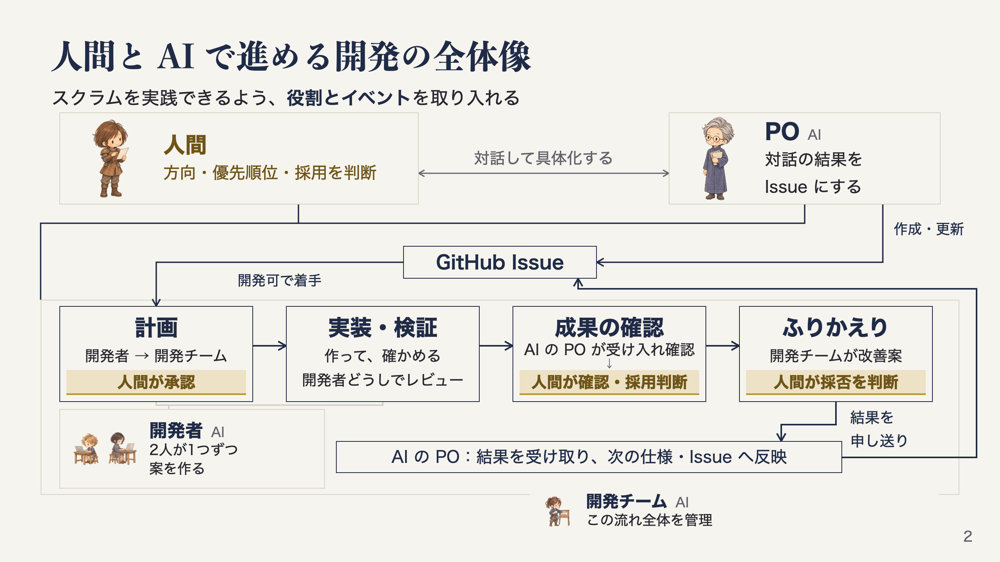

# agent-dev-template で進める、人間と AI の開発プロセス

[agent-dev-template](https://github.com/dyamada-jaki/agent-dev-template) は、人間と AI エージェントが、仕様を考えるところから実装、レビュー、ふりかえりまで進めるためのテンプレートです。AI に実装してもらう手順だけでなく、作るものを決め、できたものを確かめ、次の進め方を見直すところまでを扱います。

このプロセスを作るとき、スクラムの役割とイベントを可能な限り取り入れ、開発の中でスクラムを実践できる形にしたいと考えました。人間が作る方向や優先順位を決め、AI が計画や実装を進め、その成果と進め方を人間が確かめる流れです。

ただし、スプリント期間は設けていません。Issue ごとに、計画して、作って、確かめて、ふりかえる流れを踏襲しています。この記事では、AI の担当をどう分け、ひとつの Issue をどう進めるかを説明します。

全体図はクリックすると原寸で開けます。

## 人間と AI の担当を分ける

AI エージェントには、PO、開発チーム、開発者という3つの役割を持たせています。

PO はプロダクトオーナーの略です。このプロセスの AI の PO は、人間と相談し、決まったことを仕様や Issue に整理します。作ったものが条件を満たしているかを確かめるのも担当です。作る方向や優先順位を決めるときは、人間が PO と話し合って判断します。スクラムの PO の責任をすべて AI に移した、という意味ではありません。

開発チームは、Issue ごとの進行を管理するコーディネーターです。開発者から計画を受け取り、人間へ確認を求め、できたものやレビュー結果を比べます。採用後のマージや後片付け、ふりかえりも担当します。名前が似ていますが、スクラムチーム全体を指す呼び方ではありません。

この担当をスクラムマスターと呼ばなかったのは、進行を主導する性格が強いと考えたためです。独立したスクラムマスターは置いていません。開発チームの働きにスクラムマスターの要素も含まれる、くらいに捉えています。

開発者は、Issue を読んで計画を立て、実装と検証、レビューを行うエージェントです。ここでは Claude Code と Codex の2人が、同じ Issue に対して別々の案を作る進め方を紹介します。2人で作ることが、テンプレートのすべての作業で必須というわけではありません。1人でひとつの案を作ることもできます。

人間は、この3つの AI の役割とは別に関わります。ステークホルダーとして成果を確かめるとともに、作る方向や優先順位を決める PO の役割も担います。AI の PO が判断に必要なことを整理し、人間が計画、成果、改善案を確かめて決める、という分担です。

## やりたいことを仕様と Issue にする

作業は、人間と AI の PO が、何を作りたいかを相談するところから始まります。誰のためのものか、何ができればよいか、今回はどこまで作るかを話し、決まったことを `docs/spec.md` に書きます。これは作るもの全体の仕様です。今すぐ作らない部分や、まだ決まっていないこともここに置きます。

そこから、今回作る範囲だけを GitHub Issue に切り出します。Issue には目的、作業の範囲、受け入れ条件、スコープ外を書くようにしています。受け入れ条件は、できたものを見て完成したかどうかを確かめるための条件です。全体の仕様と、今回の作業の条件を分けて残す形です。

この Issue を、スクラムのプロダクトバックログアイテム（PBI）の代わりに使っています。やりたいことを具体化し、優先順位を考え、作業として扱えるようにする活動がリファインメントに当たります。リファインメントは、スクラムガイドでは項目を詳しくしていく継続的な活動として説明されています。ここでは人間と AI の PO が中心となり、開発者は次のプランニングから加わります。スクラムでは開発者もリファインメントに関わるため、この点は担当の分け方が異なります。

PO が着手順を決め、前提のそろった Issue に「開発可」のラベルを付けると、起動係が開発チームを起動します。開発チームは、その Issue の計画から完了までを進めます。

## 計画を確認してから、開発者に任せる

開発者は、Issue を受け取ってすぐに実装するのではなく、先に計画を出します。受け入れ条件をどう満たすか、何を作り、どう確かめるか、確認したいことはないかを示します。2人で進める場合は、同じ Issue を読んで、それぞれが計画を立てます。

開発チームは、2つの計画と確認事項を人間に示します。人間は作りたいものと照らし、必要なら調整して承認します。仕様に穴が見つかったときは、PO に戻って仕様と Issue を決め直します。曖昧な条件を、実装する側だけで確定させないための確認です。

ここに、スプリントプランニングの流れを取り入れています。何をどう作るかを合意してから開発に進みますが、Issue 1本を一定期間のスプリントとして扱うわけではありません。また、デイリースクラムは取り入れていません。

承認後は、開発者が自分の計画に沿って実装と検証を進めます。それぞれ別の worktree を使います。worktree は、同じ Git リポジトリに対して作業用のディレクトリを分ける仕組みです。エージェントの端末と worktree を扱う作業環境には Orca を使っています。

開発者は、確認コマンドを通し、変更をプルリクエスト（PR）として提出します。PR は、変更内容と確認結果を示し、レビューして取り込める状態にするためのものです。2人は互いの PR をレビューし、受け入れ条件や仕様との一致、不具合や回帰、検証の不足を確かめます。

この実装と検証、相互レビューは AI が進めます。人間が承認した計画の範囲で進められる間は、人間の作業を挟みません。途中で仕様の不足や人間の判断が必要なことが見つかった場合は、作業を止めて PO や人間に戻します。

開発チームは、できた2つの案とレビュー結果を受け取り、比べて推薦する PR を選びます。2人が作ったこと自体を採用の根拠にせず、何が条件を満たし、どんな違いや未確認事項があるかを整理して次へ渡します。

## 成果の確認と採用を分ける

開発チームが推薦した PR は、まず AI の PO が受け入れ確認をします。見るのは、受け入れ条件や仕様に合っているか、使う人から見て期待するものになっているかです。実装コードのレビューは開発者が担当し、PO はコードを見ずに成果と条件を照らします。差し戻しになった場合は、開発チームが修正を進め、改めて確認します。

その結果を受けて、人間が実物を確かめます。目的に合っているか、修正が必要か、条件そのものを見直した方がよいかを判断します。AI の PO が受け入れた時点で、人間の採用まで決まったことにはしません。

作ったものを人間が確かめ、必要な修正や次の作業を考えることで、スプリントレビューを実践していると捉えています。開発者どうしが実装をレビューする作業と、その成果を見て今後を判断する場面を分けています。スクラムガイドのスプリントレビューも、成果を検査して今後の適応を決めるイベントであり、単に PR の採用を承認する手続きと同じではありません。

実物を見て条件を見直すことになったら、人間と PO で仕様と Issue を更新します。変更後の条件で成果を再確認し、採用するかを判断します。最初の受け入れ確認が、その後の条件変更にも有効とは扱いません。

人間が採用と具体的な実行内容を承認すると、開発チームがマージし、作業用の worktree などを片付けます。何を採用するかという判断と、取り込む処理を実行する担当も分けています。

## ふりかえりを次の Issue へ戻す

成果を取り込んだあと、開発チームが Issue 1本の進め方をふりかえります。計画や検証、レビューの記録を読み、続けること、改善すること、まだ判断できないことを整理します。スプリントレトロスペクティブの考え方を、Issue ごとの作業に取り入れた部分です。

改善案は、何が起きたのか、どこをどう変えるのか、変えたあとに何を確かめるのかまで示します。人間が案ごとに採否を判断し、採用したものを開発チームが手順や文書へ反映します。作業の後片付けを任せたことを、新しい改善案すべてへの承認にはしません。

仕様に関する発見は、AI の PO に申し送ります。PO はそれを受けて、人間と次の仕様や Issue を検討します。実装中に分かったことが、次に何を作るか、どう作るかにつながる流れです。

改善は、採用したこと、手順に反映したこと、効果を確かめたことを分けて記録します。手順を書き換えただけでは役立ったかどうかは分からないので、関係する次の Issue で、同じ問題が起きなかったか、確認に役立ったかを見ます。その結果を、さらに次のふりかえりへ戻します。

具体的な8ステップは、[元テンプレートの開発手順（この記事の参照版）](https://github.com/dyamada-jaki/agent-dev-template/blob/78c72e2a824ef1056e8ecbcae141818acf28ec71/docs/workflow.md)にあります。全体を図で見たい場合は、[紹介スライドの PDF](https://github.com/dyamada-jaki/agent-dev-slide/blob/9d073116c6c54ca2a15eef99b31ac6e48e0f528a/docs/pdf/agent-dev-slide.pdf)も参照してください。スクラムの役割やイベントの定義は、[スクラムガイド2020年11月版の日本語訳](https://scrumguides.org/docs/scrumguide/v2020/2020-Scrum-Guide-Japanese.pdf)で確認できます。
