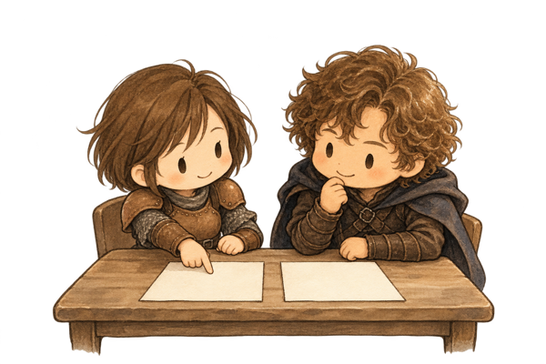

<!-- _class: cover -->
<!-- _header: 検討用・未採用 / Codex案 / 元の1枚目 -->

# エージェント 開発プロセス

Spec × Issue × Orca

agent-dev-template の全体像と役割

<!--
【話すこと】
agent-dev-template というテンプレートが用意している開発プロセスの全体像を紹介します。
最初の数分で「何をするプロセスか」と「登場する役割」を押さえ、そのあと Issue 1本の流れに進みます。

【出典】
- README 冒頭（題名「エージェント開発テンプレート（Spec × Issue × Orca）」）: https://github.com/dyamada-jaki/agent-dev-template/blob/78c72e2a824ef1056e8ecbcae141818acf28ec71/README.md
-->

---

<!-- _class: relation -->
<!-- _header: 検討用・未採用 / Codex案 / 元の3枚目 -->

## Spec・Issue・Orca の関係

  

    <h3>Spec</h3>
    <ul>
      <li>作るもの全体の仕様</li>
      <li>「何を・なぜ・どこまで」 を書く</li>
      <li>まだ作らない部分も 書いてよい</li>
    </ul>
    
docs/spec.md

  

  
→

  

    <h3>Issue</h3>
    <ul>
      <li>仕様から今回作る部分 だけを取り出した 作業の単位</li>
      <li>目的・範囲・ 受け入れ条件を書く</li>
      <li>1〜3本ずつ出し、 終わったら次を切る</li>
    </ul>
    
GitHub Issue

  

  
→

  

    <h3>Orca</h3>
    <ul>
      <li>複数の AI エージェントの 端末と worktree を まとめて扱うアプリ</li>
      <li>Issue を1本ずつ 実装する作業環境</li>
    </ul>
    
エージェントの作業場所

  

<!--
【話すこと】
Spec から今回作る部分を Issue に切り出し、Orca で1本ずつ作る
Spec は、作るもの全体について「何を・なぜ・どこまで」作るかを書いた仕様で、まだ作らない部分も書いておけます。
Issue は、その仕様から今回作る部分だけを取り出した作業の単位です。今回実装する作業の目的・範囲（やらないこと）・受け入れ条件を書きます。1〜3本ずつ出して、終わったら次を切ります。
Orca は、複数の AI エージェントの端末と worktree をまとめて扱うアプリで、Issue を1本ずつ実装する作業環境になります。

【出典】
- workflow.md 冒頭（spec.md は作るもの全体の仕様、Issue はそこから今回作る部分だけを取り出したもの、Orca で1本ずつ実装）: https://github.com/dyamada-jaki/agent-dev-template/blob/78c72e2a824ef1056e8ecbcae141818acf28ec71/docs/workflow.md
- workflow.md ステップ2「Issueを切り出す」（Issue に書くこと: 目的、受け入れ条件、スコープ外）: https://github.com/dyamada-jaki/agent-dev-template/blob/78c72e2a824ef1056e8ecbcae141818acf28ec71/docs/workflow.md
- README 冒頭（Orca の説明）: https://github.com/dyamada-jaki/agent-dev-template/blob/78c72e2a824ef1056e8ecbcae141818acf28ec71/README.md
-->

---

<!-- _class: human-page -->
<!-- _header: 検討用・未採用 / Codex案 / 元の5枚目 -->

## 人間は3つの役割に含めず、 判断を担う

  

    <h3>人間</h3>
    <ul>
      <li>PO と議論する</li>
      <li>3つの判断をする</li>
    </ul>
    
役割には数えない

    
  

  
→

  

    
1. 計画を承認する

    
2. 採用する PR を決める

    
3. 改善の採否を決める

  

<!--
【話すこと】
3つの判断は人間が行う。それ以外はエージェントが進める
人間は3つの役割のどれにも含めません。
人間がすることは、PO との議論と、3つの判断です。実装前の計画を承認する、採用する PR を決める、ふりかえりで出た改善の採否を決める。
この3つの判断は人間が行い、それ以外の作業はエージェントが進めます。
それぞれの判断がどのタイミングで来るかは、次の「Issue 1本の流れ」で説明します。

【出典】
- README「Issue 1本の流れ」（「六角形が人間の判断です。それ以外はエージェントが進めます。」「人間がすることは、PO との議論と、④⑥⑧の3つの判断です。」）: https://github.com/dyamada-jaki/agent-dev-template/blob/78c72e2a824ef1056e8ecbcae141818acf28ec71/README.md#issue-1本の流れ
- workflow.md の PO・開発チーム・開発者の担当を表にした節（人間が判断するのは3つの場面: ④計画承認、⑥採用の判断、⑧改善の採否）: https://github.com/dyamada-jaki/agent-dev-template/blob/78c72e2a824ef1056e8ecbcae141818acf28ec71/docs/workflow.md
-->
