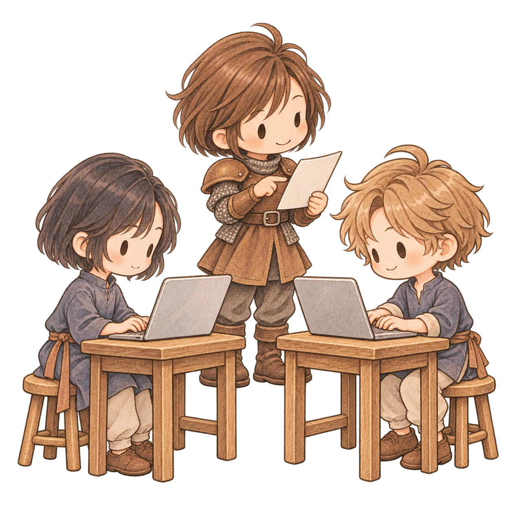
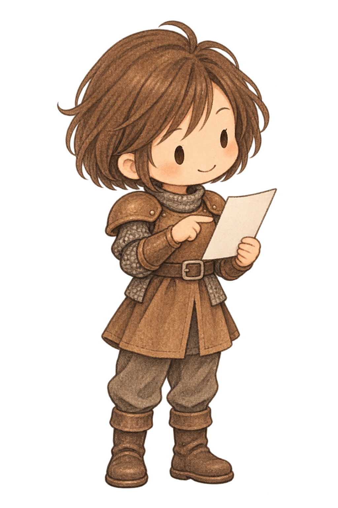
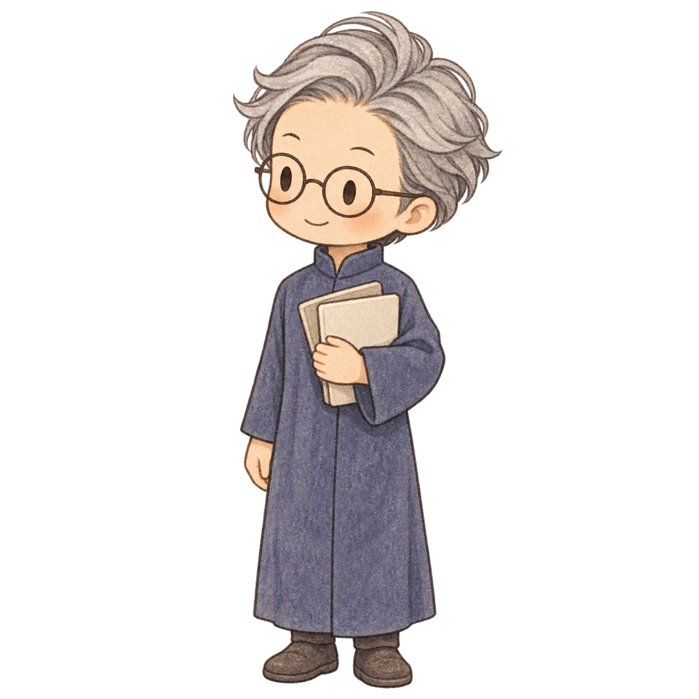
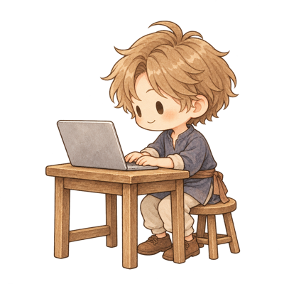
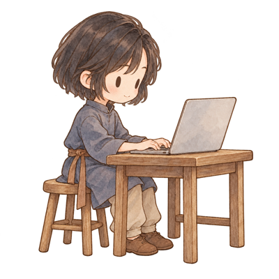
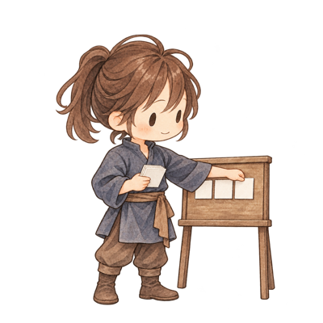

<!-- _class: cover cover-illustrated -->
<!-- _paginate: false -->

# Bringing Scrumto Developmentwith AI

---

<!-- _class: overview -->

## How people and AI work together

Putting Scrum into practice through its roles and events

<svg class="ov-wires" viewBox="0 0 1280 720" aria-hidden="true">
<defs><marker id="ov-arrow" viewBox="0 0 10 10" refX="8" refY="5" markerWidth="7" markerHeight="7" orient="auto-start-reverse"><path d="M 1 1 L 8 5 L 1 9" fill="none" stroke="#1F2B47" stroke-width="1.5"/></marker><marker id="ov-soft-arrow" viewBox="0 0 10 10" refX="8" refY="5" markerWidth="7" markerHeight="7" orient="auto-start-reverse"><path d="M 1 1 L 8 5 L 1 9" fill="none" stroke="#62626C" stroke-width="1.5"/></marker></defs>
<path d="M 382 262 V 286 H 1030 V 262 M 382 286 H 52 V 384" fill="none" stroke="#1F2B47" stroke-width="1.8"/>
<path d="M 536 222 H 856" fill="none" stroke="#62626C" stroke-width="1.5" marker-start="url(#ov-soft-arrow)" marker-end="url(#ov-soft-arrow)"/>
<g fill="none" stroke="#1F2B47" stroke-width="1.8" marker-end="url(#ov-arrow)"><path d="M 1130 262 V 336 H 764"/><path d="M 516 336 H 200 V 392"/></g>
<g fill="none" stroke="#1F2B47" stroke-width="2" marker-end="url(#ov-arrow)"><path d="M 324 443 H 366"/><path d="M 614 443 H 656"/><path d="M 904 443 H 946"/><path d="M 1070 515 V 544 H 1000 V 565"/><path d="M 1078 586 H 1250 V 370 H 740 V 357"/></g>
<path d="M 200 515 V 519 H 490 V 515 M 216 519 V 524" fill="none" stroke="#D7D2C4" stroke-width="2"/>
</svg>

<h3>Human</h3>
Sets direction and priorities. Decides what to adopt.

Clarify the work together

GitHub Issue

Create / update

Start when ready

<h3>Product OwnerAI</h3>
Turns decisions into issues

<h3>Planning</h3>
Developers → Coordinator <strong class="ov-human-action">Human approves</strong>

<h3>Development</h3>
Build and test Review each other's work

<h3>Review</h3>
AI PO checks acceptance ↓ <strong class="ov-human-action">Human reviews &amp; decides</strong>

<h3>Retrospective</h3>
Proposes improvements <strong class="ov-human-action">Human chooses changes</strong>

<h3>DevelopersAI</h3>
Two developers, two separate solutions

<h3>CoordinatorAI</h3>
Manages the entire cycle

Hand off findings

AI PO uses findings to update specifications and issues

---

## Who does what

<h3>HumanStakeholder / PO</h3><ul class="role-points"><li>Sets direction and priorities with the AI PO</li><li>Makes decisions on plans, results and improvements</li></ul>

⇄ Discuss and clarify

<h3>POAI</h3><ul class="role-points"><li>Works through priorities and writes specifications and issues</li><li>Checks the result against acceptance criteria</li></ul>

<h3>CoordinatorAI</h3><ul class="role-points"><li>Manages each issue and compares the two solutions</li><li>Merges the chosen work, cleans up and runs the retrospective</li></ul>

<h3>DevelopersAI</h3><ul class="role-points"><li>Plan, build and test separate solutions to the same issue</li><li>Review each other's pull requests (PRs)</li></ul>

PO = Product Owner. The coordinator is the template’s “development team” role. There is no separate Scrum Master.

---

<ol class="acts" aria-label="Scrum events and related activities"><li class="acts-label">Events &amp; activities</li><li class="now">Refinement</li><li>Planning</li><li>Development</li><li>Review</li><li>Retrospective</li></ol>

## Refinement: defining what to build

<h3>Human</h3>

Discusses the goal with the AI PO. <strong class="act-judge">Sets direction and priorities.</strong>

Discuss &amp; clarify⇄

<h3>POAI</h3>

Records decisions in the specification (spec.md) and scopes the next issue.

Write→

<h3>GitHub Issue</h3>
Serves as a Product Backlog Item (PBI). States the purpose, scope and acceptance criteria.

The PO orders the work and marks an issue ready. This starts the coordinator and planning.

Here, the human and AI PO lead refinement. Developers join at planning. In Scrum, developers also take part in refinement.

---

<ol class="acts" aria-label="Scrum events and related activities"><li class="acts-label">Events &amp; activities</li><li>Refinement</li><li class="now">Planning</li><li>Development</li><li>Review</li><li>Retrospective</li></ol>

## Planning: agreeing on what and how

Each issue follows the flow of a Sprint, without a fixed Sprint timebox.

<h3>DeveloperAI</h3>
Claude Code

Reads the issue and drafts a separate plan.

<h3>DeveloperAI</h3>
Codex

Reads the issue and drafts a separate plan.

Two plans→

<h3>CoordinatorAI</h3>

Presents both plans and open questions to the human.

Plans→

<h3>Human</h3>

Checks the plans against the goal. <strong class="act-judge">Refines and approves.</strong>

↩ Gaps in the specification? Resolve them with the PO.

Once the human approves, both developers build and test their own planned solution.

This process does not include a Daily Scrum.

---

<ol class="acts" aria-label="Scrum events and related activities"><li class="acts-label">Events &amp; activities</li><li>Refinement</li><li>Planning</li><li class="now">Development</li><li>Review</li><li>Retrospective</li></ol>

## Development: two solutions, mutual review

Two developers work independently on the same issue, using the plans the human approved.

<h3>DeveloperAI</h3>
Claude Code

Builds and tests the approved plan. Opens PR 1.

Review each other's PR⇄

<h3>DeveloperAI</h3>
Codex

Builds and tests the approved plan. Opens PR 2.

Two PRs and review findings→

<h3>CoordinatorAI</h3>

Compares both solutions and the review findings.

The coordinator recommends a PR for the AI PO and the human to review.

Within the approved plans, AI handles implementation, testing and mutual review. No human work is required during this stage.

---

<ol class="acts" aria-label="Scrum events and related activities"><li class="acts-label">Events &amp; activities</li><li>Refinement</li><li>Planning</li><li>Development</li><li class="now">Review</li><li>Retrospective</li></ol>

## Review: inspecting the result and deciding

After developer reviews, the AI PO checks acceptance. Then the human reviews the result.

<h3>CoordinatorAI</h3>

Compares the two solutions and reviews. Recommends a PR.

Proposed PR→

<h3>POAI</h3>

Checks the result against the specification and acceptance criteria. No code review here.

↩ If changes are needed, the coordinator arranges fixes and another check.

Acceptance findings→

<h3>Human</h3>

Inspects the actual result. <strong class="act-judge">Decides whether to adopt, request fixes, or revise the criteria.</strong>

↩ Revising criteria? Update the specification and issue with the PO.

After the human chooses the result, the coordinator merges it, cleans up and starts the retrospective.

---

<ol class="acts" aria-label="Scrum events and related activities"><li class="acts-label">Events &amp; activities</li><li>Refinement</li><li>Planning</li><li>Development</li><li>Review</li><li class="now">Retrospective</li></ol>

## Retrospective: improving how we work

Once the chosen result is merged, look back at how the issue was handled.

<h3>CoordinatorAI</h3>

Uses test and review records to identify improvements backed by evidence.

Proposed changes→

<h3>Human</h3>

Considers each proposal. <strong class="act-judge">Chooses which changes to adopt.</strong>

Approved changes→

<h3>CoordinatorAI</h3>

Updates procedures and documentation. Passes specification findings to the AI PO.

The AI PO and the human use the findings to refine future specifications and issues.

Check whether the changes help on the next issue. Approving a change, applying it and checking its effect are separate steps.

