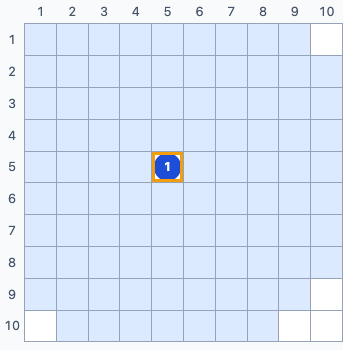
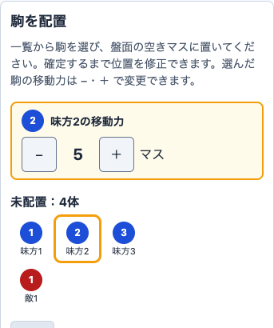
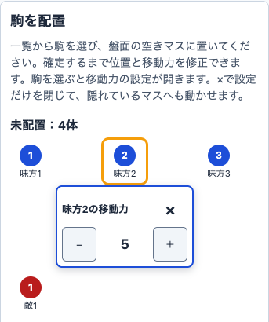

<!-- _class: cover -->
<!-- _paginate: false -->

# エージェント 開発プロセス

Spec × Issue × Orca

agent-dev-template の全体像と役割

<!--
【話すこと】
agent-dev-template というテンプレートが用意している開発プロセスの全体像を紹介します。
最初の数分で「何をするプロセスか」と「登場する役割」を押さえ、そのあと Issue 1本の流れに進みます。

【出典】
- README 冒頭（題名「エージェント開発テンプレート（Spec × Issue × Orca）」）: https://github.com/dyamada-jaki/agent-dev-template/blob/78c72e2a824ef1056e8ecbcae141818acf28ec71/README.md
-->

---

## 何をするプロセスか

人間が判断し、AI エージェント（Claude Code と Codex）が 仕様づくりから実装・レビュー・マージ・ふりかえりまでを進める

  
仕様づくり

  
→

  
実装

  
→

  
レビュー

  
→

  
マージ

  
→

  
ふりかえり

<!--
【話すこと】
agent-dev-template は、このプロセスを一式そろえたテンプレート
一言でいうと、人間が判断し、AI エージェントが仕様づくりからふりかえりまでを進めるためのプロセスです。
エージェントは Claude Code と Codex の2種類を使います。
各工程の細かい手順は、このあと「Issue 1本の流れ」で説明します。ここでは「人間は判断、エージェントは作業」という分担だけ覚えてください。

【出典】
- README 冒頭「人間が判断し、AI エージェント（Claude Code と Codex）が仕様づくりから実装・レビュー・マージ・ふりかえりまでを進めるための、プロセス一式のテンプレートです。」: https://github.com/dyamada-jaki/agent-dev-template/blob/78c72e2a824ef1056e8ecbcae141818acf28ec71/README.md
-->

---

## Spec・Issue・Orca の関係

  

    <h3>Spec</h3>
    <ul>
      <li>作るもの全体の仕様</li>
      <li>「何を・なぜ・どこまで」 を書く</li>
      <li>まだ作らない部分も 書いてよい</li>
    </ul>
    
docs/spec.md

  

  
→

  

    <h3>Issue</h3>
    <ul>
      <li>仕様から今回作る部分 だけを取り出した 作業の単位</li>
      <li>目的・範囲・ 受け入れ条件を書く</li>
      <li>1〜3本ずつ出し、 終わったら次を切る</li>
    </ul>
    
GitHub Issue

  

  
→

  

    <h3>Orca</h3>
    <ul>
      <li>複数の AI エージェントの 端末と worktree を まとめて扱うアプリ</li>
      <li>Issue を1本ずつ 実装する作業環境</li>
    </ul>
    
エージェントの作業場所

  

<!--
【話すこと】
Spec から今回作る部分を Issue に切り出し、Orca で1本ずつ作る
Spec は、作るもの全体について「何を・なぜ・どこまで」作るかを書いた仕様で、まだ作らない部分も書いておけます。
Issue は、その仕様から今回作る部分だけを取り出した作業の単位です。今回実装する作業の目的・範囲（やらないこと）・受け入れ条件を書きます。1〜3本ずつ出して、終わったら次を切ります。
Orca は、複数の AI エージェントの端末と worktree をまとめて扱うアプリで、Issue を1本ずつ実装する作業環境になります。

【出典】
- workflow.md 冒頭（spec.md は作るもの全体の仕様、Issue はそこから今回作る部分だけを取り出したもの、Orca で1本ずつ実装）: https://github.com/dyamada-jaki/agent-dev-template/blob/78c72e2a824ef1056e8ecbcae141818acf28ec71/docs/workflow.md
- workflow.md ステップ2「Issueを切り出す」（Issue に書くこと: 目的、受け入れ条件、スコープ外）: https://github.com/dyamada-jaki/agent-dev-template/blob/78c72e2a824ef1056e8ecbcae141818acf28ec71/docs/workflow.md
- README 冒頭（Orca の説明）: https://github.com/dyamada-jaki/agent-dev-template/blob/78c72e2a824ef1056e8ecbcae141818acf28ec71/README.md
-->

---

## 3つの役割（どれも AI エージェント）

  

    

      
      <h3>PO</h3>
    

    <ul>
      <li>人間と議論して spec.md と Issue を書く</li>
      <li>着手してよい Issue に 「開発可」を付ける</li>
      <li>推薦された PR を 受け入れ確認する （コードは見ない）</li>
    </ul>
    
長く使う

  

  

    

      
      <h3>開発チーム</h3>
    

    <ul>
      <li>Issue 1本を 最後まで進める</li>
      <li>開発者2人の実装を比べ、 採る PR を推薦する</li>
      <li>後片付けとふりかえり</li>
    </ul>
    
Issue ごとに開いて閉じる

  

  

    

      
      
      <h3>開発者</h3>
    

    <ul>
      <li>自分の worktree で 計画・実装・PR・レビュー</li>
      <li>Claude Code と Codex が 1人ずつ</li>
    </ul>
    
実装からマージまで

  

<!--
【話すこと】
人間はこの3つの役割に含めない（次のページ）
絵の人物は AI エージェントの3つの役割を表します。次のページの2人は人間です。
エージェントは3つの役割に分かれます。
PO は人間と議論して仕様と Issue を書き、開発チームが推薦する PR を受け入れ条件・仕様・使う人の目で確かめます。コードは見ません。
開発チームは Issue 1本を最後まで進めます。開発者2人に同じ Issue を別々に実装させ、互いにレビューさせて、どちらを採るかを推薦します。
開発者は自分の worktree で計画・実装・PR・レビューを行います。
PO と開発チームを分けているのは、1つの端末にまとめると文脈がすぐあふれ、開発中にプロダクトの検討を進めにくくなるためです。
（開発チームを自動で開く「起動係」という仕組みもありますが、3つの役割には含めないので後のパートで扱います。）

【出典】
- workflow.md の PO・開発チーム・開発者の担当を表にした節: https://github.com/dyamada-jaki/agent-dev-template/blob/78c72e2a824ef1056e8ecbcae141818acf28ec71/docs/workflow.md
- README の PO・開発チーム・開発者の役割と受け渡しを説明した節（役割の表、PO と開発チームを分ける理由）: https://github.com/dyamada-jaki/agent-dev-template/blob/78c72e2a824ef1056e8ecbcae141818acf28ec71/README.md
-->

---

## 人間は3つの役割に含めず、 判断を担う

  

    <h3>人間</h3>
    <ul>
      <li>PO と議論する</li>
      <li>3つの判断をする</li>
    </ul>
    
役割には数えない

    
  

  
→

  

    
1. 計画を承認する

    
2. 採用する PR を決める

    
3. 改善の採否を決める

  

<!--
【話すこと】
3つの判断は人間が行う。それ以外はエージェントが進める
人間は3つの役割のどれにも含めません。
人間がすることは、PO との議論と、3つの判断です。実装前の計画を承認する、採用する PR を決める、ふりかえりで出た改善の採否を決める。
この3つの判断は人間が行い、それ以外の作業はエージェントが進めます。
それぞれの判断がどのタイミングで来るかは、次の「Issue 1本の流れ」で説明します。

【出典】
- README「Issue 1本の流れ」（「六角形が人間の判断です。それ以外はエージェントが進めます。」「人間がすることは、PO との議論と、④⑥⑧の3つの判断です。」）: https://github.com/dyamada-jaki/agent-dev-template/blob/78c72e2a824ef1056e8ecbcae141818acf28ec71/README.md#issue-1本の流れ
- workflow.md の PO・開発チーム・開発者の担当を表にした節（人間が判断するのは3つの場面: ④計画承認、⑥採用の判断、⑧改善の採否）: https://github.com/dyamada-jaki/agent-dev-template/blob/78c72e2a824ef1056e8ecbcae141818acf28ec71/docs/workflow.md
-->

---

## ここまでのまとめ

<table class="recap">
  <tr><th>何を</th><td>人間が判断し、AI エージェントが仕様からふりかえりまで進める</td></tr>
  <tr><th>何で</th><td>Spec から今回作る部分を Issue に切り出し、Orca で作る</td></tr>
  <tr><th>誰が</th><td>PO・開発チーム・開発者の3つの役割と、判断を担う人間</td></tr>
</table>

次: Issue 1本の流れ ― 仕様から切り出した Issue が、どう進んでいくか

<!--
【話すこと】
ここまでをまとめると、何をするか・何を使うか・誰が担うか、の3点です。
次は、Issue 1本が切り出されてから、計画・実装・レビュー・マージ・ふりかえりへ進む流れを見ていきます。

【出典】
- README 冒頭・役割と受け渡しの節・「Issue 1本の流れ」: https://github.com/dyamada-jaki/agent-dev-template/blob/78c72e2a824ef1056e8ecbcae141818acf28ec71/README.md
- workflow.md 冒頭・3つの役割の節: https://github.com/dyamada-jaki/agent-dev-template/blob/78c72e2a824ef1056e8ecbcae141818acf28ec71/docs/workflow.md
-->

---

<ol class="steps">
  <li class="now">①議論</li>
  <li>②切り出し</li>
  <li>③着手</li>
  <li class="judge">④計画承認</li>
  <li>⑤実装</li>
  <li class="judge">⑥レビュー・採用</li>
  <li>⑦マージ</li>
  <li class="judge">⑧ふりかえり</li>
</ol>

## ① 人間と PO が、作りたいものを仕様にする

  

    
このプロセスでは

    <table class="duty">
      <tr><th>担当</th><td>

        
PO

        
人間

      
</td></tr>
      <tr><th>渡すもの</th><td>spec.md（何を・なぜ・ どこまで作るか）</td></tr>
      <tr><th>人間が 決めること</th><td>作りたいものを PO と議論する （3つの判断の前の段階）</td></tr>
    </table>
  

  

    <h3>実例: overstrata-board #37</h3>
    
盤面の駒を選び、 動ける範囲の目安を表示するアプリ

    

      
      
全駒5マス固定から、 準備中に駒ごとの 移動力を変えたい。  人間と PO が仕様へ

    

    
以降の実例は別プロジェクトのアプリ開発

  

<!--
【話すこと】
ここからは別プロジェクト overstrata-board の Issue #37 を例に、Issue 1本の流れを見ます。このスライド制作で起きた出来事とは区別します。
上は元テンプレートの8ステップ、左は一般的な手順、右は board の実例です。金色の④⑥⑧が人間の判断です。
①では人間が作りたいものを PO と議論し、PO が全体の仕様 spec.md に残します。
board は、盤面の駒を選ぶと動ける範囲の目安を薄い色で示すアプリです。それまで全駒5マス固定だったものを、準備中に駒ごとに変えたい、という開発内容です。ゲームのルール全体を知る必要はありません。

【実画面】
PR #40 比較版 b1902c4 を幅375pxで再現し、味方3・敵1を用意、味方1を5列5行へ配置・選択して＋を1回押した状態。画像は盤面だけの切り抜き。取得条件は slides/assets/issue-17-board/README.md。

【時間見積もり】45秒（実測は未実施）

【出典】
一般的な手順:
- README の8ステップと workflow ステップ1: https://github.com/dyamada-jaki/agent-dev-template/blob/78c72e2a824ef1056e8ecbcae141818acf28ec71/README.md#L49-L71
- 人間との議論から PO が仕様を書く: https://github.com/dyamada-jaki/agent-dev-template/blob/78c72e2a824ef1056e8ecbcae141818acf28ec71/docs/workflow.md#L132-L143
board の実例:
- #37 レポート2章（全駒5マス固定からの目的・範囲）: https://github.com/dyamada-jaki/overstrata-board/blob/346606809993990ddf3cdb0244b0db9a59e42a7d/docs/issue-reports/issue-37.md
- 当時の仕様2.2（利用者の承認で #32 から移動力設定を #37 に分けた経緯）: https://github.com/dyamada-jaki/overstrata-board/blob/b1902c451de34eb2725c9da48dc3435bd7cbfa64/docs/spec.md
- 実画面の固定版: https://github.com/dyamada-jaki/overstrata-board/tree/b1902c451de34eb2725c9da48dc3435bd7cbfa64
-->

---

<ol class="steps">
  <li>①議論</li>
  <li class="now">②切り出し</li>
  <li class="now">③着手</li>
  <li class="judge">④計画承認</li>
  <li>⑤実装</li>
  <li class="judge">⑥レビュー・採用</li>
  <li>⑦マージ</li>
  <li class="judge">⑧ふりかえり</li>
</ol>

## ②③ 今回作る範囲を Issue にし、着手する

  

    
このプロセスでは

    <table class="duty">
      <tr><th>担当</th><td>

        
PO

        →
        
開発チーム

        
間で起動係（仕組み）が開発チームを開く

      
</td></tr>
      <tr><th>渡すもの</th><td>Issue（目的・受け入れ条件・ スコープ外）と「開発可」</td></tr>
      <tr><th>人間が 決めること</th><td>なし（着手の順番は PO が決める）</td></tr>
    </table>
  

  

    <h3>実例: overstrata-board #37</h3>
    <ul>
      <li>駒の準備・配置（#32）とは分け、 移動力設定を1本の Issue に</li>
      <li>0〜9・初期値5・±で1ずつ変更。 選択中の範囲へすぐ反映</li>
      <li>戦闘途中の変更・特殊な移動は スコープ外</li>
      <li>#32 完了 →「開発可」→ 起動係が開発チームを開く</li>
    </ul>
    
board #37 レポート2・3章

  

<!--
【話すこと】
②で PO は今回作る範囲を Issue に切り出し、目的・受け入れ条件・スコープ外を示します。依存する作業が完了してから「開発可」にします。付けるのは PO か人間です。
③では起動係が「開発可」と動いている開発チームの有無を見て開発チームを開き、開発チームが着手します。
board は駒の準備・配置の #32 と、移動力設定の #37 を分けました。#37 は0〜9、初期値5、±で1ずつ変更し、値と範囲にすぐ反映するところまでです。確定後の変更や特殊な移動は含めません。
#32 は PR #38、main c276d11 で完了済み。PO が開発可とし、起動係が着手中へ更新、19:45に開発チームが着手しました。

【時間見積もり】45秒（実測は未実施）

【出典】
一般的な手順:
- Issue を切り出す、開発可を付ける、着手する: https://github.com/dyamada-jaki/agent-dev-template/blob/78c72e2a824ef1056e8ecbcae141818acf28ec71/docs/workflow.md#L145-L175
- 起動係の役割: https://github.com/dyamada-jaki/agent-dev-template/blob/78c72e2a824ef1056e8ecbcae141818acf28ec71/README.md#L40-L45
board の実例:
- #37 レポート2章（依存先 #32、範囲）・3章（起動と着手）: https://github.com/dyamada-jaki/overstrata-board/blob/346606809993990ddf3cdb0244b0db9a59e42a7d/docs/issue-reports/issue-37.md
- 分割と開発順の当時の仕様: https://github.com/dyamada-jaki/overstrata-board/blob/b1902c451de34eb2725c9da48dc3435bd7cbfa64/docs/spec.md
-->

---

<ol class="steps">
  <li>①議論</li>
  <li>②切り出し</li>
  <li>③着手</li>
  <li class="judge now">④計画承認</li>
  <li>⑤実装</li>
  <li class="judge">⑥レビュー・採用</li>
  <li>⑦マージ</li>
  <li class="judge">⑧ふりかえり</li>
</ol>

## ④ 開発者が計画を出し、人間が承認する

  

    
このプロセスでは

    <table class="duty">
      <tr><th>担当</th><td>

        
開発者

        
開発チーム

      
</td></tr>
      <tr><th>渡すもの</th><td>計画（受け入れ条件ごとの 作り方・確かめ方・確認したいこと）</td></tr>
      <tr class="decide"><th>人間が 決めること</th><td>
計画を承認する
</td></tr>
    </table>
  

  

    <h3>実例: overstrata-board #37</h3>
    <ul>
      <li>駒の近くに置く案と、 操作パネルに1つ置く案</li>
      <li>人間は両案での実装を承認し、 実際の画面で見比べることに</li>
      <li>「近く」に届くか、欄が盤面を 覆うか。距離・表示を実測し、 判断材料として PR へ</li>
    </ul>
    
board #37 レポート3章（20:01承認）

  

<!--
【話すこと】
④は人間の1つ目の判断です。開発者は、受け入れ条件ごとの作り方・確かめ方・確認したいことを計画し、開発チームが人間へ見せます。実装へ渡すのは開発チームです。
board は、対象の駒の近くに設定欄を置く案と、操作パネルに1つ置く案が出ました。当初の条件3は「対象の駒の近く」ですから、操作パネル案が届かないおそれも計画で見せています。
人間は20:01、両案のまま作り、画面で見比べることを承認しました。そのうえで、375pxとPC幅で、駒と欄の距離や覆うマスの扱いを実測して PR に残すよう指示しました。
不安を先に示し、どこを見て決めるかを共有した例です。計画承認は、この段階での最終的な採用ではありません。

【補足】
この実例の駒の近く案は Codex の PR #41、操作パネル案は Claude Code の PR #40。製品と人物の絵は対応させない。性能比較はしない。

【時間見積もり】50秒（実測は未実施）

【出典】
一般的な手順:
- 計画の承認と仕様に穴が見つかったときの分岐: https://github.com/dyamada-jaki/agent-dev-template/blob/78c72e2a824ef1056e8ecbcae141818acf28ec71/docs/workflow.md#L177-L195
board の実例:
- #37 レポート3章（2案・承認・測定の追加指示）・9章（受け入れ条件に届かないおそれの提示）: https://github.com/dyamada-jaki/overstrata-board/blob/346606809993990ddf3cdb0244b0db9a59e42a7d/docs/issue-reports/issue-37.md
-->

---

<ol class="steps">
  <li>①議論</li>
  <li>②切り出し</li>
  <li>③着手</li>
  <li class="judge">④計画承認</li>
  <li class="now">⑤実装</li>
  <li class="judge now">⑥レビュー・採用</li>
  <li>⑦マージ</li>
  <li class="judge">⑧ふりかえり</li>
</ol>

## ⑤⑥ 開発者が実装・検証し、互いにレビューする

  

    
このプロセスでは

    <h3>担当</h3>
    

      
      
    

    
開発者2人 各自の worktree

    <h3>渡すもの</h3>
    
PR・確認結果と 相互レビュー

    <h3>人間が決めること</h3>
    
なし（この間は待つ）

  

  

    

      

        <h3>操作パネル案</h3>
        
PR #40・b1902c4

        
        
設定欄は一覧と別。 駒の横の並びを保つ

      

      

        <h3>駒の近く案</h3>
        
PR #41・526f8f8

        
        
選んだ駒の下に欄が入り、 一覧の駒の位置がずれる

      

    

  

<!--
【話すこと】
⑤では開発者が各自の worktree で実装・検証して PR を出し、⑥で互いの PR をレビューします。この間は人間は待ちます。
この実例は同じ Issue を2人が別々に作る二重実装です。元テンプレートの任意の進め方で、全 Issue の必須条件ではありません。
右は、未配置の味方2を選んだ同じ状態です。画像の中の文字を読む必要はありません。操作パネル案は一覧と別の欄、駒の近く案は一覧の駒の下に欄が入り、1・2・3の横位置が離れます。この並びの変化が人間の判断につながります。
配置済みの駒を選ぶと、近く案は盤面に重なり、375pxでは18マスを覆います。一方、操作パネル案は盤面から離れ、当初の「近く」という条件を満たしませんでした。
両案は自動確認・E2E・相互レビューを通し、仕様への適合と使い勝手を比較できる状態にしています。自動テスト成功だけで採用を決めるわけではありません。

【実画面と版】
比較は PR #40 b1902c4（Claude Code）と PR #41 526f8f8（Codex）。幅375・高さ812・DPR1、味方3・敵1を用意し、未配置の味方2を選択。設定値は5のまま。全画面を縮小せず、両方とも元画像の x16/y526/幅343/高さ410 を切り抜き、同じ縮尺で表示。選択前後の実画面と位置の測定は素材 README に残す。
採用版 #40 629709a は後述の README 修正後の版であり、比較版と区別する。ここで製品の性能差は説明しない。

【時間見積もり】60秒（実測は未実施）

【出典】
一般的な手順:
- 実装: https://github.com/dyamada-jaki/agent-dev-template/blob/78c72e2a824ef1056e8ecbcae141818acf28ec71/docs/workflow.md#L197-L204
- レビューと任意の二重実装: https://github.com/dyamada-jaki/agent-dev-template/blob/78c72e2a824ef1056e8ecbcae141818acf28ec71/docs/workflow.md#L206-L227
board の実例:
- #37 レポート4〜6章（位置・閉じ方、確認結果、一覧の組み替わりと盤面を覆う範囲）: https://github.com/dyamada-jaki/overstrata-board/blob/346606809993990ddf3cdb0244b0db9a59e42a7d/docs/issue-reports/issue-37.md
- PR #40 比較版: https://github.com/dyamada-jaki/overstrata-board/tree/b1902c451de34eb2725c9da48dc3435bd7cbfa64
- PR #41 比較版: https://github.com/dyamada-jaki/overstrata-board/tree/526f8f8340fe64b065ee8d618fc8852c237d8c64
-->

---

<ol class="steps">
  <li>①議論</li>
  <li>②切り出し</li>
  <li>③着手</li>
  <li class="judge">④計画承認</li>
  <li>⑤実装</li>
  <li class="judge now">⑥レビュー・採用</li>
  <li>⑦マージ</li>
  <li class="judge">⑧ふりかえり</li>
</ol>

## ⑥ 推薦・PO の受け入れ確認と、人間の採用判断

  

    
実例: board #37 の判断と再確認

    <table class="duty loop board-loop">
      <tr><th>開発チーム → PO</th><td><b>#41 を推薦 → 受け入れ</b>（旧条件）</td></tr>
      <tr class="decide"><th>人間</th><td><b>#40 を選ぶ</b>。一覧の駒の位置が ずれず、使いやすい</td></tr>
      <tr><th>PO</th><td>条件3を更新</td></tr>
      <tr><th>開発者</th><td>README を修正（仕様更新と並行） 629709a。UI の作り直しはない</td></tr>
      <tr><th>開発者 開発チーム</th><td>更新後の条件で再レビュー → #40 推薦</td></tr>
      <tr><th>PO</th><td><b>#40 を受け入れ</b> → 人間の承認後に⑦へ</td></tr>
    </table>
  

  

    <h3>条件3を、使いやすさから見直す</h3>
    
変更前 対象の駒の近くに設定欄

    
変更後 操作パネルに1つ。 駒名・陣営色・番号で対象を示す

    
推薦・PO の確認・人間の採用判断は それぞれ別。PO の差し戻しは0回

    
board #37 レポート7章 採用版: PR #40・629709a

  

<!--
【話すこと】
⑥後半の、開発チームの推薦、PO の受け入れ確認、人間の採用判断を分けます。PO が受け入れても、採用する PR を決めるのは人間です。
最初は「駒の近く」という条件を満たす #41 を推薦し、PO も受け入れました。その後、人間がスマホで触り比べ、駒の位置がずれず使いやすい #40 を選びました。目的に照らした使いやすさの判断です。
PO は条件3を、駒の近くから、操作パネルに1つ出し駒名・陣営色・番号で対象を示す条件へ更新しました。スマホの縦スクロールも許容しました。
この間、開発者は古かった README を修正しています。仕様更新と README 修正は並行です。UI を作り直したわけではありません。
そのあと更新後の条件で再レビューし、開発チームは #40 推薦に更新、PO も #40 を受け入れました。人間の判断による変更であり、PO の差し戻しには数えません。

【時点の照合】
- 当初: #41 526f8f8 を推薦、21:10 PO 受け入れ。
- 21:35までに人間が #40 b1902c4 の UI を選ぶ。原文は、駒の近くにはないが #41 は近くにあるため駒の位置がずれ、#40 の方が使いやすい、という趣旨。会話は創作しない。
- レポート9章は「README の修正・PO の仕様更新（並行）21:36→21:52」と記録する。README 629709a はコミット21:36・push21:52、条件3の仕様更新3bac3e9はコミット21:40。どちらが先という直列の説明をしない。
- 採用版 #40 629709a と比較版 b1902c4 の差分は README の1行だけ。
- 21:52〜21:56 更新後の条件で再レビュー、21:56 #40推薦へ更新、22:02 PO が #40を受け入れ。差し戻し0回。

【時間見積もり】85秒（実測は未実施）

【出典】
一般的な手順:
- 推薦、PO の確認、人間の採用判断: https://github.com/dyamada-jaki/agent-dev-template/blob/78c72e2a824ef1056e8ecbcae141818acf28ec71/README.md#L49-L71
- レビューと受け入れ確認: https://github.com/dyamada-jaki/agent-dev-template/blob/78c72e2a824ef1056e8ecbcae141818acf28ec71/docs/workflow.md#L206-L227
board の実例:
- #37 レポート7章（人間の判断、更新後の条件、再受け入れ）・9章（並行の時間表）: https://github.com/dyamada-jaki/overstrata-board/blob/346606809993990ddf3cdb0244b0db9a59e42a7d/docs/issue-reports/issue-37.md
- 当初の PO 受け入れ: https://github.com/dyamada-jaki/overstrata-board/pull/41#issuecomment-6364548520
- 条件更新コメント: https://github.com/dyamada-jaki/overstrata-board/issues/37#issuecomment-6365106903
- 条件の変更前後: https://github.com/dyamada-jaki/overstrata-board/commit/3bac3e9ed1b884765a3519157b634c1bb128e2e3
- README だけを修正: https://github.com/dyamada-jaki/overstrata-board/commit/629709a1f9825a8974f8e4d20cf6208eb6f5c463
- 再レビュー: https://github.com/dyamada-jaki/overstrata-board/pull/40#issuecomment-6365375650
- 推薦の変更: https://github.com/dyamada-jaki/overstrata-board/pull/40#issuecomment-6365395577
- 変更後の PO 受け入れ: https://github.com/dyamada-jaki/overstrata-board/pull/40#issuecomment-6365485501
-->

---

<ol class="steps">
  <li>①議論</li>
  <li>②切り出し</li>
  <li>③着手</li>
  <li class="judge">④計画承認</li>
  <li>⑤実装</li>
  <li class="judge">⑥レビュー・採用</li>
  <li class="now">⑦マージ</li>
  <li class="judge now">⑧ふりかえり</li>
</ol>

## ⑦⑧ 採用した成果を取り込み、改善を次へ渡す

  

    
このプロセスでは

    <table class="duty">
      <tr><th>担当</th><td>

        
開発チーム: 承認の後に マージ・後片付け・ふりかえり

      
</td></tr>
      <tr><th>渡すもの</th><td>改善案（根拠・反映先）と、 PO への申し送り</td></tr>
      <tr class="decide"><th>人間が 決めること</th><td>
<ul class="decisions"><li>マージの実行内容を 承認する</li><li>改善の採否を決める</li></ul>
</td></tr>
    </table>
  

  

    <h3>実例: overstrata-board #37</h3>
    <ul>
      <li>人間の承認後、開発チームが #40 を main e3311d4 へ取り込み、 後片付け。#41 は閉じた</li>
      <li>改善 F: 実機確認の結果は 会話で聞き、開発チームが代筆</li>
      <li>改善 G: 条件に合わない選択は PO へ送り、仕様更新を頼む</li>
    </ul>
    
F/G は人間が採用 → 9b7eae7 で反映 効果は次の該当 Issue で確認する

  

<!--
【話すこと】
⑦は人間が採用する PR とマージ・後片付けの実行内容を承認し、開発チームが実行します。board は #40 を main e3311d4 へ取り込み、#41 を閉じ、自分たちの環境を片付けました。
⑧では開発チームが根拠と反映先を添えて改善を提案し、人間が採否を決めます。
F は、実機確認の結果を会話で聞き、伝えられた範囲だけ PR に代筆する手順です。未記載を埋めて成功とは書きません。
G は、人間が条件に合わない案を選んだとき、その判断を原文のまま PO に送り、Issue と仕様の更新を頼む手順です。修正は並行してよく、再確認と PO 確認は更新後の条件で行います。
2案を比べた記録から F/G を提案し、人間が採用、手順へ反映しました。効果の確認は次の該当 Issue で行います。提案・採用・反映と効果を分けます。

【補足】
- board の記録: 22:22 人間が結果を会話で伝え、開発チームが PR に代筆。22:26 に #40 629709a を squash マージ、main e3311d4。#41 はリモートブランチを保持して閉じ、作業環境を後片付け。22:40に人間が F/G を採用し、9b7eae7で反映。
- G は board の当時の手順8の7.を説明する。このスライド制作の現行手順と混ぜず、仕様更新の後に修正を開始した、と言い換えない。再確認は更新後に行う。
- board の当時の実機確認はスマホで比較した記録であり、端末・ブラウザ・経路・項目別の結果は記載なし。今回のスライドの新しい版の実機確認結果ではない。

【時間見積もり】55秒（実測は未実施）
次章6枚の合計見積もりは340秒（5分40秒）。発表に使う画面での通し説明の実測は、人間による今回の版の確認時に対象 SHA とともに記録する。

【出典】
一般的な手順:
- 8ステップ: https://github.com/dyamada-jaki/agent-dev-template/blob/78c72e2a824ef1056e8ecbcae141818acf28ec71/README.md#L49-L71
- マージとふりかえり: https://github.com/dyamada-jaki/agent-dev-template/blob/78c72e2a824ef1056e8ecbcae141818acf28ec71/docs/workflow.md#L229-L266
- 人間が実行内容を承認し開発チームが実行: https://github.com/dyamada-jaki/agent-dev-template/blob/78c72e2a824ef1056e8ecbcae141818acf28ec71/.claude/skills/finish-issue/SKILL.md#L46-L60
- 記載の不一致: 同じ版の workflow ステップ6（225行目）は人間がマージすると記す。README・ステップ7・finish-issue の、人間の承認後に開発チームがマージする説明を採用する。参照版は変更しない: https://github.com/dyamada-jaki/agent-dev-template/blob/78c72e2a824ef1056e8ecbcae141818acf28ec71/docs/workflow.md#L225
board の実例:
- #37 レポート8〜10章（完了・F/G の提案と採用・反映・次の効果確認）: https://github.com/dyamada-jaki/overstrata-board/blob/346606809993990ddf3cdb0244b0db9a59e42a7d/docs/issue-reports/issue-37.md
- 実機比較の記録: https://github.com/dyamada-jaki/overstrata-board/pull/40#issuecomment-6365962809
- 成果の採用: https://github.com/dyamada-jaki/overstrata-board/commit/e3311d43c6f125adec76eafe0d683e6d62fa74bb
- 改善 F/G の反映: https://github.com/dyamada-jaki/overstrata-board/commit/9b7eae763cfc199080f09653f65c31a1cf01e072
- 当時の G（修正は仕様更新と並行可、再確認は更新後）: https://github.com/dyamada-jaki/overstrata-board/blob/9b7eae763cfc199080f09653f65c31a1cf01e072/.claude/skills/dual-implement/SKILL.md
- 完了の申し送り: https://github.com/dyamada-jaki/overstrata-board/issues/37#issuecomment-6366665330
-->
