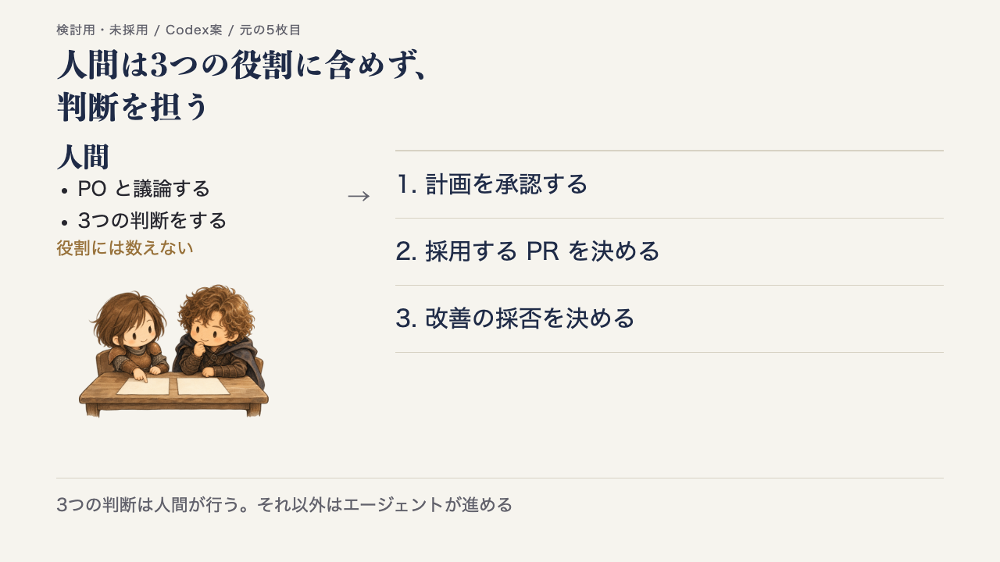
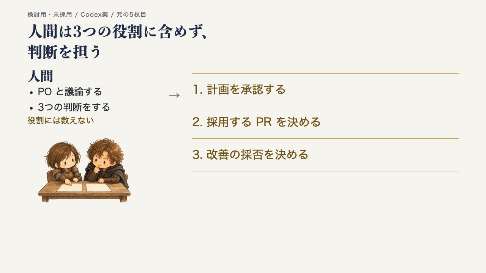

<!-- _class: cover -->
<!-- _paginate: false -->

# エージェント 開発プロセス

Spec × Issue × Orca

agent-dev-template の全体像と役割

<!--
【話すこと】
agent-dev-template というテンプレートが用意している開発プロセスの全体像を紹介します。
最初の数分で「何をするプロセスか」と「登場する役割」を押さえ、そのあと Issue 1本の流れに進みます。

【出典】
- README 冒頭（題名「エージェント開発テンプレート（Spec × Issue × Orca）」）: https://github.com/dyamada-jaki/agent-dev-template/blob/78c72e2a824ef1056e8ecbcae141818acf28ec71/README.md
-->

---

## 何をするプロセスか

人間が判断し、AI エージェント（Claude Code と Codex）が 仕様づくりから実装・レビュー・マージ・ふりかえりまでを進める

  
仕様づくり

  
→

  
実装

  
→

  
レビュー

  
→

  
マージ

  
→

  
ふりかえり

<!--
【話すこと】
agent-dev-template は、このプロセスを一式そろえたテンプレート
一言でいうと、人間が判断し、AI エージェントが仕様づくりからふりかえりまでを進めるためのプロセスです。
エージェントは Claude Code と Codex の2種類を使います。
各工程の細かい手順は、このあと「Issue 1本の流れ」で説明します。ここでは「人間は判断、エージェントは作業」という分担だけ覚えてください。

【出典】
- README 冒頭「人間が判断し、AI エージェント（Claude Code と Codex）が仕様づくりから実装・レビュー・マージ・ふりかえりまでを進めるための、プロセス一式のテンプレートです。」: https://github.com/dyamada-jaki/agent-dev-template/blob/78c72e2a824ef1056e8ecbcae141818acf28ec71/README.md
-->

---

## Spec・Issue・Orca の関係

  

    <h3>Spec</h3>
    <ul>
      <li>作るもの全体の仕様</li>
      <li>「何を・なぜ・どこまで」 を書く</li>
      <li>まだ作らない部分も 書いてよい</li>
    </ul>
    
docs/spec.md

  

  
→

  

    <h3>Issue</h3>
    <ul>
      <li>仕様から今回作る部分 だけを取り出した 作業の単位</li>
      <li>目的・範囲・ 受け入れ条件を書く</li>
      <li>1〜3本ずつ出し、 終わったら次を切る</li>
    </ul>
    
GitHub Issue

  

  
→

  

    <h3>Orca</h3>
    <ul>
      <li>複数の AI エージェントの 端末と worktree を まとめて扱うアプリ</li>
      <li>Issue を1本ずつ 実装する作業環境</li>
    </ul>
    
エージェントの作業場所

  

<!--
【話すこと】
Spec から今回作る部分を Issue に切り出し、Orca で1本ずつ作る
Spec は、作るもの全体について「何を・なぜ・どこまで」作るかを書いた仕様で、まだ作らない部分も書いておけます。
Issue は、その仕様から今回作る部分だけを取り出した作業の単位です。今回実装する作業の目的・範囲（やらないこと）・受け入れ条件を書きます。1〜3本ずつ出して、終わったら次を切ります。
Orca は、複数の AI エージェントの端末と worktree をまとめて扱うアプリで、Issue を1本ずつ実装する作業環境になります。

【出典】
- workflow.md 冒頭（spec.md は作るもの全体の仕様、Issue はそこから今回作る部分だけを取り出したもの、Orca で1本ずつ実装）: https://github.com/dyamada-jaki/agent-dev-template/blob/78c72e2a824ef1056e8ecbcae141818acf28ec71/docs/workflow.md
- workflow.md ステップ2「Issueを切り出す」（Issue に書くこと: 目的、受け入れ条件、スコープ外）: https://github.com/dyamada-jaki/agent-dev-template/blob/78c72e2a824ef1056e8ecbcae141818acf28ec71/docs/workflow.md
- README 冒頭（Orca の説明）: https://github.com/dyamada-jaki/agent-dev-template/blob/78c72e2a824ef1056e8ecbcae141818acf28ec71/README.md
-->

---

## 3つの役割（どれも AI エージェント）

  

    

      
      <h3>PO</h3>
    

    <ul>
      <li>人間と議論して spec.md と Issue を書く</li>
      <li>着手してよい Issue に 「開発可」を付ける</li>
      <li>推薦された PR を 受け入れ確認する （コードは見ない）</li>
    </ul>
    
長く使う

  

  

    

      
      <h3>開発チーム</h3>
    

    <ul>
      <li>Issue 1本を 最後まで進める</li>
      <li>開発者2人の実装を比べ、 採る PR を推薦する</li>
      <li>後片付けとふりかえり</li>
    </ul>
    
Issue ごとに開いて閉じる

  

  

    

      
      
      <h3>開発者</h3>
    

    <ul>
      <li>自分の worktree で 計画・実装・PR・レビュー</li>
      <li>Claude Code と Codex が 1人ずつ</li>
    </ul>
    
実装からマージまで

  

<!--
【話すこと】
人間はこの3つの役割に含めない（次のページ）
絵の人物は AI エージェントの3つの役割を表します。次のページの2人は人間です。
エージェントは3つの役割に分かれます。
PO は人間と議論して仕様と Issue を書き、開発チームが推薦する PR を受け入れ条件・仕様・使う人の目で確かめます。コードは見ません。
開発チームは Issue 1本を最後まで進めます。開発者2人に同じ Issue を別々に実装させ、互いにレビューさせて、どちらを採るかを推薦します。
開発者は自分の worktree で計画・実装・PR・レビューを行います。
PO と開発チームを分けているのは、1つの端末にまとめると文脈がすぐあふれ、開発中にプロダクトの検討を進めにくくなるためです。
（開発チームを自動で開く「起動係」という仕組みもありますが、3つの役割には含めないので後のパートで扱います。）

【出典】
- workflow.md の PO・開発チーム・開発者の担当を表にした節: https://github.com/dyamada-jaki/agent-dev-template/blob/78c72e2a824ef1056e8ecbcae141818acf28ec71/docs/workflow.md
- README の PO・開発チーム・開発者の役割と受け渡しを説明した節（役割の表、PO と開発チームを分ける理由）: https://github.com/dyamada-jaki/agent-dev-template/blob/78c72e2a824ef1056e8ecbcae141818acf28ec71/README.md
-->

---

## 人間は3つの役割に含めず、 判断を担う

  

    <h3>人間</h3>
    <ul>
      <li>PO と議論する</li>
      <li>3つの判断をする</li>
    </ul>
    
役割には数えない

    
  

  
→

  

    
1. 計画を承認する

    
2. 採用する PR を決める

    
3. 改善の採否を決める

  

<!--
【話すこと】
3つの判断は人間が行う。それ以外はエージェントが進める
人間は3つの役割のどれにも含めません。
人間がすることは、PO との議論と、3つの判断です。実装前の計画を承認する、採用する PR を決める、ふりかえりで出た改善の採否を決める。
この3つの判断は人間が行い、それ以外の作業はエージェントが進めます。
それぞれの判断がどのタイミングで来るかは、次の「Issue 1本の流れ」で説明します。

【出典】
- README「Issue 1本の流れ」（「六角形が人間の判断です。それ以外はエージェントが進めます。」「人間がすることは、PO との議論と、④⑥⑧の3つの判断です。」）: https://github.com/dyamada-jaki/agent-dev-template/blob/78c72e2a824ef1056e8ecbcae141818acf28ec71/README.md#issue-1本の流れ
- workflow.md の PO・開発チーム・開発者の担当を表にした節（人間が判断するのは3つの場面: ④計画承認、⑥採用の判断、⑧改善の採否）: https://github.com/dyamada-jaki/agent-dev-template/blob/78c72e2a824ef1056e8ecbcae141818acf28ec71/docs/workflow.md
-->

---

## ここまでのまとめ

<table class="recap">
  <tr><th>何を</th><td>人間が判断し、AI エージェントが仕様からふりかえりまで進める</td></tr>
  <tr><th>何で</th><td>Spec から今回作る部分を Issue に切り出し、Orca で作る</td></tr>
  <tr><th>誰が</th><td>PO・開発チーム・開発者の3つの役割と、判断を担う人間</td></tr>
</table>

次: Issue 1本の流れ ― 仕様から切り出した Issue が、どう進んでいくか

<!--
【話すこと】
ここまでをまとめると、何をするか・何を使うか・誰が担うか、の3点です。
次は、Issue 1本が切り出されてから、計画・実装・レビュー・マージ・ふりかえりへ進む流れを見ていきます。

【出典】
- README 冒頭・役割と受け渡しの節・「Issue 1本の流れ」: https://github.com/dyamada-jaki/agent-dev-template/blob/78c72e2a824ef1056e8ecbcae141818acf28ec71/README.md
- workflow.md 冒頭・3つの役割の節: https://github.com/dyamada-jaki/agent-dev-template/blob/78c72e2a824ef1056e8ecbcae141818acf28ec71/docs/workflow.md
-->

---

<!-- _class: issue-cycle -->
<!-- _header: "Issue 1本の流れ ／ 実例は本プロジェクトの Issue #5" -->

## ① 人間と PO が、希望を仕様にする

  

    
    <h3>人間</h3>
    
作りたいものを PO と議論する

  

  

    
議論して決めたこと

    <h3>Spec に残す</h3>
    
何を・なぜ・どこまで作るか。 作るもの全体の仕様にする。

    

      
#5 につながった希望

      
Overstrata の雰囲気を スライドのデザインに取り入れたい

    

  

  

    
    <h3>PO</h3>
    
Spec を更新し、 決定を残す

  

<!--
【目安時間】45秒（この章の合計は5分30秒の見積もり。実測ではない）
【話すこと】
ここからは Issue 1本の流れです。元テンプレートの8ステップを6枚にまとめ、このスライドを作ったプロジェクトの Issue #5 を実例にします。
出発点は、人間と PO の議論です。作りたいものの目的や範囲を決め、PO が仕様に残します。渡すものは、作るもの全体の Spec です。
#5 につながったのは、Overstrata の雰囲気をスライドに取り入れたい、という希望でした。仕様全体から、今回作る範囲を選ぶところへ進みます。

【補足（質疑・参照用。目安時間には含めない）】
ここからは Issue 1本の流れです。元テンプレートの8ステップを6枚にまとめ、本プロジェクトの Issue #5 を実例として添えます。
出発点は、人間が作りたいものを PO と議論することです。PO は質問し、決まった目的・範囲を Spec に書きます。ここで渡すものは、作るもの全体の仕様です。
本プロジェクトでは、Overstrata の雰囲気を取り入れた個人用スライドデザインを検討したい、という希望がありました。人間と PO が検討範囲を決め、次の Issue に切り出します。
本文の工程は一般的な進め方、#5 と示した部分はこのプロジェクトの記録です。人物は人間がレナ・ヨナ、PO は名前のない AI の役割の人物です。

【出典】
- 一般の手順・ステップ1: https://github.com/dyamada-jaki/agent-dev-template/blob/78c72e2a824ef1056e8ecbcae141818acf28ec71/docs/workflow.md
- 実例・目的と計画（2・3章）: https://github.com/dyamada-jaki/agent-dev-slide/blob/4c79405a64f13ec4359e6ceb57d1c871ba84b35f/docs/issue-reports/issue-5.md
- 実例・デザイン検討の希望と比較範囲（2.2）: https://github.com/dyamada-jaki/agent-dev-slide/blob/39ed2669af843fa14994e24abf5f3a425f8d76fa/docs/spec.md
-->

---

<!-- _class: issue-cycle -->
<!-- _header: "Issue 1本の流れ ／ 実例は本プロジェクトの Issue #5" -->

## ②③ Issue から着手につなぐ

  

    
<h3>PO が切り出す</h3>

    
目的・範囲・受け入れ条件を Issue に書く

    

      
#5 の範囲

      
導入の代表3枚 （1・3・5枚目）を2案で比較

    

  

  

    <h3>「開発可」で起動</h3>
    
PO または人間が付ける 着手してよいというラベル

    
起動係が見つけ、 開発チームを開く

    

人間は今回の範囲を PO と合意する

  

  

    
<h3>開発チーム</h3>

    
Issue を受け取り、 前提と作業範囲を確認する

    

      
次に渡すもの

      
Issue の目的・完成の条件を 開発者へ渡す

    

  

<!--
【目安時間】45秒
【話すこと】
PO は仕様から今回作る範囲を Issue にし、目的・範囲・受け入れ条件を書きます。#5 では、代表3枚の見本を2案で比べる範囲に絞りました。共通テーマ化は後です。
人間と範囲を合意し、着手してよい Issue に PO または人間が「開発可」を付けます。起動係が見つけて開発チームを開きます。
開発チームは前提と作業範囲を確認し、Issue の目的と完成の条件を開発者に渡します。ラベルを付ける判断と、自動で端末を開く処理を分けています。

【補足（質疑・参照用。目安時間には含めない）】
PO は Spec から、今回作る範囲を Issue にします。一般の手順では1〜3本ずつ切り出し、前提がそろい、PR 1本で終わり、完成を確かめられる大きさにします。
#5 では全部をデザインし直すのではなく、代表3枚の見本を2案で比較する範囲にしました。正式な共通テーマと残りのページへの適用は別の Issue です。
着手してよい Issue に PO または人間が「開発可」を付けます。起動係はそのラベルを見つけ、開発チームを開きます。開発チームは Issue の目的・受け入れ条件・前提を確認し、開発者に渡します。
ここで人間は今回の範囲を PO と合意します。ラベルを付ける権限と、起動係による起動を区別してください。起動係は3つの役割には含めません。操作や設定の説明はこの章では扱いません。

【出典】
- 一般の手順・ステップ2・3、着手ラベルの担当: https://github.com/dyamada-jaki/agent-dev-template/blob/78c72e2a824ef1056e8ecbcae141818acf28ec71/docs/workflow.md
- 実例・目的、代表3枚と計画（2・3章）: https://github.com/dyamada-jaki/agent-dev-slide/blob/4c79405a64f13ec4359e6ceb57d1c871ba84b35f/docs/issue-reports/issue-5.md
-->

---

<!-- _class: issue-cycle -->
<!-- _header: "Issue 1本の流れ ／ 実例は本プロジェクトの Issue #5" -->

## ④ 計画を出し、人間が承認する

  

    

    <h3>開発者2人</h3>
    
Claude Code と Codex

    
作り方と確かめ方を計画する

    

#5 の提案

配色・配置・人物の使い方 HTML・PDF での確認方法

  

  

    
    <h3>開発チーム</h3>
    
計画を整理し、 人間に提示する

  

  

    
    <h3>人間</h3>
    
計画を承認する

    
Issue の条件と照らして判断

    
承認した計画を 開発者へ渡し、実装へ

  

<!--
【目安時間】45秒
【話すこと】
開発者はすぐには実装せず、作り方と確かめ方を計画します。#5 では、配色や配置、人物の使い方、HTML・PDF の確認方法を提案しました。
開発チームが計画を整理して提示し、人間が Issue の条件と照らして承認します。確認事項にも答え、承認済みの計画を開発者に渡して実装へ進みます。
#5 では、見本のビルドは本編を変えず別コマンドにする、と人間が決めました。仕様が足りなければ、この時点で PO に戻します。

【補足（質疑・参照用。目安時間には含めない）】
開発者はすぐに実装せず、受け入れ条件をどう満たし、どの方法で確かめるかを計画します。開発チームが2人の計画を整理し、人間が承認します。
#5 は2案を作る計画を承認しました。人間は、配色が近いことを承知したうえで、レイアウトや人物の使い方を比較することにしました。
確認事項にも答えています。Codex 案の本編ビルドを変更する案には、本編は変えず、見本を別のコマンドに分ける、と決めました。渡すものは、この決着も含む承認済みの計画です。
計画に仕様の穴が見つかった場合は、PO に戻して仕様と Issue を直してから進めます。人間の承認前に作り始める説明にはしません。
開発者の絵は2人で Claude Code と Codex を表します。どちらの顔がどの製品かは割り当てていません。

【出典】
- 一般の手順・ステップ4: https://github.com/dyamada-jaki/agent-dev-template/blob/78c72e2a824ef1056e8ecbcae141818acf28ec71/docs/workflow.md
- 実例・両案の計画と人間の回答（3章）: https://github.com/dyamada-jaki/agent-dev-slide/blob/4c79405a64f13ec4359e6ceb57d1c871ba84b35f/docs/issue-reports/issue-5.md
-->

---

<!-- _class: issue-cycle cycle-compare -->
<!-- _header: "Issue 1本の流れ ／ 実例は本プロジェクトの Issue #5" -->

## ⑤⑥ 2案を作り、互いにレビューする

  

<strong>開発者2人</strong>が実装・検証し、相互レビュー 渡すもの: PR・検証結果・レビュー結果

  

<strong>開発チーム</strong>が比較 人間の採用判断は次へ

  

    <h3>初回 PR #6 Codex</h3>
    
c332c37 ／ 元の5枚目

    
    
罫線と余白で区切る

  

  

    <h3>初回 PR #7 Claude Code</h3>
    
b3e0c3e ／ 元の5枚目

    
    
金色の箱で判断を強調する

  

<!--
【目安時間】55秒
【話すこと】
開発者は自分の worktree で実装・検証し、PR を作ります。#5 では Claude Code と Codex が同じ内容を2案にし、互いにレビューしました。PR と検証・レビュー結果を開発チームに渡します。
ここにあるのは初回の同じページです。左の #6 は罫線と余白、右の #7 は金色の箱に違いがあります。画像内の文章を読む必要はありません。外側の説明と形を見てください。
開発チームは指摘を裏付けて比較します。二重実装はこの実例の進め方で、全 Issue の必須条件ではありません。採用を決めるのは次の段階です。

【補足（質疑・参照用。目安時間には含めない）】
開発者はそれぞれの worktree で実装し、確認コマンドと表示確認を行って PR を作ります。この実例では Claude Code と Codex が同じ内容を2案に実装し、互いにレビューしました。開発チームはレビューの指摘を裏付け、比較を整理します。
画面は実際の初回2案の、同じ人間の判断ページです。左の PR #6 は罫線と余白、右の PR #7 は金色の箱に違いがあります。小さい画像の中の文章を読む必要はありません。画像の外の説明と形の違いを見てください。
どちらも初回比較の版です。次のページの採用修正版とは違います。画像内の人物は当時の人間の表現で、現在の AI の役割の人物とは別です。画像の金色も当時の案の一部であり、本章の担当ラベルでは人間の判断だけに金色を使います。
2案とも本文と発表ノートの意味・出典をそろえていました。これはデザイン比較の実例であり、二重実装がすべての Issue の必須条件という説明ではありません。一般の手順には、1本の PR で進める方法と、任意に2案を比べる方法があります。
人間が採用を決めるのは、検証とレビューの後です。この時点の PR やレビューの完了を、採用済みとは扱いません。モデルの性能比較にも使いません。

【出典】
- 一般の手順・ステップ5・6と任意の比較: https://github.com/dyamada-jaki/agent-dev-template/blob/78c72e2a824ef1056e8ecbcae141818acf28ec71/docs/workflow.md
- 実例・初回の比較とレビュー（4〜6章）: https://github.com/dyamada-jaki/agent-dev-slide/blob/4c79405a64f13ec4359e6ceb57d1c871ba84b35f/docs/issue-reports/issue-5.md
- 左の初回原稿（c332c37）: https://github.com/dyamada-jaki/agent-dev-slide/blob/c332c3760316c7509452b0cc6be39d138d712368/slides/design-codex.md
- 右の初回原稿（b3e0c3e）: https://github.com/dyamada-jaki/agent-dev-slide/blob/b3e0c3e8964a764a424a131f004625d5f4b6697d/slides/samples/issue-5-claude/index.md
-->

---

<!-- _class: issue-cycle cycle-selection -->
<!-- _header: "Issue 1本の流れ ／ 実例は本プロジェクトの Issue #5" -->

## ⑥ 推薦・受け入れ確認・採用判断

  

    

<strong>開発チーム</strong>が PR #6 を推薦

    

<strong>PO</strong> が受け入れ条件・仕様を確認 「人間の判断が必要」

    

<strong>人間</strong>が #6 を土台に選び、 #7 の金色を取り入れると決める

    

<strong>PO</strong> が仕様・Issue を更新して渡す

    

<strong>開発者</strong>が修正し、再レビュー

    

<strong>PO</strong> が修正版を受け入れ確認

  

  

    <h3>採用修正版 PR #6</h3>
    
3480008 ／ 元の5枚目

    
    
罫線を保ち、判断は金色に

    
下部2文は発表ノートへ移す

    
条件が変われば仕様・Issue に戻る。 修正後の版で、もう一度確認する。

  

<!--
【目安時間】75秒
【話すこと】
推薦と PO の受け入れ確認、人間の採用判断を分けます。#5 では開発チームが #6 を推薦し、PO は「人間の判断が必要」と返しました。
人間は #6 を土台にし、#7 の金色を取り入れ、下部の文をノートへ移す方針を選びました。条件が変わるため、PO が仕様・Issue を更新するまで修正を始めませんでした。
更新後に開発者が修正し、再レビューを経て、PO が修正版を受け入れ確認しました。右が3480008の採用修正版です。
このように、仕様・Issue に戻る往復もあります。PO の確認やレビューの完了だけで、デザインの採用や人間の実機確認が済んだとは扱いません。

【補足（質疑・参照用。目安時間には含めない）】
レビュー・推薦・PO の受け入れ確認・人間の採用判断は別の作業です。#5 では開発チームが初回 PR #6 c332c37 を推薦しました。PO は条件・仕様の観点で見て、人間の判断が必要と返しました。PO がデザインの採用を決めたわけではありません。
14時台、人間は PR #6 の罫線を土台に、PR #7 の金色を取り入れ、下部の1行コメントをノートへ移す方針を選びました。3枚目と5枚目の下部2文が対象です。元の条件「内容を保つ」の例外になるため、PO が仕様と Issue を更新するまで修正を始めませんでした。PO の更新は03383d7、14:38。修正開始は14:39です。
修正後にはレビューをやり直し、開発チームが推薦を更新して、PO が3480008を15:08に受け入れました。図の開発者2人は、修正と再レビューを分担した開発者を表し、両方の PR を直したという意味ではありません。修正は Codex、再確認は Claude Code が担当しました。品質レビューは初回のみで、修正後には相互レビュー担当が再確認しました。
右は採用修正版3480008の記録画像です。画像内の「検討用・未採用」は見本制作時の見出しで、ここで示す採用状態は画像外の版ラベルに従います。初回2案と取り違えないでください。
この時点で修正版の人間による実機確認結果は記録がありません。PO の受け入れやマージを、実機確認済みという意味にはしません。現在の後続作業の完了状況と、この実例の時点も分けます。

【出典】
- 一般の手順・ステップ6と条件変更時の戻り方: https://github.com/dyamada-jaki/agent-dev-template/blob/78c72e2a824ef1056e8ecbcae141818acf28ec71/docs/workflow.md
- 実例・推薦、PO の確認、人間の回答、更新・修正・再確認（6・8章）: https://github.com/dyamada-jaki/agent-dev-slide/blob/4c79405a64f13ec4359e6ceb57d1c871ba84b35f/docs/issue-reports/issue-5.md
- 採用修正版の原稿（3480008）: https://github.com/dyamada-jaki/agent-dev-slide/blob/3480008867440677afcb0b29e8a0b8aa06a08c00/slides/design-codex.md
- 同版の画像: https://github.com/dyamada-jaki/agent-dev-slide/blob/3480008867440677afcb0b29e8a0b8aa06a08c00/docs/design-samples/issue-5-codex-preview/03-human.png
-->

---

<!-- _class: issue-cycle cycle-finish -->
<!-- _header: "Issue 1本の流れ ／ 実例は本プロジェクトの Issue #5" -->

## ⑦⑧ マージし、改善を次へ渡す

  

    <h3>⑦ 採用した成果を取り込む</h3>
    

<strong>人間</strong>が採用する PR と 実行内容を承認する

    

<strong>開発チーム</strong>が マージ・後片付けを行う

    

#5 で残した成果

PR #6 の見本を main へ PR #7 は閉じ、ブランチを保存

  

  

    
<h3>⑧ ふりかえり・改善案</h3>

    

<strong>人間</strong>が改善の採否を決める

    
#5 の改善の状態

    <dl class="cycle-improvements">
      <dt>A〜C 採用済み 反映済み</dt><dd>計画を PR へ／代替表示確認／ 人物の外見の根拠を計画へ</dd>
      <dt>D 継続観測</dt><dd>小さな差分の再確認を 軽くする案は、記録を集める</dd>
    </dl>
    

<strong>PO へ記録を渡す</strong> 次の #8: 共通デザインを整え、 導入6枚へ適用する

  

<!--
【目安時間】65秒
【話すこと】
人間は採用する PR と実行内容を承認し、開発チームがマージと後片付けを行います。#5 では14時台の採用・修正方針の判断と、再確認後15:54の「このまま実行する」という承認が別にありました。
次に開発チームがふりかえり、具体的な改善案を示し、人間が採否を決めます。#5 の A〜C は、計画を PR に残す、代替表示確認を決める、人物の外見の根拠を計画に入れること。採用して反映済みです。D は小さな差分の再確認を軽くする案で、継続観測です。
記録を PO に渡し、次の #8 で共通デザインと導入6枚への適用へ進みます。反映と効果確認は分けて追います。

【補足（質疑・参照用。目安時間には含めない）】
採用を決める人間と、マージを実行する開発チームを分けます。#5 では人間の判断が2回ありました。14時台は、PR #6 を土台とし、金色とノート移動を取り入れる採用・修正方針の判断です。修正と再レビュー、PO の受け入れ確認の後、15:54に人間が「このまま実行する」と実行内容を承認しました。この承認を受け、開発チームが head 3480008 の PR #6 を squash マージし、main e0d645a に取り込みました。PR #7 は閉じてリモートブランチを保存し、サーバー・worktree などを片付けました。実機確認結果が記録されていないことを示したうえでの承認です。
元テンプレートの固定版 README、workflow のステップ7、finish-issue は、人間が実行内容を承認し開発チームがマージする流れです。一方、同じ固定版 workflow のステップ6には人間がマージする記載もあり、不一致が残っています。本章は前者と実例に合わせて説明します。参照版や元資料を変更済みとは扱いません。
完了後、開発チームはふりかえりと具体的な改善案を示し、人間が採否を決めます。#5 の A は計画要点を PR に残す、B は Orca で確かめられないときの代替確認方法、C は人物の外見の根拠を計画で求めることです。人間が16時台に A〜C を採用し、手順・文書へ反映済みです。提案しただけという状態とは分けます。
D は、小さな差分の再確認を軽くする案です。この時点では手順を変えず、数本分の記録で継続観測します。A〜C と同じく反映済みとはしません。反映したことだけで改善の効果を確認したことにもならず、効果は後続で観測します。モデル全般の優劣は断定しません。
記録を PO に渡し、次は #8 で見本を共通デザインに整え、導入6枚へ適用します。この実例の時点の次の目的として示しており、#8 の完了や効果を #5 の成果に含めていません。

【出典】
- 一般の流れとマージ担当: https://github.com/dyamada-jaki/agent-dev-template/blob/78c72e2a824ef1056e8ecbcae141818acf28ec71/README.md
- 一般の手順・ステップ7・8、ステップ6の担当記載の不一致: https://github.com/dyamada-jaki/agent-dev-template/blob/78c72e2a824ef1056e8ecbcae141818acf28ec71/docs/workflow.md
- 人間の実行内容承認とマージ・改善反映（手順3・4・7・8）: https://github.com/dyamada-jaki/agent-dev-template/blob/78c72e2a824ef1056e8ecbcae141818acf28ec71/.claude/skills/finish-issue/SKILL.md
- 実例・完了とふりかえり、人間の採否と反映内容（9〜11章）: https://github.com/dyamada-jaki/agent-dev-slide/blob/4c79405a64f13ec4359e6ceb57d1c871ba84b35f/docs/issue-reports/issue-5.md
- 次の Issue の目的・範囲: https://github.com/dyamada-jaki/agent-dev-slide/issues/8
-->
