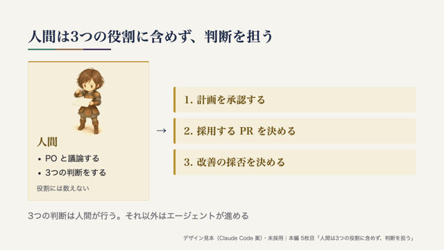

<!-- _class: cover -->
<!-- _paginate: false -->

# エージェント 開発プロセス

Spec × Issue × Orca

agent-dev-template の全体像と役割

<!--
【話すこと】
agent-dev-template というテンプレートが用意している開発プロセスの全体像を紹介します。
最初の数分で「何をするプロセスか」と「登場する役割」を押さえ、そのあと Issue 1本の流れに進みます。

【出典】
- README 冒頭（題名「エージェント開発テンプレート（Spec × Issue × Orca）」）: https://github.com/dyamada-jaki/agent-dev-template/blob/78c72e2a824ef1056e8ecbcae141818acf28ec71/README.md
-->

---

## 何をするプロセスか

人間が判断し、AI エージェント（Claude Code と Codex）が 仕様づくりから実装・レビュー・マージ・ふりかえりまでを進める

  
仕様づくり

  
→

  
実装

  
→

  
レビュー

  
→

  
マージ

  
→

  
ふりかえり

<!--
【話すこと】
agent-dev-template は、このプロセスを一式そろえたテンプレート
一言でいうと、人間が判断し、AI エージェントが仕様づくりからふりかえりまでを進めるためのプロセスです。
エージェントは Claude Code と Codex の2種類を使います。
各工程の細かい手順は、このあと「Issue 1本の流れ」で説明します。ここでは「人間は判断、エージェントは作業」という分担だけ覚えてください。

【出典】
- README 冒頭「人間が判断し、AI エージェント（Claude Code と Codex）が仕様づくりから実装・レビュー・マージ・ふりかえりまでを進めるための、プロセス一式のテンプレートです。」: https://github.com/dyamada-jaki/agent-dev-template/blob/78c72e2a824ef1056e8ecbcae141818acf28ec71/README.md
-->

---

## Spec・Issue・Orca の関係

  

    <h3>Spec</h3>
    <ul>
      <li>作るもの全体の仕様</li>
      <li>「何を・なぜ・どこまで」 を書く</li>
      <li>まだ作らない部分も 書いてよい</li>
    </ul>
    
docs/spec.md

  

  
→

  

    <h3>Issue</h3>
    <ul>
      <li>仕様から今回作る部分 だけを取り出した 作業の単位</li>
      <li>目的・範囲・ 受け入れ条件を書く</li>
      <li>1〜3本ずつ出し、 終わったら次を切る</li>
    </ul>
    
GitHub Issue

  

  
→

  

    <h3>Orca</h3>
    <ul>
      <li>複数の AI エージェントの 端末と worktree を まとめて扱うアプリ</li>
      <li>Issue を1本ずつ 実装する作業環境</li>
    </ul>
    
エージェントの作業場所

  

<!--
【話すこと】
Spec から今回作る部分を Issue に切り出し、Orca で1本ずつ作る
Spec は、作るもの全体について「何を・なぜ・どこまで」作るかを書いた仕様で、まだ作らない部分も書いておけます。
Issue は、その仕様から今回作る部分だけを取り出した作業の単位です。今回実装する作業の目的・範囲（やらないこと）・受け入れ条件を書きます。1〜3本ずつ出して、終わったら次を切ります。
Orca は、複数の AI エージェントの端末と worktree をまとめて扱うアプリで、Issue を1本ずつ実装する作業環境になります。

【出典】
- workflow.md 冒頭（spec.md は作るもの全体の仕様、Issue はそこから今回作る部分だけを取り出したもの、Orca で1本ずつ実装）: https://github.com/dyamada-jaki/agent-dev-template/blob/78c72e2a824ef1056e8ecbcae141818acf28ec71/docs/workflow.md
- workflow.md ステップ2「Issueを切り出す」（Issue に書くこと: 目的、受け入れ条件、スコープ外）: https://github.com/dyamada-jaki/agent-dev-template/blob/78c72e2a824ef1056e8ecbcae141818acf28ec71/docs/workflow.md
- README 冒頭（Orca の説明）: https://github.com/dyamada-jaki/agent-dev-template/blob/78c72e2a824ef1056e8ecbcae141818acf28ec71/README.md
-->

---

## 3つの役割（どれも AI エージェント）

  

    

      
      <h3>PO</h3>
    

    <ul>
      <li>人間と議論して spec.md と Issue を書く</li>
      <li>着手してよい Issue に 「開発可」を付ける</li>
      <li>推薦された PR を 受け入れ確認する （コードは見ない）</li>
    </ul>
    
長く使う

  

  

    

      
      <h3>開発チーム</h3>
    

    <ul>
      <li>Issue 1本を 最後まで進める</li>
      <li>開発者2人の実装を比べ、 採る PR を推薦する</li>
      <li>後片付けとふりかえり</li>
    </ul>
    
Issue ごとに開いて閉じる

  

  

    

      
      
      <h3>開発者</h3>
    

    <ul>
      <li>自分の worktree で 計画・実装・PR・レビュー</li>
      <li>Claude Code と Codex が 1人ずつ</li>
    </ul>
    
実装からマージまで

  

<!--
【話すこと】
人間はこの3つの役割に含めない（次のページ）
絵の人物は AI エージェントの3つの役割を表します。次のページの2人は人間です。
エージェントは3つの役割に分かれます。
PO は人間と議論して仕様と Issue を書き、開発チームが推薦する PR を受け入れ条件・仕様・使う人の目で確かめます。コードは見ません。
開発チームは Issue 1本を最後まで進めます。開発者2人に同じ Issue を別々に実装させ、互いにレビューさせて、どちらを採るかを推薦します。
開発者は自分の worktree で計画・実装・PR・レビューを行います。
PO と開発チームを分けているのは、1つの端末にまとめると文脈がすぐあふれ、開発中にプロダクトの検討を進めにくくなるためです。
（開発チームを自動で開く「起動係」という仕組みもありますが、3つの役割には含めないので後のパートで扱います。）

【出典】
- workflow.md の PO・開発チーム・開発者の担当を表にした節: https://github.com/dyamada-jaki/agent-dev-template/blob/78c72e2a824ef1056e8ecbcae141818acf28ec71/docs/workflow.md
- README の PO・開発チーム・開発者の役割と受け渡しを説明した節（役割の表、PO と開発チームを分ける理由）: https://github.com/dyamada-jaki/agent-dev-template/blob/78c72e2a824ef1056e8ecbcae141818acf28ec71/README.md
-->

---

## 人間は3つの役割に含めず、 判断を担う

  

    <h3>人間</h3>
    <ul>
      <li>PO と議論する</li>
      <li>3つの判断をする</li>
    </ul>
    
役割には数えない

    
  

  
→

  

    
1. 計画を承認する

    
2. 採用する PR を決める

    
3. 改善の採否を決める

  

<!--
【話すこと】
3つの判断は人間が行う。それ以外はエージェントが進める
人間は3つの役割のどれにも含めません。
人間がすることは、PO との議論と、3つの判断です。実装前の計画を承認する、採用する PR を決める、ふりかえりで出た改善の採否を決める。
この3つの判断は人間が行い、それ以外の作業はエージェントが進めます。
それぞれの判断がどのタイミングで来るかは、次の「Issue 1本の流れ」で説明します。

【出典】
- README「Issue 1本の流れ」（「六角形が人間の判断です。それ以外はエージェントが進めます。」「人間がすることは、PO との議論と、④⑥⑧の3つの判断です。」）: https://github.com/dyamada-jaki/agent-dev-template/blob/78c72e2a824ef1056e8ecbcae141818acf28ec71/README.md#issue-1本の流れ
- workflow.md の PO・開発チーム・開発者の担当を表にした節（人間が判断するのは3つの場面: ④計画承認、⑥採用の判断、⑧改善の採否）: https://github.com/dyamada-jaki/agent-dev-template/blob/78c72e2a824ef1056e8ecbcae141818acf28ec71/docs/workflow.md
-->

---

## ここまでのまとめ

<table class="recap">
  <tr><th>何を</th><td>人間が判断し、AI エージェントが仕様からふりかえりまで進める</td></tr>
  <tr><th>何で</th><td>Spec から今回作る部分を Issue に切り出し、Orca で作る</td></tr>
  <tr><th>誰が</th><td>PO・開発チーム・開発者の3つの役割と、判断を担う人間</td></tr>
</table>

次: Issue 1本の流れ ― 仕様から切り出した Issue が、どう進んでいくか

<!--
【話すこと】
ここまでをまとめると、何をするか・何を使うか・誰が担うか、の3点です。
次は、Issue 1本が切り出されてから、計画・実装・レビュー・マージ・ふりかえりへ進む流れを見ていきます。

【出典】
- README 冒頭・役割と受け渡しの節・「Issue 1本の流れ」: https://github.com/dyamada-jaki/agent-dev-template/blob/78c72e2a824ef1056e8ecbcae141818acf28ec71/README.md
- workflow.md 冒頭・3つの役割の節: https://github.com/dyamada-jaki/agent-dev-template/blob/78c72e2a824ef1056e8ecbcae141818acf28ec71/docs/workflow.md
-->

---

<ol class="steps">
  <li class="now">①議論</li>
  <li>②切り出し</li>
  <li>③着手</li>
  <li class="judge">④計画承認</li>
  <li>⑤実装</li>
  <li class="judge">⑥レビュー・採用</li>
  <li>⑦マージ</li>
  <li class="judge">⑧ふりかえり</li>
</ol>

## ① 人間と PO が、作りたいものを仕様にする

  

    
このプロセスでは

    <table class="duty">
      <tr><th>担当</th><td>

        
PO

        
人間

      
</td></tr>
      <tr><th>渡すもの</th><td>spec.md（何を・なぜ・ どこまで作るか）</td></tr>
      <tr><th>人間が 決めること</th><td>作りたいものを PO と議論する （3つの判断の前の段階）</td></tr>
    </table>
  

  

    <h3>実例: Issue #5</h3>
    <ul>
      <li>人間の希望: Overstrata の雰囲気を取り入れた 個人用のスライドデザインを検討したい</li>
      <li>PO が spec.md に記録し、 導入のページで2案を比べることにした</li>
    </ul>
    
spec.md 2.2・決定の記録（2026-10-28）

  

<!--
【話すこと】
ここから、Issue 1本が進む流れを、このスライド自体の制作で行った Issue #5 を例に見ていきます。
上の帯は元テンプレートの8ステップで、金色の④⑥⑧が人間の判断です。各ページの左が一般的な手順、右が実例です。
① 議論では、PO が人間と議論して、作るもの全体の仕様 spec.md を書きます。会話は消えますが、spec.md は残ります。
ここで人間がするのは議論で、3つの判断はまだ来ません。

【実例】
Issue #5 では、人間が「Overstrata の雰囲気を取り入れた個人用のデザインを検討したい」と希望しました。
PO はこれを spec.md に記録し、導入の代表3枚で2つのデザイン案を比べる進め方を人間と決めました（「OK。それで進めましょう」）。

【時間】約45秒

【出典】
一般的な手順:
- README「Issue 1本の流れ」の流れ図（①〜⑧、六角形が人間の判断）: https://github.com/dyamada-jaki/agent-dev-template/blob/78c72e2a824ef1056e8ecbcae141818acf28ec71/README.md#L49-L71
- workflow.md ステップ1「議論する」: https://github.com/dyamada-jaki/agent-dev-template/blob/78c72e2a824ef1056e8ecbcae141818acf28ec71/docs/workflow.md#L132-L143
本プロジェクトの実例:
- spec.md 2.2・6章の決定の記録（2026-10-28、Overstrata を取り入れたデザインの検討と、代表3枚で2案を比べる方針）: https://github.com/dyamada-jaki/agent-dev-slide/blob/4c79405a64f13ec4359e6ceb57d1c871ba84b35f/docs/spec.md
-->

---

<ol class="steps">
  <li>①議論</li>
  <li class="now">②切り出し</li>
  <li class="now">③着手</li>
  <li class="judge">④計画承認</li>
  <li>⑤実装</li>
  <li class="judge">⑥レビュー・採用</li>
  <li>⑦マージ</li>
  <li class="judge">⑧ふりかえり</li>
</ol>

## ②③ 今回作る範囲を Issue にし、着手する

  

    
このプロセスでは

    <table class="duty">
      <tr><th>担当</th><td>

        
PO

        →
        
開発チーム

        
間で起動係（仕組み）が開発チームを開く

      
</td></tr>
      <tr><th>渡すもの</th><td>Issue（目的・受け入れ条件・ スコープ外）と「開発可」</td></tr>
      <tr><th>人間が 決めること</th><td>なし（着手の順番は PO が決める）</td></tr>
    </table>
  

  

    <h3>実例: Issue #5</h3>
    <ul>
      <li>導入6枚から代表3枚に絞り、 同じ内容でデザインを2案作る</li>
      <li>スコープ外: 6枚すべてへの展開、 共通テーマの正式実装</li>
      <li>「開発可」を見て起動係が 開発チームを開いた（13:04）</li>
    </ul>
    
Issue #5 レポート 2・3章

  

<!--
【話すこと】
② 切り出しでは、PO が spec.md から今すぐ作る部分を Issue にします。目的・受け入れ条件・スコープ外を書き、PR 1本で終わる大きさにします。
着手してよい Issue に PO が「開発可」のラベルを付けると、③ 着手です。Orca の定期実行の「起動係」が、動いている開発チームがいないときだけ、開発チームを開きます。起動係は3つの役割に含めない仕組みなので、人物の絵は付けていません。
ここでも人間の判断はありません。

【実例】
Issue #5 は、導入6枚から代表3枚を選び、同じ内容でデザインを2案作るという範囲にしました。6枚すべてへの展開や共通テーマの正式実装は、スコープ外として後の Issue に分けています。
「開発可」が付いた Issue を起動係が見つけ、開発チームが開いて 13:04 に着手しました。

【時間】約50秒

【出典】
一般的な手順:
- workflow.md ステップ2「Issueを切り出す」（Issue に書くこと、着手の合図）: https://github.com/dyamada-jaki/agent-dev-template/blob/78c72e2a824ef1056e8ecbcae141818acf28ec71/docs/workflow.md#L145-L169
- workflow.md ステップ3「着手する」: https://github.com/dyamada-jaki/agent-dev-template/blob/78c72e2a824ef1056e8ecbcae141818acf28ec71/docs/workflow.md#L171-L175
- README の役割の表（起動係は「開発可」の Issue があり、動いている開発チームがいないときだけ開発チームを開く）: https://github.com/dyamada-jaki/agent-dev-template/blob/78c72e2a824ef1056e8ecbcae141818acf28ec71/README.md#L40-L45
本プロジェクトの実例:
- Issue #5 レポート 2章（目的と範囲・スコープ外）・3章（13:04 の着手、起動係から開いた Run）: https://github.com/dyamada-jaki/agent-dev-slide/blob/4c79405a64f13ec4359e6ceb57d1c871ba84b35f/docs/issue-reports/issue-5.md
-->

---

<ol class="steps">
  <li>①議論</li>
  <li>②切り出し</li>
  <li>③着手</li>
  <li class="judge now">④計画承認</li>
  <li>⑤実装</li>
  <li class="judge">⑥レビュー・採用</li>
  <li>⑦マージ</li>
  <li class="judge">⑧ふりかえり</li>
</ol>

## ④ 開発者が計画を出し、人間が承認する

  

    
このプロセスでは

    <table class="duty">
      <tr><th>担当</th><td>

        
開発者

        
開発チーム

      
</td></tr>
      <tr><th>渡すもの</th><td>計画（受け入れ条件ごとの 作り方・確かめ方・確認したいこと）</td></tr>
      <tr class="decide"><th>人間が 決めること</th><td>
計画を承認する
</td></tr>
    </table>
  

  

    <h3>実例: Issue #5</h3>
    <ul>
      <li>開発者2人が、配色・書体・ 形・人物の使い方を提案</li>
      <li>人間は両案をそのまま承認。 見本のビルドは本編と別の コマンドに分けるよう回答</li>
    </ul>
    
Issue #5 レポート 3章

  

<!--
【話すこと】
④ 計画承認は、人間の1つ目の判断です。開発者はすぐにはコードを書かず、受け入れ条件ごとにどう作り、どう確かめるかの計画を出します。開発チームがそれを人間に見せます。
人間は Issue と見比べて、受け入れ条件を全部カバーしているか、スコープ外のことをしようとしていないかを確かめます。仕様に穴が見つかったら、実装を止めて PO に戻します。
Issue の曖昧さは計画に表れるので、コードになる前に見つけるのがいちばん安い、という考え方です。

【実例】
Issue #5 では、開発者2人がそれぞれ配色・書体・形（カードか罫線か）・人物の使い方を提案しました。
人間は両案をそのまま承認し、見本を作るビルドは本編のビルドを変えずに別のコマンドに分けるよう答えました。

【時間】約50秒

【出典】
一般的な手順:
- workflow.md ステップ4「計画を承認する」（人間が確かめる点と分岐）: https://github.com/dyamada-jaki/agent-dev-template/blob/78c72e2a824ef1056e8ecbcae141818acf28ec71/docs/workflow.md#L177-L195
- README「Issue 1本の流れ」（開発者2人がそれぞれ計画を立て、人間が④で承認）: https://github.com/dyamada-jaki/agent-dev-template/blob/78c72e2a824ef1056e8ecbcae141818acf28ec71/README.md#L49-L71
本プロジェクトの実例:
- Issue #5 レポート 3章「計画の要約」「人間の回答（計画承認）」: https://github.com/dyamada-jaki/agent-dev-slide/blob/4c79405a64f13ec4359e6ceb57d1c871ba84b35f/docs/issue-reports/issue-5.md
-->

---

<ol class="steps">
  <li>①議論</li>
  <li>②切り出し</li>
  <li>③着手</li>
  <li class="judge">④計画承認</li>
  <li class="now">⑤実装</li>
  <li class="judge now">⑥レビュー・採用</li>
  <li>⑦マージ</li>
  <li class="judge">⑧ふりかえり</li>
</ol>

## ⑤⑥ 開発者が実装・検証し、互いにレビューする

  

    
このプロセスでは

    <table class="duty">
      <tr><th>担当</th><td>

        
開発者2人 （それぞれの worktree）

      
</td></tr>
      <tr><th>渡すもの</th><td>PR（何をしたか・確認結果）と 相手の PR へのレビュー</td></tr>
      <tr><th>人間が 決めること</th><td>なし（この間は待つ）</td></tr>
    </table>
  

  

    <h3>実例: Issue #5（初回の2案）</h3>
    

      

        
        
罫線と余白 判断は藍色

        
PR #6 初回・c332c37 （Codex）

      

      

        
        
カードで囲み 判断を金色で強調

        
PR #7 初回・b3e0c3e （Claude Code）

      

    

  

<!--
【話すこと】
⑤ 実装では、開発者が自分の worktree で計画どおりに作り、確認コマンドを通して PR を出します。GitHub Actions でも同じ確認が回ります。この間、人間は待っています。
⑥ レビューでは、開発者2人が互いの PR を、受け入れ条件・仕様・回帰の観点でレビューします。
今回は同じ Issue を2人が別々に作る「二重実装」で進めました。元テンプレートでは任意の進め方で、1本だけ実装する方法もあります。
右は Issue #5 で出てきた初回の2案で、同じ「人間の判断」のページです。画像の中の文字は読まなくて大丈夫です。違いは下に書いたとおりで、PR #6 は罫線と余白で区切り、PR #7 はカードで囲んで判断を金色で強調しました。

【実例】
PR #6（Codex）は 13:32、PR #7（Claude Code）は 13:38 にでき、どちらも確認コマンドと CI が成功しました。相互レビューの必須の指摘は、どちらも0件でした。
このときは人間の指定で、独立した品質レビューも加えています（詳細はこの章では扱いません）。
画像は、それぞれの PR の当時の版（PR #6 は c332c37、PR #7 は b3e0c3e）の原稿を Marp で描いて縮小したものです。後で直した採用修正版とは別の版です。

【時間】約60秒

【出典】
一般的な手順:
- workflow.md ステップ5「実装」: https://github.com/dyamada-jaki/agent-dev-template/blob/78c72e2a824ef1056e8ecbcae141818acf28ec71/docs/workflow.md#L197-L204
- workflow.md ステップ6「レビュー」（任意: 2つのエージェントで作らせて比べる、相互レビューの担当）: https://github.com/dyamada-jaki/agent-dev-template/blob/78c72e2a824ef1056e8ecbcae141818acf28ec71/docs/workflow.md#L206-L227
本プロジェクトの実例:
- Issue #5 レポート 3章（PR の完成時刻）・4章（初回2案の比較）・6章（レビューの結果）: https://github.com/dyamada-jaki/agent-dev-slide/blob/4c79405a64f13ec4359e6ceb57d1c871ba84b35f/docs/issue-reports/issue-5.md
- 初回の PR #6 の原稿（c332c37）: https://github.com/dyamada-jaki/agent-dev-slide/blob/c332c3760316c7509452b0cc6be39d138d712368/slides/design-codex.md
- 初回の PR #7 の原稿（b3e0c3e）: https://github.com/dyamada-jaki/agent-dev-slide/blob/b3e0c3e8964a764a424a131f004625d5f4b6697d/slides/samples/issue-5-claude/index.md
-->

---

<ol class="steps">
  <li>①議論</li>
  <li>②切り出し</li>
  <li>③着手</li>
  <li class="judge">④計画承認</li>
  <li>⑤実装</li>
  <li class="judge now">⑥レビュー・採用</li>
  <li>⑦マージ</li>
  <li class="judge">⑧ふりかえり</li>
</ol>

## ⑥ 推薦・PO の受け入れ確認と、人間の採用判断

  

    
実例: Issue #5 の往復（担当とすること）

    <table class="duty loop">
      <tr><th>開発チーム</th><td><b>推薦</b>: PR #6 を土台に（c332c37）</td></tr>
      <tr><th>PO</th><td><b>受け入れ確認</b>:「人間の判断が必要」</td></tr>
      <tr class="decide"><th>人間</th><td><b>採用判断</b>: #6 の罫線に #7 の金色を足す</td></tr>
      <tr><th>PO</th><td>仕様・Issue を更新（①②へ戻る）</td></tr>
      <tr><th>開発者</th><td>修正（3480008）、相互レビューで再確認</td></tr>
      <tr><th>PO</th><td><b>受け入れ</b>（2回目）→ 人間の承認後に⑦へ</td></tr>
    </table>
  

  

    <h3>採用修正版</h3>
    

      

        
        
罫線のまま、判断を金色で強調。 下部の1行は発表ノートへ

        
PR #6 修正版・3480008

      

    

  

<!--
【話すこと】
⑥ の後半は、3つの確認を分けて進みます。開発チームの推薦、PO の受け入れ確認、そして人間の採用判断です。
推薦は、開発チームがレビューを踏まえて「どちらを採るか」を推すことです。PO はコードを見ず、受け入れ条件・仕様・使う人の目で確かめます。採用する PR を決めるのは、2つ目の判断として人間です。
Issue #5 は一直線には進みませんでした。PO は「人間の判断が必要」と返し、人間が修正の方針を選びました。条件が変わったので、PO が先に仕様と Issue を更新し、それから開発者が直しました。再確認のあと、PO が2回目で受け入れています。
右が採用した修正版です。罫線の案を土台にしたまま、判断を金色で強調し、下部の1行コメントは発表ノートに移しました。人間は「main に残すのは #6 だけ」とも決めています。

【実例】
- 13時台: 開発チームが、相互レビューと指摘の裏付けを踏まえて PR #6 を土台として推薦。表紙に人物がなく役割を混同させないこと、ヨナの参照元を記録していることを根拠にし、デザインの好みは人間が決めるとした
- 13:56: PO の受け入れ確認（1回目）は「人間の判断が必要」。差し戻しではない
- 14時台: 人間が「カードはとてもAIっぽさが良くも悪くも出るので、罫線にしてみましょうか。また、下部の１行コメントも無しでいいです」と答え、判断を金色で強調する、main に残すのは #6 だけ、を選んだ
- 14:38: PO が Issue #5 と spec.md などを更新（03383d7）。その後に修正を開始
- 修正1（78842cd）と修正2（3480008）、相互レビュー担当の再確認で必須の指摘0
- 15:08: PO が受け入れ（2回目）
推薦・PO の受け入れ確認・人間の採用判断は別の作業で、PO の受け入れはマージの決定ではありません。

【時間】約75秒

【出典】
一般的な手順:
- README「Issue 1本の流れ」（相互レビュー → 開発チームが推す PR を選ぶ → PO の受け入れ確認 → ⑥ 採用する PR を決める）: https://github.com/dyamada-jaki/agent-dev-template/blob/78c72e2a824ef1056e8ecbcae141818acf28ec71/README.md#L49-L71
- workflow.md ステップ6（推薦後に PO が受け入れの一次判断をする）: https://github.com/dyamada-jaki/agent-dev-template/blob/78c72e2a824ef1056e8ecbcae141818acf28ec71/docs/workflow.md#L206-L227
- workflow.md ステップ4の分岐（仕様の穴は PO に戻し、spec.md・Issue を直してから進める）: https://github.com/dyamada-jaki/agent-dev-template/blob/78c72e2a824ef1056e8ecbcae141818acf28ec71/docs/workflow.md#L177-L195
本プロジェクトの実例:
- Issue #5 レポート 6章（一次判断）・8章（PO の受け入れ確認、人間の判断、判断の後の修正と再確認）: https://github.com/dyamada-jaki/agent-dev-slide/blob/4c79405a64f13ec4359e6ceb57d1c871ba84b35f/docs/issue-reports/issue-5.md
- 開発チームの推薦: https://github.com/dyamada-jaki/agent-dev-slide/pull/6#issuecomment-6460995440
- PO の受け入れ確認（1回目）: https://github.com/dyamada-jaki/agent-dev-slide/pull/6#issuecomment-6461020528
- PO の受け入れ確認（2回目）: https://github.com/dyamada-jaki/agent-dev-slide/pull/6#issuecomment-6462049792
- 採用修正版の原稿（3480008）: https://github.com/dyamada-jaki/agent-dev-slide/blob/3480008867440677afcb0b29e8a0b8aa06a08c00/slides/design-codex.md
-->

---

<ol class="steps">
  <li>①議論</li>
  <li>②切り出し</li>
  <li>③着手</li>
  <li class="judge">④計画承認</li>
  <li>⑤実装</li>
  <li class="judge">⑥レビュー・採用</li>
  <li class="now">⑦マージ</li>
  <li class="judge now">⑧ふりかえり</li>
</ol>

## ⑦⑧ 採用した成果を取り込み、改善を次へ渡す

  

    
このプロセスでは

    <table class="duty">
      <tr><th>担当</th><td>

        
開発チーム: 承認の後に マージ・後片付け・ふりかえり

      
</td></tr>
      <tr><th>渡すもの</th><td>改善案（根拠・反映先）と、 PO への申し送り</td></tr>
      <tr class="decide"><th>人間が 決めること</th><td>
<ul class="decisions"><li>マージの実行内容を 承認する</li><li>改善の採否を決める</li></ul>
</td></tr>
    </table>
  

  

    <h3>実例: Issue #5</h3>
    <ul>
      <li>人間の承認後、開発チームが PR #6 修正版をマージ。PR #7 は ブランチを残して閉じた</li>
      <li>改善 A〜C は採用・反映済み、 D は継続観測</li>
      <li>次へ: Issue #8 で共通デザインを 整え、導入6枚に適用する</li>
    </ul>
    
Issue #5 レポート 9〜12章

  

<!--
【話すこと】
⑦ マージは、人間が採用する PR とマージ・後片付けの実行内容を承認し、そのあと開発チームがマージと後片付けを行います。人間が自分でマージボタンを押すのではありません。
⑧ ふりかえりは、開発チームが記録から「続けること・改善すること」を整理し、改善案ごとに根拠と反映先を示します。採るかどうかを決めるのが、人間の3つ目の判断です。仕様についての発見は PO に申し送り、次の ① 議論につながります。
採用した改善と、その効果を確かめたことは分けて扱います。

【実例】
- 15:54: 実機確認の記録がないことを示したうえで、人間が「このまま実行する」と承認。開発チームが PR #6（3480008）を squash でマージし（main e0d645a）、PR #7 はブランチを残して閉じた。修正版の実機確認の結果は記録されていない
- ふりかえりの改善案4件のうち、人間が「A〜Cを採用してください」と回答。A 承認した計画の要点を PR 本文に残す、B Orca のブラウザで確かめられないときの代わりの方法、C 人物の外見の根拠を計画で求める、を手順書に反映した。D 小さな差分の再確認を軽くする、は変更せず継続観測。効果は次の Issue で確かめることにした
- PO への申し送りから、共通デザインを整えて導入6枚に適用する Issue #8 につながった

【時間】約60秒

【出典】
一般的な手順:
- README「Issue 1本の流れ」（⑦ 開発チームがマージし、後片付けする、⑧ 改善の採否を決める）: https://github.com/dyamada-jaki/agent-dev-template/blob/78c72e2a824ef1056e8ecbcae141818acf28ec71/README.md#L49-L71
- workflow.md ステップ7「マージ」・ステップ8「ふりかえりと還流」: https://github.com/dyamada-jaki/agent-dev-template/blob/78c72e2a824ef1056e8ecbcae141818acf28ec71/docs/workflow.md#L229-L266
- finish-issue 手順3（マージ・後片付けの実行内容を人間に確認する）・手順4（マージする）: https://github.com/dyamada-jaki/agent-dev-template/blob/78c72e2a824ef1056e8ecbcae141818acf28ec71/.claude/skills/finish-issue/SKILL.md#L46-L60
- 記載の不一致: 同じ版の workflow.md ステップ6（225行目）には「マージ（⑦）は人間がする」とある。README の流れ図・ステップ7・finish-issue は、人間の承認後に開発チームがマージする構成で、このスライドは後者で説明する（参照版・元資料は変更していない）: https://github.com/dyamada-jaki/agent-dev-template/blob/78c72e2a824ef1056e8ecbcae141818acf28ec71/docs/workflow.md#L225
本プロジェクトの実例:
- Issue #5 レポート 9章（完了処理）・10章（ふりかえり）・11章（改善案と人間の判断）・12章（PO への申し送り）: https://github.com/dyamada-jaki/agent-dev-slide/blob/4c79405a64f13ec4359e6ceb57d1c871ba84b35f/docs/issue-reports/issue-5.md
- Issue #8（共通デザインを整え、導入6枚に適用する）: https://github.com/dyamada-jaki/agent-dev-slide/issues/8
-->
