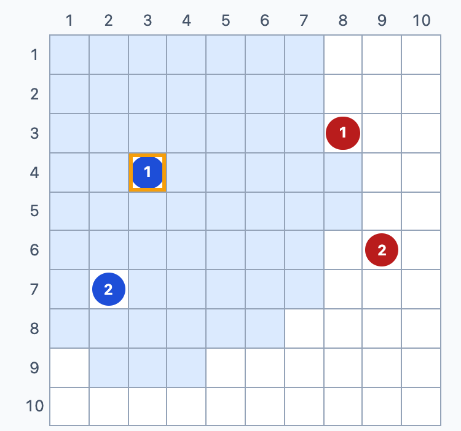
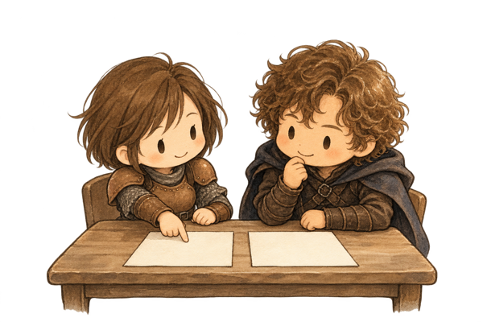
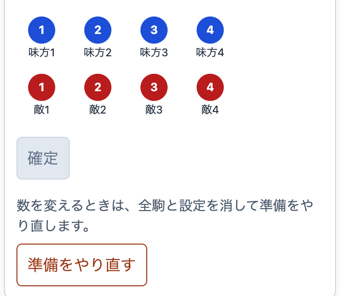
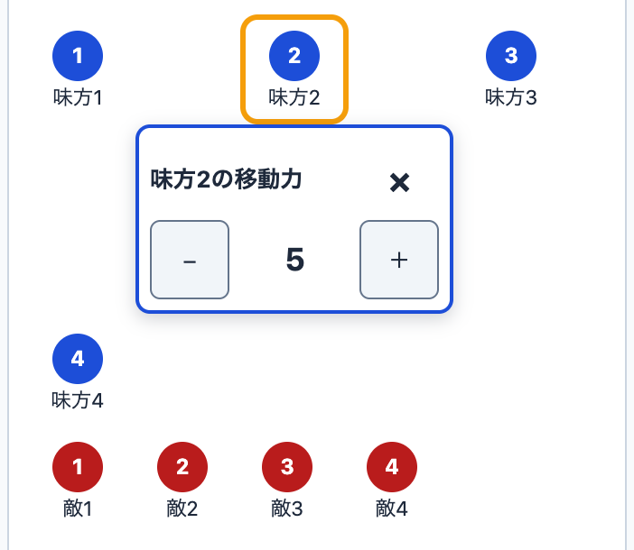
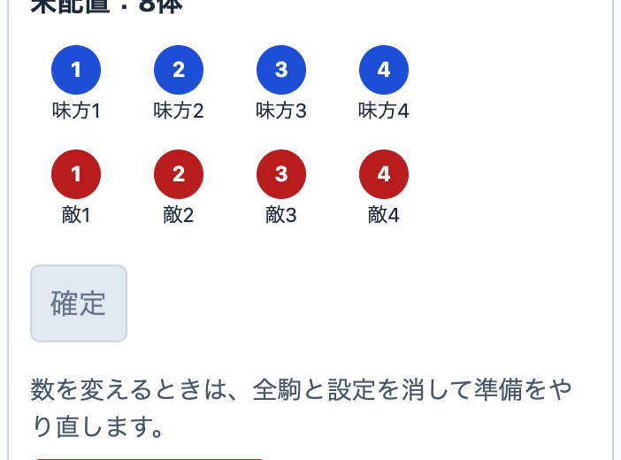
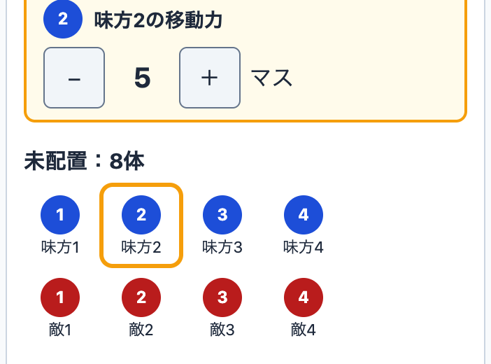

<!-- _class: cover -->
<!-- _paginate: false -->

# エージェント 開発プロセス

agent-dev-template の全体像と役割

<!--
【話すこと】
agent-dev-template というテンプレートが用意している、人間と AI エージェントで進める開発プロセスを紹介します。
この開発プロセスでは、スクラムを実践できるように、役割とイベントを可能な限り取り入れています。
最初に全体像と役割、スクラムのイベントと関連する5つの活動を押さえ、そのあと実際の Issue 1本の流れに進みます。
まず全体像を見てください。

【時間】約20秒（見積もり）

【出典】
固定版の手順:
- README 冒頭（テンプレートの題名と概要）: https://github.com/dyamada-jaki/agent-dev-template/blob/78c72e2a824ef1056e8ecbcae141818acf28ec71/README.md
設計者の意図:
- 「スクラムを実践できるように、役割とイベントを可能な限り取り入れている」は、このテンプレートを作った人間が説明した設計意図（本プロジェクトの docs/spec.md 2.3「再計画で合意した説明の軸」）。元テンプレートの文書には書かれていない。
-->

---

<!-- _class: overview -->

## 人間と AI で進める開発の全体像

スクラムを実践できるよう、役割とイベントを取り入れる

<svg class="ov-wires" viewBox="0 0 1280 720" aria-hidden="true">
<defs><marker id="ov-arrow" viewBox="0 0 10 10" refX="8" refY="5" markerWidth="7" markerHeight="7" orient="auto-start-reverse"><path d="M 1 1 L 8 5 L 1 9" fill="none" stroke="#1F2B47" stroke-width="1.5"/></marker><marker id="ov-soft-arrow" viewBox="0 0 10 10" refX="8" refY="5" markerWidth="7" markerHeight="7" orient="auto-start-reverse"><path d="M 1 1 L 8 5 L 1 9" fill="none" stroke="#62626C" stroke-width="1.5"/></marker></defs>
<path d="M 382 262 V 286 H 1030 V 262 M 382 286 H 52 V 384" fill="none" stroke="#1F2B47" stroke-width="1.8"/>
<path d="M 536 222 H 856" fill="none" stroke="#62626C" stroke-width="1.5" marker-start="url(#ov-soft-arrow)" marker-end="url(#ov-soft-arrow)"/>
<g fill="none" stroke="#1F2B47" stroke-width="1.8" marker-end="url(#ov-arrow)"><path d="M 1130 262 V 336 H 764"/><path d="M 516 336 H 200 V 392"/></g>
<g fill="none" stroke="#1F2B47" stroke-width="2" marker-end="url(#ov-arrow)"><path d="M 324 443 H 366"/><path d="M 614 443 H 656"/><path d="M 904 443 H 946"/><path d="M 1070 515 V 544 H 1000 V 565"/><path d="M 1078 586 H 1250 V 370 H 740 V 357"/></g>
<path d="M 200 515 V 519 H 490 V 515 M 216 519 V 524" fill="none" stroke="#D7D2C4" stroke-width="2"/>
</svg>

<h3>人間</h3>
方向・優先順位・採用を判断

対話して具体化する

GitHub Issue

作成・更新

開発可で着手

<h3>POAI</h3>
対話の結果を Issue にする

<h3>計画</h3>
開発者 → 開発チーム <strong class="ov-human-action">人間が承認</strong>

<h3>実装・検証</h3>
作って、確かめる 開発者どうしでレビュー

<h3>成果の確認</h3>
AI の PO が受け入れ確認 ↓ <strong class="ov-human-action">人間が確認・採用判断</strong>

<h3>ふりかえり</h3>
開発チームが改善案 <strong class="ov-human-action">人間が採否を判断</strong>

<h3>開発者AI</h3>
2人が1つずつ 案を作る

<h3>開発チームAI</h3>
この流れ全体を管理

結果を 申し送り

AI の PO：結果を受け取り、次の仕様・Issue へ反映

<!--
【話すこと】
画面のすべての文字や線は読み上げず、上段 → Issue → 4つの工程 → 金色 → 次への反映の順で案内します。
このページでは、誰と誰が関わり、何が渡り、どこで人間が判断するかの流れだけを見ます。それぞれの担当の詳しい違いは、次のページで説明します。
まず上段です。人間が、AI の PO と何を作るかを対話します。PO はプロダクトオーナーの略です。対話の結果を、PO が中央の GitHub Issue にします。
Issue には、今回作る範囲と完成の条件をまとめます。着手できる状態（「開発可」）になったら、下の開発の流れが始まります。
下の流れ全体は開発チームが管理します。左下の開発者は2人で、1人1つずつ案を作ります。流れは、計画、実装・検証、成果の確認、ふりかえりの順です。成果の確認では、AI の PO が先に確かめ、そのあと人間が確かめます。
この開発の流れで人間が判断するのが、金色の3か所です。計画を承認する。実物を確認して採用を決める。そして、ふりかえりで改善案を採るか決める。
最後に、結果を AI の PO に申し送り、次の仕様や Issue に反映します。作って終わりにせず、次の開発につなげます。
Issue の中身と、AI が作業する環境は、このあと実例で見ます。次のページでは、誰が何を担うかを詳しく見ます。

話し方の注意: 「人間は3回クリックするだけ」「人間の関与はこの3か所だけ」とは説明しない。上段の相談や、必要な修正の判断もある。図は通常の流れをまとめたもので、採用・マージの実行内容の承認などの詳細は後の実例で示す。

補足（聞かれたら）:
- 計画の承認を通常 AI の PO に依頼する手順はない。仕様の不足が見つかった場合は PO に戻して人間と決め直す。承認した計画と確認事項の決着は記録に残り、PO が成果の受け入れ確認のときに読む。
- PO の受け入れ確認で差し戻しとなった場合は、修正・レビューを経て再確認する。図は通常の進行だけを示す。
- 通常は「開発可」の Issue を、Orca の定期実行（起動係）が見つけて開発チームを起動する。Issue を作っただけで、未確定の課題まで実装が始まるわけではない。
- ふりかえりの全結果を PO が事前に承認するわけではない。改善の採否は人間が判断し、仕様や Issue の案を PO に申し送る。
- 元テンプレートでは、同じ Issue を2人で作る進め方（二重実装）は任意。1本だけ実装する方法もある。このプロセスの説明と後の実例は2人で作る進め方。

【時間】約85秒（見積もり。#27 で各役割の担当の詳しい説明を次のページへ移し、95秒から減らした）

【出典】
固定版の手順:
- workflow.md の PO・開発チーム・開発者の担当を表にした節（PO は Issue を切って「開発可」を付け、推薦を受け入れ確認する。開発チームは実装・レビューをさせ、PO の確認を経て人間に報告し、ふりかえりを行う。人間が判断するのは④計画承認・⑥PO の受け入れ確認のあとの採用判断・⑧改善の採否）、ステップ4・6・8: https://github.com/dyamada-jaki/agent-dev-template/blob/78c72e2a824ef1056e8ecbcae141818acf28ec71/docs/workflow.md
- dual-implement の計画提示と PO への受け入れ依頼: https://github.com/dyamada-jaki/agent-dev-template/blob/78c72e2a824ef1056e8ecbcae141818acf28ec71/.claude/skills/dual-implement/SKILL.md
- accept-review（PO の受け入れ確認と判定の返信）: https://github.com/dyamada-jaki/agent-dev-template/blob/78c72e2a824ef1056e8ecbcae141818acf28ec71/.claude/skills/accept-review/SKILL.md
- finish-issue（ふりかえり、改善の採否、PO への申し送り）: https://github.com/dyamada-jaki/agent-dev-template/blob/78c72e2a824ef1056e8ecbcae141818acf28ec71/.claude/skills/finish-issue/SKILL.md
- workflow.md ステップ6「レビュー」（任意: 2つのエージェントで作らせて比べる。開発者どうしの相互レビュー）: https://github.com/dyamada-jaki/agent-dev-template/blob/78c72e2a824ef1056e8ecbcae141818acf28ec71/docs/workflow.md#L206-L227
設計者の意図と当てはめ（解釈）:
- 上の一文と、人間がステークホルダーと PO の役割を担うという説明は、本プロジェクトの docs/spec.md 2.3（人間の説明と合意）による。図の構成は本プロジェクトの見本 slides/samples/issue-4-overview（採用版 ae2f691）。
- PO の優先順位の検討と、開発者2人が同じ Issue を別々に作ることは、本プロジェクトの docs/spec.md 2.3「導入4枚への絞り込みと担当の補足」（人間の原文「POのやっていることとして、優先順位の検討を追加したい。また、開発者は同じものを別々に作っている事がわかる表現にしたいな。」）による。元テンプレートの workflow.md の担当の表では、PO は「人間と議論する、spec.md を書く、Issue を切って順番を決め「開発可」を付ける」担当（Issue の着手の順番は PO が決める）。何を作るかの優先順位を人間と検討し、人間が判断するという書き方は、本プロジェクトの説明（当てはめ）。
- 2枚目では役割の箱の説明を短くし、流れの中の位置だけを示す。各担当の詳しい説明は3枚目に置く。これは docs/spec.md 2.3「役割説明の分担と実例への中表紙」（人間の原文「２ページ目と３ページ目の各役割の箱に入っている説明がほぼ一緒なので、繰り返す意味はないかも。３枚目の役割の内容をもっと濃くするか、２枚目の役割の説明をもう少し軽くした方がいいかも。」）による。
-->

---

## 人間と AI の役割分担

  

    

      
      

        <h3>人間ステークホルダー・PO</h3>
        <ul class="role-points"><li>作る方向と優先順位を PO と相談して決める</li><li>計画・成果・改善案を 確かめて判断する</li></ul>
      

    

    
⇄ 対話して 具体化する

    

      
      

        <h3>POAI</h3>
        <ul class="role-points"><li>人間と優先順位を検討し、 仕様・Issue に整理する</li><li>成果を受け入れ条件と 照らして確認する</li></ul>
      

    

  

  

    

      
      

        <h3>開発チームAI</h3>
        <ul class="role-points"><li>Issue ごとの進行を管理し、 2つの実装案を比べる</li><li>採用後にマージ・後片付け・ ふりかえりを行う</li></ul>
      

    

    

      

        
        
      

      

        <h3>開発者AI</h3>
        <ul class="role-points"><li>同じ Issue を2人が別々に 計画・実装・検証する</li><li>互いの PR を レビューする</li></ul>
      

    

  

  
AI は PO・開発チーム・開発者の3つの役割。独立したスクラムマスターは置いていない

<!--
【話すこと】
全体図の登場人物を、誰が何を担うかで詳しく見ます。流れは前のページで見たので、ここでは担当の違いだけを見ます。
上段は人間と AI の PO です。人間はステークホルダーとして成果を確かめ、PO の役割も担います。作る方向と、何から作るか（優先順位）を PO と相談して決め、計画・成果・改善案を確かめて判断します。前のページの金色の3か所が、この判断です。
AI の PO は、優先順位を人間と検討し、仕様と Issue に整理します。優先順位を判断するのは人間で、PO が単独で決めるわけではありません。PO は、開発チームが推薦した成果を、受け入れ条件・仕様・使う人の目で確認します。コードは見ません。
下段は開発を進める AI です。開発チームは Issue 1本を最後まで進め、開発者2人の実装案を比べます。人間が採用を決めたあとは、マージ・後片付け・ふりかえりまでの完了処理を行います。
開発者は2人で、同じ Issue をそれぞれ自分の worktree で別々に計画・実装・検証し、互いの PR をレビューします。作業を分け合ったり、1つの実装を2人で書いたりするのではなく、同じ Issue から2つの案を作ります。Claude Code と Codex が1人ずつです。
AI は PO・開発チーム・開発者の3つの役割に分かれます。PO と開発チームを分けているのは、1つの端末にまとめると文脈がすぐあふれ、開発中にプロダクトの検討を進めにくくなるためです。
スクラムには進め方を支えるスクラムマスターという役割がありますが、このプロセスには独立した役割として置いていません。
次からの5ページでは、スクラムのイベントと関連する5つの活動で、誰が何をして何を渡し、人間が何を決めるかを1つずつ見ます。

補足（聞かれたら）: 設計者の認識では、開発チームは進行を主導する性格が強いため、スクラムマスターとは別の役割として「開発チーム」と名付けた。強いて言えば、開発チームの働きにスクラムマスターの要素も含まれる、という程度の関係で、開発チームとスクラムマスターを同じ役割としては扱わない。
（開発チームを自動で開く「起動係」という仕組みもありますが、3つの役割には含めない仕組みなので後のパートで扱います。）
補足（聞かれたら）: 元テンプレートでは、同じ Issue を2人で作る進め方（二重実装）は任意。1本だけ実装する方法もある。

【時間】約75秒（見積もり。#27 で2枚目から各担当の詳しい説明を移し、65秒から増やした）

【出典】
固定版の手順:
- workflow.md の PO・開発チーム・開発者の担当を表にした節: https://github.com/dyamada-jaki/agent-dev-template/blob/78c72e2a824ef1056e8ecbcae141818acf28ec71/docs/workflow.md
- README の PO・開発チーム・開発者の役割と受け渡しを説明した節（役割の表、PO と開発チームを分ける理由）: https://github.com/dyamada-jaki/agent-dev-template/blob/78c72e2a824ef1056e8ecbcae141818acf28ec71/README.md
- 人間の判断（④計画承認・⑥採用判断・⑧改善の採否）と、開発チームの完了処理（人間の承認後のマージ・後片付け、ふりかえり）: workflow.md ステップ4・6〜8 https://github.com/dyamada-jaki/agent-dev-template/blob/78c72e2a824ef1056e8ecbcae141818acf28ec71/docs/workflow.md ・finish-issue https://github.com/dyamada-jaki/agent-dev-template/blob/78c72e2a824ef1056e8ecbcae141818acf28ec71/.claude/skills/finish-issue/SKILL.md
- PO の受け入れ確認（受け入れ条件・仕様・使う人の目で確認し、コードは見ない）: accept-review https://github.com/dyamada-jaki/agent-dev-template/blob/78c72e2a824ef1056e8ecbcae141818acf28ec71/.claude/skills/accept-review/SKILL.md
スクラムの定義:
- スクラムガイド2020年11月版 日本語訳「スクラムチーム」（スクラムマスター・プロダクトオーナー・開発者の説明責任）: https://scrumguides.org/docs/scrumguide/v2020/2020-Scrum-Guide-Japanese.pdf
設計者の意図と当てはめ（解釈）:
- 人間がステークホルダーと PO の役割を担うこと、独立したスクラムマスターを置いていないこと、開発チームとスクラムマスターの関係は、本プロジェクトの docs/spec.md 2.3（人間の説明と合意）による。元テンプレートが明記した対応ではない。
- PO の「人間と優先順位を検討し」と、開発者の「同じ Issue を2人が別々に計画・実装・検証する」「互いの PR をレビューする」は、docs/spec.md 2.3「導入4枚への絞り込みと担当の補足」（人間の原文は前のページのノート）による。
- 2枚目は流れ、このページは担当の違いを説明する分担は、docs/spec.md 2.3「役割説明の分担と実例への中表紙」による。人間の「作る方向と優先順位を PO と相談して決める」「計画・成果・改善案を確かめて判断する」の2点は、Issue #27 の計画で人間が選んだ書き方（人間の関与をこの2点の3か所だけとは説明しない）。元テンプレートの担当の表では、PO は「Issue を切って順番を決め「開発可」を付ける」担当。二重実装の出典は workflow.md ステップ6「任意: 2つのエージェントで作らせて比べる」: https://github.com/dyamada-jaki/agent-dev-template/blob/78c72e2a824ef1056e8ecbcae141818acf28ec71/docs/workflow.md#L206-L227
-->

---

<ol class="acts" aria-label="スクラムのイベントと関連する5つの活動。このページはリファインメント"><li class="acts-label">スクラムのイベントと関連する活動</li><li class="now">リファインメント</li><li>プランニング</li><li>開発</li><li>レビュー</li><li>ふりかえり</li></ol>

## リファインメント：やりたいことを仕様と Issue にする

  

    
<h3>人間</h3>

    
やりたいことを PO と相談し、 <strong class="act-judge">方向と優先順位を決める</strong>

  

  
対話して 具体化⇄

  

    
<h3>POAI</h3>

    
相談の結果を 仕様（spec.md）に書き、 今回作る範囲を Issue に切り出す

  

  
書く→

  

    <h3>Issue（PBI）</h3>
    
スクラムのプロダクト バックログアイテム （PBI）の代わり。 目的・範囲・ 受け入れ条件を書く

  

PO が着手順を決めて「開発可」ラベルを付けると、開発チームが起動し、プランニングへ

スクラムでは開発者もリファインメントに加わるが、 このプロセスでは人間と AI の PO が中心で、開発者はプランニングから加わる

<!--
【話すこと】
ここからの5ページで、スクラムのイベントと関連する5つの活動を、1つずつ図で見ます。各ページでは、誰が何をして、何を次へ渡し、人間が何を決めるかを左から順に追います。
最初はリファインメントです。作りたいものの中身を、仕様と Issue に具体化します。
左の人間が、やりたいことを AI の PO と相談し、作る方向と、何から作るか（優先順位）を決めます。決めるのは人間で、PO が単独で決めるわけではありません。
PO は相談の結果を仕様（spec.md）に書き、今回作る範囲を Issue に切り出します。Issue には目的・範囲・受け入れ条件を書きます。スクラムでいうプロダクトバックログアイテム（PBI）の代わりが、この Issue です。
PO が着手の順番を決めて Issue に「開発可」というラベルを付けると、開発チームが起動し、次のプランニングに進みます。
スクラムでは開発者もリファインメントに加わりますが、このプロセスでは人間と AI の PO が中心に行い、開発者が加わるのは次のプランニングからです。スクラムのイベントなどを、このプロセスに合わせて形を変えながら取り入れている例の1つです。

補足（聞かれたら）: 「開発可」の Issue は、Orca の定期実行（起動係）が見つけて開発チームを開く。Issue を作っただけでは、着手条件のそろっていない作業は始まらない。具体的な起動の様子は後の実例で見る。

【時間】未見積もり（Issue #30 で追加。時間調整は後段で行う）

【出典】
固定版の手順:
- workflow.md ステップ1「議論する」（AI が人間に質問して決めるべき点を洗い出し、spec.md を更新）・ステップ2「Issueを切り出す」（Issue に目的・spec.md へのリンク・受け入れ条件・スコープ外を書く。着手の合図として「開発可」を付けると起動係が開発チームを開く。順番を決めるのは PO）: https://github.com/dyamada-jaki/agent-dev-template/blob/78c72e2a824ef1056e8ecbcae141818acf28ec71/docs/workflow.md
スクラムの定義:
- スクラムガイド2020年11月版 日本語訳「スクラムの作成物」の「プロダクトバックログ」（印刷ページ12。リファインメントでプロダクトバックログアイテムに詳細を追加する。作業を行う開発者が作業規模の評価に責任を持つ）: https://scrumguides.org/docs/scrumguide/v2020/2020-Scrum-Guide-Japanese.pdf
設計者の意図と当てはめ（解釈）:
- リファインメントを加えて活動を1枚ずつ図にすること、本プロセスの担当（人間と AI の PO）とスクラムで開発者も関わることを「スクラムでは開発者もリファインメントに加わるが、」から次の行へつないで説明することは、本プロジェクトの docs/spec.md 2.3「導入の活動別図示への再構成」「PR #32 の実機確認後の条件変更」による（人間の原文「この資料は正しいスクラムを伝えたいわけではなくて、スクラムのイベントなどをこの開発プロセスに形を変えつつ取り込んでいることを伝えたい」）。
- 活動の名前を「リファインメント・プランニング・レビュー・ふりかえり」とすること（人間の回答「スプリントにはなってないので、リファインメント、プランニング、レビュー、ふりかえりの４つでいいかな。」）と、プランニングとレビューの間に「開発」を1枚加えること（PR #32 の実機確認後の人間の選択「開発のページを足す」。docs/spec.md 2.3「PR #32 の実機確認後の条件変更」）、「開発可」ラベルで開発チームが起動することと、Issue が PBI を代替していることを示すこと（同「開発可というラベルを付けることで、開発チームが起動されることを明記したいね。そして、Issueに書かれるのがPBIを代替していることを書いてほしい。Issue(PBI)くらいの表現でもＯＫ」）は、Issue #30 の計画への人間の回答による。Issue を PBI の代わりと見るのは本プロセスの当てはめで、元テンプレートが明記した対応ではない。
- 人間が方向・優先順位を判断し、PO が着手順に具体化することは、docs/spec.md 2.3「導入4枚への絞り込みと担当の補足」による（人間の原文は2枚目のノートの出典）。
-->

---

<ol class="acts" aria-label="スクラムのイベントと関連する5つの活動。このページはプランニング"><li class="acts-label">スクラムのイベントと関連する活動</li><li>リファインメント</li><li class="now">プランニング</li><li>開発</li><li>レビュー</li><li>ふりかえり</li></ol>

## プランニング：何をどう作るかを合意する

スプリント期間は設けず、Issue ごとにスプリントの流れを踏襲する

  

    

      
      
<h3>開発者AI</h3>
同じ Issue を読み、 自分の計画を立てる

    

    

      
      
<h3>開発者AI</h3>
同じ Issue を読み、 自分の計画を立てる

    

  

  
計画 （2つ）→

  

    
<h3>開発チームAI</h3>

    
2つの計画と 確認したいことを、 人間に示す

  

  
計画→

  

    
<h3>人間</h3>

    
作りたいものと照らして <strong class="act-judge">確認・調整し、承認する</strong>

    
↩ 仕様の穴が見つかったら、 PO に戻して決め直す

  

人間が承認すると、開発者2人がその計画でそれぞれ実装・検証に進む（開発へ）

計画の承認を AI の PO に頼む手順はない。デイリースクラムは取り入れていない

<!--
【話すこと】
2つ目はプランニングです。スクラムのスプリントプランニングに当たります。
このプロセスには、スプリントのような決まった期間（スプリント期間）はありません。その代わり、Issue 1本ごとに、計画して作り、成果を確かめ、進め方をふりかえる、というスプリントの流れを踏襲しています。そのため、ここからの活動の名前にも「スプリント」は付けていません。
開発チームが起動すると、開発者2人が同じ Issue を読み、それぞれ別々に計画を立てます。左の2つの枠が、2人の開発者です。開発チームは2つの計画と、計画の中で確認したいことをまとめて人間に示します。
人間は、作りたいものと照らして計画を確認し、必要なら調整して承認します。何をどう作るかを、コードを書く前に合意するところです。計画を確かめる中で仕様の穴が見つかったら、実装を止めて PO に戻し、人間と PO で決め直します。
人間が承認すると、開発者2人がその計画でそれぞれ実装・検証に進みます。これは次のページの開発で見ます。
計画の承認を AI の PO に頼む手順はありません。また、毎日の進み具合を確かめるデイリースクラムは取り入れていません。

補足（聞かれたら）: 承認した計画の要点と、確認したいことの決着は記録に残り、PO が後の受け入れ確認で読む。元テンプレートでは、同じ Issue を2人で作る進め方（二重実装）は任意で、1本だけ実装する方法もある。

【時間】未見積もり（Issue #30 で追加。時間調整は後段で行う）

【出典】
固定版の手順:
- workflow.md ステップ3「着手する」・ステップ4「計画を承認する」（エージェントはまず計画を出し、人間が Issue と見比べて確認・承認する。仕様の穴が見つかったら実装を止めて PO に戻す。承認した計画の要点と確認事項の決着を記録する）・ステップ5「実装」: https://github.com/dyamada-jaki/agent-dev-template/blob/78c72e2a824ef1056e8ecbcae141818acf28ec71/docs/workflow.md
- dual-implement の計画提示（開発者2人の計画を開発チームが人間に示す）: https://github.com/dyamada-jaki/agent-dev-template/blob/78c72e2a824ef1056e8ecbcae141818acf28ec71/.claude/skills/dual-implement/SKILL.md
- workflow.md ステップ6「任意: 2つのエージェントで作らせて比べる」（二重実装は任意）: https://github.com/dyamada-jaki/agent-dev-template/blob/78c72e2a824ef1056e8ecbcae141818acf28ec71/docs/workflow.md#L206-L227
スクラムの定義:
- スクラムガイド2020年11月版 日本語訳「スクラムイベント」の「スプリント」「スプリントプランニング」「デイリースクラム」（印刷ページ8〜10）: https://scrumguides.org/docs/scrumguide/v2020/2020-Scrum-Guide-Japanese.pdf
設計者の意図と当てはめ（解釈）:
- スプリント期間を設けずスプリントの流れを踏襲すること、デイリースクラムを取り入れていないことは、本プロジェクトの docs/spec.md 2.3（人間の説明と合意）による。本文の「スプリント期間」は、同「導入の活動別図示への再構成」の人間の指定「『固定期間』→『スプリント期間』にしよう」による。
- 通常の計画に AI の PO の承認工程を加えないこと、開発者の計画→開発チーム→人間の確認・調整・承認の順は、docs/spec.md 2.3「導入の活動別図示への再構成」による。開発者の枠を2つに分けること、下の枠を「人間が承認すると、」で始めて次へ進む条件を示すことは、同「PR #32 の実機確認後の条件変更」（人間の原文「開発者の箱を２つに割ったら、それぞれ別々に動いているような雰囲気になるかな？と思った」「下の枠の中の行は、「人間が承認すると、」という次の動作への条件を書いてほしい」）による。活動の名前の出典は前のページのノート。
-->

---

<ol class="acts" aria-label="スクラムのイベントと関連する5つの活動。このページは開発"><li class="acts-label">スクラムのイベントと関連する活動</li><li>リファインメント</li><li>プランニング</li><li class="now">開発</li><li>レビュー</li><li>ふりかえり</li></ol>

## 開発：2人がそれぞれ作り、互いにレビューする

人間が承認した計画で、同じ Issue から2つの案を作る

  

    
<h3>開発者AI</h3>

    
自分の計画で 実装・検証し、 PR（案1）を出す

  

  
互いの PR を レビュー⇄

  

    
<h3>開発者AI</h3>

    
自分の計画で 実装・検証し、 PR（案2）を出す

  

  
PR（2つ）と レビューの 結果→

  

    
<h3>開発チームAI</h3>

    
2つの案と レビューの結果を 受け取り、比べる

  

比べた結果から、開発チームが推薦する PR を選び、レビューへ

新しい会議や承認は加えない。2人で作る進め方は任意で、1人で1つの案を作ることもある

<!--
【話すこと】
3つ目は開発です。スクラムでは、スプリントの中で開発者が作業を進める部分に当たります。
人間が承認した計画で、開発者2人がそれぞれ自分の worktree で実装し、検証して、PR を出します。同じ Issue から、2つの案ができます。作業を分け合うのではなく、2人が別々に作ります。
2人は、互いの PR をコードレビューします。真ん中の矢印がそれです。
開発チームは、2つの PR とレビューの結果を受け取り、比べます。比べた結果から推薦する PR を選び、次のレビューに進みます。
この活動では、人間が新しく承認する工程や、新しい会議は加えていません。また、2人で作る進め方（二重実装）は任意で、1人が1つの案を作る進め方もあります。このプロセスの説明と後の実例は、2人で作る進め方です。

補足（聞かれたら）: 開発者は Claude Code と Codex が1人ずつ。実装中に仕様の穴が見つかったら、実装を止めて PO に戻す（前のページの ↩ と同じ）。

【時間】未見積もり（Issue #30 の PR #32 の実機確認後に追加。時間調整は後段で行う）

【出典】
固定版の手順:
- workflow.md ステップ5「実装」・ステップ6「レビュー」（任意: 2つのエージェントで作らせて比べる。開発者どうしの相互レビュー。推薦する PR が決まると、開発チームが PO に受け入れ確認を頼む）: https://github.com/dyamada-jaki/agent-dev-template/blob/78c72e2a824ef1056e8ecbcae141818acf28ec71/docs/workflow.md#L206-L227
- dual-implement（承認された計画で開発者2人がそれぞれ実装・検証し、互いの PR をレビューし、開発チームが比べて推薦する）: https://github.com/dyamada-jaki/agent-dev-template/blob/78c72e2a824ef1056e8ecbcae141818acf28ec71/.claude/skills/dual-implement/SKILL.md
スクラムの定義:
- スクラムガイド2020年11月版 日本語訳「スクラムイベント」の「スプリント」（印刷ページ8。プロダクトゴールを達成するための作業は、スプリントの中で行う）: https://scrumguides.org/docs/scrumguide/v2020/2020-Scrum-Guide-Japanese.pdf
設計者の意図と当てはめ（解釈）:
- プランニングとレビューの間に開発の図を1枚加えること、人間が承認した計画で開発者2人がそれぞれ実装・検証し、互いの PR をレビューし、開発チームの比較・推薦からレビューへつなぐこと、二重実装を任意とする説明を保ち新しい会議や承認を加えないことは、本プロジェクトの docs/spec.md 2.3「導入の活動別図示への再構成」「PR #32 の実機確認後の条件変更」（人間の原文「この枠の中の内容は次のページには書かれないので、、、、開発のページを作るか、開発でフェーズで行われることをもう少し細かく書くかにしたい」、選択「開発のページを足す」）による。「開発」をスクラムの作業に当てはめるのは本プロセスの説明で、元テンプレートが明記した対応ではない。活動の名前の出典は4枚目のノート。
-->

---

<ol class="acts" aria-label="スクラムのイベントと関連する5つの活動。このページはレビュー"><li class="acts-label">スクラムのイベントと関連する活動</li><li>リファインメント</li><li>プランニング</li><li>開発</li><li class="now">レビュー</li><li>ふりかえり</li></ol>

## レビュー：成果を確かめ、採用を決める

開発者どうしのレビューを終えた成果を、AI の PO → 人間の順に確かめる

  

    
<h3>開発チームAI</h3>

    
2つの案と レビューの結果を比べ、 推薦する PR を選ぶ

  

  
推薦→

  

    
<h3>POAI</h3>

    
受け入れ条件・仕様と 照らして受け入れ確認 （コードは見ない）

    
↩ 差し戻しなら、 開発チームが直して再確認

  

  
確認の 結果→

  

    
<h3>人間</h3>

    
実物を確かめ、 <strong class="act-judge">採用か、修正か、 条件の見直しかを決める</strong>

    
↩ 条件を見直すときは、 PO と仕様・Issue を直す

  

採用が決まると、開発チームがマージと後片付けをして、ふりかえりへ（実行内容は人間が承認）

開発者どうしのコードレビューは開発の中の作業。このレビューは成果の確認で、別のもの

<!--
【話すこと】
4つ目はレビューです。スクラムのスプリントレビューに当たり、作ったものを確かめます。
前のページの開発で、開発チームは2つの案とそのレビューの結果を受け取りました。開発チームはそれらを比べて、推薦する PR を選びます。
推薦を受けた AI の PO が、受け入れ条件・仕様・使う人の目で受け入れ確認をします。コードは見ません。差し戻しになったら、開発チームが直して再確認します。
そのあと人間が実物を確かめ、目的に合うかを判断します。採用するか、修正が必要か、受け入れ条件そのものを見直すかを決めます。条件を見直すときは、人間と PO で仕様と Issue を直します。
採用が決まると、人間がマージなどの実行内容を承認し、開発チームがマージと後片付けをして、ふりかえりに進みます。
もう1つ、開発者どうしのコードレビューは、前のページの開発の中で行う作業です。このページのレビューは、人間と PO が成果を確かめるもので、別のものです。

補足（聞かれたら）: 図は通常の進行を示したもの。PO の差し戻しは2回までで、3回目は人間に判断を仰ぐ。条件を見直した実際の例は、後の実例で見る。

【時間】未見積もり（Issue #30 で追加。時間調整は後段で行う）

【出典】
固定版の手順:
- workflow.md ステップ6「レビュー」（推薦する PR が決まると開発チームが PO に受け入れの一次判断を頼む。PO はコードではなく、受け入れ条件・仕様・スコープ・使う人から見た振る舞いを見る。差し戻しなら開発チームが直して再確認し、人間に報告が来る。開発者どうしの相互レビュー）・ステップ7「マージ」、「受け渡し」の節（差し戻しは2回まで）: https://github.com/dyamada-jaki/agent-dev-template/blob/78c72e2a824ef1056e8ecbcae141818acf28ec71/docs/workflow.md
- accept-review（PO の受け入れ確認と判定の返信）: https://github.com/dyamada-jaki/agent-dev-template/blob/78c72e2a824ef1056e8ecbcae141818acf28ec71/.claude/skills/accept-review/SKILL.md
- finish-issue（人間が実行内容を承認した後に開発チームがマージ・後片付けを行う）: https://github.com/dyamada-jaki/agent-dev-template/blob/78c72e2a824ef1056e8ecbcae141818acf28ec71/.claude/skills/finish-issue/SKILL.md
スクラムの定義:
- スクラムガイド2020年11月版 日本語訳「スクラムイベント」の「スプリントレビュー」（印刷ページ10）: https://scrumguides.org/docs/scrumguide/v2020/2020-Scrum-Guide-Japanese.pdf
設計者の意図と当てはめ（解釈）:
- 人間による成果確認をスプリントレビューの実践と捉えること、開発チームの推薦→AI の PO の受け入れ確認→人間の成果確認・採用判断の順と、開発者間のコードレビューとの区別、必要な条件の見直しは、本プロジェクトの docs/spec.md 2.3（「成果の確認とデイリースクラムについての認識」「導入の活動別図示への再構成」）による。マージを「人間が採用・実行内容を承認し、開発チームがマージする」と説明することは docs/sources.md「固定版で確認した記載の不一致」による。活動の名前の出典は4枚目のノート。
-->

---

<ol class="acts" aria-label="スクラムのイベントと関連する5つの活動。このページはふりかえり"><li class="acts-label">スクラムのイベントと関連する活動</li><li>リファインメント</li><li>プランニング</li><li>開発</li><li>レビュー</li><li class="now">ふりかえり</li></ol>

## ふりかえり：進め方を改善し、次へつなぐ

採用した成果を取り込んだあと、Issue 1本の進め方をふりかえる

  

    
<h3>開発チームAI</h3>

    
検証・レビューの 記録からふりかえり、 根拠のある改善案を示す

  

  
改善案→

  

    
<h3>人間</h3>

    
改善案ごとに <strong class="act-judge">採否を判断する</strong>

  

  
採用した 改善→

  

    
<h3>開発チームAI</h3>

    
採用した改善を 手順・文書へ反映し、 仕様についての発見を PO へ申し送る

  

申し送りを受けた AI の PO が、人間と次の仕様・Issue を検討する（リファインメントへ）

反映した改善の効果は、次の Issue で確かめる。採用・反映・効果の確認は別のこと

<!--
【話すこと】
最後はふりかえりです。スクラムのスプリントレトロスペクティブに当たります。
採用した成果をマージしたあと、開発チームが、検証やレビューの記録をもとに Issue 1本の進め方をふりかえり、根拠のある改善案を示します。
人間は、改善案ごとに採るかどうかを判断します。
開発チームは、採用された改善だけを手順や文書へ反映します。仕様についての発見や次の Issue の案は、AI の PO へ申し送ります。
申し送りを受けた PO が、人間と次の仕様や Issue を検討します。ここで最初のリファインメントにつながり、次の Issue へ流れが続きます。
採用すること、手順に反映すること、その効果を確かめることは別のことです。反映した改善が役に立ったかは、次の Issue で確かめます。
ここまでが、プロセス全体の説明です。次のページから、この5つの活動が実際の Issue でどう動くかを見ていきます。

補足（聞かれたら）: ふりかえりの全結果を PO が事前に承認するわけではない。改善の採否は人間が判断し、仕様や Issue の案を PO に申し送る。

【時間】未見積もり（Issue #30 で追加。時間調整は後段で行う）

【出典】
固定版の手順:
- workflow.md ステップ8「ふりかえりと還流」（記録から続けること・改善することを整理し、改善案ごとに人間に採否を確認する。承認された改善を反映し、仕様についての発見は PO へ申し送る。前回の改善は効果を観測したかを記録し、「手順に反映済み」と「効果を確認済み」を分ける）: https://github.com/dyamada-jaki/agent-dev-template/blob/78c72e2a824ef1056e8ecbcae141818acf28ec71/docs/workflow.md
- finish-issue（ふりかえり、改善の採否、PO への申し送り）: https://github.com/dyamada-jaki/agent-dev-template/blob/78c72e2a824ef1056e8ecbcae141818acf28ec71/.claude/skills/finish-issue/SKILL.md
スクラムの定義:
- スクラムガイド2020年11月版 日本語訳「スクラムイベント」の「スプリントレトロスペクティブ」（印刷ページ11）: https://scrumguides.org/docs/scrumguide/v2020/2020-Scrum-Guide-Japanese.pdf
設計者の意図と当てはめ（解釈）:
- 開発チームの改善提案→人間の採否判断→手順への反映と PO への申し送り→次の仕様・Issue の順と、改善の採用・反映・効果確認を混同しないことは、本プロジェクトの docs/spec.md 2.3「導入の活動別図示への再構成」による。人間が改善の採否を判断することは、同「人間の役割と3つのイベントへの関与」による。活動の名前の出典は4枚目のノート。
-->

---

<!-- _class: chapter -->

ここから実例

# 実例：1つの Issue が進むまで

別の開発プロジェクト overstrata-board の Issue #37 を、ここまでの流れに沿って追う

<!--
【話すこと】
ここからは、プロセス全体の説明から実例に切り替えます。
例にするのは、別の開発プロジェクト overstrata-board の Issue #37 です。まず、この Issue で何を作りたかったか（課題）と、何を満たせば完成か（完成条件）を見てから、8つの段階を順に追います。

【時間】約15秒（見積もり。#27 で追加）

【出典】
- 中表紙を置くことと見出し「実例：1つの Issue が進むまで」は、本プロジェクトの docs/spec.md 2.3「役割説明の分担と実例への中表紙」（人間の原文「中表紙があるといいのかな。突然話が変わるのは確かに気になるかも」、PO の提案に人間が「いいね、そうしましょう。」と回答）による。
- 題材の出典は次のページ以降のノートに記す。
-->

---

## この章の題材: overstrata-board #37

  

    
Issue（今回作る範囲と完成条件）の目的から（要約）

    <table class="duty">
      <tr><th>何の アプリか</th><td>マス目の盤面に駒を並べ、各駒が 動ける範囲の目安を表示するアプリ （スマホ）。使うのはゲームの進行役</td></tr>
      <tr><th>今の 課題</th><td>用意した駒の移動力は、すべて 5マス固定。駒ごとに変えられない</td></tr>
      <tr><th>したい こと</th><td>準備中に駒ごとの移動力を設定し、 その値で範囲の目安を出したい</td></tr>
    </table>
  

  

    <h3>画面と言葉</h3>
    

      

        
        

          
選んだ駒の 範囲の目安 （薄い青）

          
#37 を作る前の画面 （全駒5マス）

        

      

    

    <ul>
      <li><b>移動力</b>: 1回に動けるマス数</li>
      <li><b>準備中</b>: 駒を並べ、「確定」を押すまで</li>
      <li><b>範囲の目安</b>: 選んだ駒の周りの薄い色。 範囲の外へも動かせる</li>
    </ul>
  

<!--
【話すこと】
題材の overstrata-board #37 です。Issue は、今回作る範囲と完成の条件を書いた GitHub の Issue で、全体図の中央にあったものです。工程に入る前に、この Issue で何を作りたかったのかを、Issue の目的から抜き出して紹介します（左の表は要約です）。
overstrata-board は、マス目の盤面に駒を並べて、選んだ駒が動ける範囲の目安を表示するスマホ向けのアプリです。使うのはゲームの進行役です。ゲームの種類やルールの話はしません。
右の画面のように、駒を選ぶと周りのマスが薄い色になります。これが「範囲の目安」で、アプリは移動を禁止しません。範囲の外へも動かせます。
この時点の課題は、用意した駒の移動力（1回に動けるマス数）がすべて5マスに固定されていたことです。
したいことは、駒を並べて「確定」を押すまでの準備中に、駒ごとの移動力を設定し、その値で範囲の目安を出すことです。

【元の言葉】
board の仕様・Issue では、このアプリは TRPG「Overstrata」のプレイ中に使う戦闘ボードで、進行役は GM と書かれています。本文では、ゲームそのものの説明に入らないよう、人間の判断で「ゲームの進行役」と言い換えました。

画像: overstrata-board の c276d11（#32 を取り込んだ main、#37 の着手前）を手元で起動し、スマホ幅 375×667（2倍の解像度）で、味方2・敵2を用意して盤面に置き、味方1を選んだ状態の盤面部分を切り抜いたもの。

【時間】約60秒（見積もり。#27 で章の導入を前の中表紙へ移し、65秒から減らした）

【出典】
一般的な手順（Issue の説明）:
- workflow.md 冒頭（Issue は spec.md から今回作る部分だけを取り出したもの）・ステップ2「Issueを切り出す」（Issue に書くこと: 目的、受け入れ条件、スコープ外）: https://github.com/dyamada-jaki/agent-dev-template/blob/78c72e2a824ef1056e8ecbcae141818acf28ec71/docs/workflow.md
overstrata-board の実例（本文は以下からの要約）:
- Issue #37 の「目的」（GM が準備中に移動力を設定する、全駒5マス固定から駒ごとの値を移動範囲の目安へ反映する）・「前提・着手条件」・「#32からの引き継ぎ」・受け入れ条件1・2・6・8（範囲の外へも動かせ、移動力で移動を禁止しない）: https://github.com/dyamada-jaki/overstrata-board/issues/37
- 条件変更の直前の仕様 d6b5d01 の1章（TRPG のプレイ中に使う戦闘ボード、ルールを強制せず範囲を見せるだけ）: https://github.com/dyamada-jaki/overstrata-board/blob/d6b5d015f79b8324d1a776882c7e1089e2ff1ecc/docs/spec.md#L11-L25
- 同じ版の2.2（#32 は全駒5マス固定で範囲は目安、#37 で GM が準備中に0〜9・初期値5で設定）: https://github.com/dyamada-jaki/overstrata-board/blob/d6b5d015f79b8324d1a776882c7e1089e2ff1ecc/docs/spec.md#L115-L117
- 画像の版（#37 着手前の main、PR #38）: https://github.com/dyamada-jaki/overstrata-board/tree/c276d11e5da42c7664ffa41693d5c9cb762ac7d0
-->

---

## 何を満たせば完成か（受け入れ条件の抜粋）

  

    
board #37 の受け入れ条件（10項目）から（要約）

    <table class="duty">
      <tr><th>設定の 範囲</th><td>準備中に選んだ駒を、0〜9マス （初期値5）で設定する</td></tr>
      <tr><th>操作</th><td>数値は表示だけ。 「−」「＋」で1ずつ変える</td></tr>
      <tr><th>反映</th><td>対象の駒と、範囲の目安へ すぐ反映する</td></tr>
      <tr><th>置き場所 （当初）</th><td>設定欄は<b>対象の駒の近く</b>に出す。 どの駒か分かり、対象だけ変わる</td></tr>
    </table>
  

  

    <h3>この条件への2つの解決案</h3>
    <ul>
      <li>開発者2人が、同じ課題と条件から 別々に作った</li>
      <li>分かれたのは設定欄の置き場所: <b>駒の近く案</b>と<b>操作パネル案</b></li>
      <li>置き場所の条件は、2案を比べた後に 人間の判断で変わる（⑥で説明）</li>
    </ul>
    
置き場所は、条件を変更する前の版

  

<!--
【話すこと】
では、何ができれば完成なのか。Issue の受け入れ条件は10項目ありますが、代表的なものだけ抜き出しました。
準備中に選んだ駒の移動力を0〜9マス、初期値5マスで設定できること。数値は表示だけで、「−」「＋」で1ずつ変えること。変えた値が、その駒と範囲の目安にすぐ反映されること。
そして、最後の行が2案を比べる基準になります。当初の条件では、設定欄は「対象の駒の近く」に出し、どの駒の値を変えているか分かり、変更はその駒だけに反映する、となっていました。
このあと、開発者2人が同じ課題と条件から別々に作り、設定欄の置き場所が「駒の近く案」と「操作パネル案」に分かれます。
なお、現在の Issue のこの条件は「操作パネルに1つ表示する」に変わっています。これは2案を触り比べた後の人間の判断によるもので、最初からの条件ではありません。経緯は⑥のページで説明します。

【抜き出した条件】
- 設定の範囲: 受け入れ条件1（0〜9マスの整数、初期値5マス）・2（未配置・配置済みとも「確定」まで変更できる）
- 操作: 受け入れ条件4（数値は「−」「＋」の間に表示し、直接入力・削除はできない）・5（1ずつ増減、0の「−」と9の「＋」は押せない）
- 反映: 受け入れ条件6（その駒の移動力へすぐ反映）・7（移動範囲の目安にも反映）
- 置き場所（当初）: 変更前の受け入れ条件3「設定欄は対象の駒の近くに表示し、どの駒の値を変更しているか分かる。変更は対象の駒だけに反映する。」
- 抜き出していない条件: 8（範囲外へも移動できる。前のページで紹介）・9（確定後は値を引き継ぎ、変更操作はない）・10（やり直しで値も消える）

【時間】約60秒（見積もり）

【出典】
overstrata-board の実例:
- Issue #37 の受け入れ条件（現在の本文。条件3は人間の判断の後に変更された版）: https://github.com/dyamada-jaki/overstrata-board/issues/37
- 変更前の条件3は、Issue の編集履歴の 2026-10-23 08:30:40 UTC の版（21:41 JST の条件変更の直前）で確認した。固定版では、条件変更の直前の仕様 d6b5d01 の2.2（設定欄は対象の駒の近くに表示し、どの駒か分かり、対象だけに反映）: https://github.com/dyamada-jaki/overstrata-board/blob/d6b5d015f79b8324d1a776882c7e1089e2ff1ecc/docs/spec.md#L127
- 条件変更のコメント（「従来の『対象の駒の近くに表示する』という条件を置き換えました」「受け入れ条件1・2・4〜10は変更していません」）: https://github.com/dyamada-jaki/overstrata-board/issues/37#issuecomment-6365106903
-->

---

<ol class="steps">
  <li class="now">①議論</li>
  <li>②切り出し</li>
  <li>③着手</li>
  <li class="judge">④計画承認</li>
  <li>⑤実装</li>
  <li class="judge">⑥レビュー・採用</li>
  <li>⑦マージ</li>
  <li class="judge">⑧ふりかえり</li>
</ol>

## ① 人間と PO が、作りたいものを仕様にする

  

    
このプロセスでは

    <table class="duty">
      <tr><th>担当</th><td>

        
PO

        
人間

      
</td></tr>
      <tr><th>渡すもの</th><td>spec.md：作るもの全体の仕様 （何を・なぜ・どこまで作るか）</td></tr>
      <tr><th>人間が 決めること</th><td>作りたいものを PO と議論する （3つの判断の前の段階）</td></tr>
    </table>
  

  

    <h3>実例: overstrata-board #37</h3>
    <ul>
      <li>前の Issue #32 から、移動力の 設定を別の Issue（#37）に分けると、 人間と PO が合意した</li>
      <li>PO が spec.md に記録: 0〜9マス・ 初期値5・設定欄は駒の近く</li>
    </ul>
    
spec.md 2.2・6章、#37 レポート 2章

  

<!--
【話すこと】
ここから、題材の Issue #37 が8つの段階をどう進んだかを見ていきます。
上部の段階の行は元テンプレートの8ステップで、金色の④⑥⑧が人間の判断です。各ページの左が一般的な手順、右が実例です。
① 議論では、PO が人間と議論して、作るもの全体の仕様 spec.md を書きます。何を・なぜ・どこまで作るかを書き、まだ作らない部分も書いておけます。会話は消えますが、spec.md は残ります。
ここで人間がするのは議論で、3つの判断はまだ来ません。

【実例】
前提のページで紹介した課題（全駒5マス固定）と、したいこと（準備中に駒ごとに設定）は、この段階で人間（利用者）と PO が議論し、spec.md に書いたものです。
前の Issue #32（駒の準備・配置）から移動力の設定を #37 に分けることを決め、PO が spec.md に記録しました。0〜9マス・初期値5マス、設定欄は「駒の近く」に出す、という合意もこのとき引き継いでいます。

【時間】約40秒（見積もり。#24 で Spec の短い説明を足し、35秒から増やした）

【出典】
一般的な手順:
- workflow.md 冒頭（spec.md は作るもの全体の仕様）: https://github.com/dyamada-jaki/agent-dev-template/blob/78c72e2a824ef1056e8ecbcae141818acf28ec71/docs/workflow.md
- README「Issue 1本の流れ」の流れ図（①〜⑧、六角形が人間の判断）: https://github.com/dyamada-jaki/agent-dev-template/blob/78c72e2a824ef1056e8ecbcae141818acf28ec71/README.md#L49-L71
- workflow.md ステップ1「議論する」: https://github.com/dyamada-jaki/agent-dev-template/blob/78c72e2a824ef1056e8ecbcae141818acf28ec71/docs/workflow.md#L132-L143
overstrata-board の実例:
- Issue #37 レポート 2章（全駒5マス固定から、準備中に駒ごとに0〜9マスへ）: https://github.com/dyamada-jaki/overstrata-board/blob/346606809993990ddf3cdb0244b0db9a59e42a7d/docs/issue-reports/issue-37.md
- spec.md 2.2（#32 は全駒5マス固定、駒ごとの設定は #37）と6章の決定の記録（2026-10-23、#32 から #37 へ分離、駒の近くの入力欄などの合意を引き継ぐ）: https://github.com/dyamada-jaki/overstrata-board/blob/346606809993990ddf3cdb0244b0db9a59e42a7d/docs/spec.md#L117-L119 ・ https://github.com/dyamada-jaki/overstrata-board/blob/346606809993990ddf3cdb0244b0db9a59e42a7d/docs/spec.md#L532
-->

---

<ol class="steps">
  <li>①議論</li>
  <li class="now">②切り出し</li>
  <li class="now">③着手</li>
  <li class="judge">④計画承認</li>
  <li>⑤実装</li>
  <li class="judge">⑥レビュー・採用</li>
  <li>⑦マージ</li>
  <li class="judge">⑧ふりかえり</li>
</ol>

## ②③ 今回作る範囲を Issue にし、着手する

  

    
このプロセスでは

    <table class="duty tight">
      <tr><th>担当</th><td>

        
PO

        →
        
GitHubIssue と「開発可」

        →
        
Orca の起動係定期実行で起動

        →
        
開発チーム

      
</td></tr>
      <tr><th>渡すもの</th><td>Issue（目的・受け入れ条件・ スコープ外）と「開発可」</td></tr>
      <tr><th>人間が 決めること</th><td>この工程で追加の判断はなし人間と相談して決めた優先順位を、 PO が Issue の着手順に具体化する</td></tr>
    </table>
    
Orca: AI の端末と worktree を扱う作業環境

  

  

    <h3>実例: overstrata-board #37</h3>
    <ul>
      <li>範囲: 前提で示した条件を含む 受け入れ条件10項目</li>
      <li>スコープ外: 戦闘途中の駒の増減、 倒れた駒の表示（別の Issue）</li>
      <li>#32 の完了後に「開発可」。 Orca の起動係が開発チームを 起動し、19:45 に着手した</li>
    </ul>
    
#37 レポート 2・3章

  

<!--
【話すこと】
② 切り出しでは、PO が spec.md から今すぐ作る部分を Issue にします。目的・受け入れ条件・スコープ外を書き、PR 1本で終わる大きさにします。
PO は GitHub に Issue を書き、着手してよい Issue に「開発可」のラベルを付けます。担当の行の真ん中の GitHub の枠がこれです。
すると ③ 着手です。Orca は、AI エージェントの端末と worktree（作業用のフォルダ）をまとめて扱うアプリで、開発はその上で進みます。Orca の定期実行の「起動係」が、「開発可」の Issue があり、動いている開発チームがいないときだけ、開発チームを起動します。担当の行の「Orca の起動係」の枠がこれです。GitHub と起動係は3つの役割に含めない仕組みなので、人物の絵ではなく文字の枠で示しています。
役割分担のページで、何から作るか（優先順位）は人間が PO と相談して決める、と話しました。この段階では、人間と相談して決めた優先順位を、AI の PO が Issue の着手の順番に具体化し、「開発可」を付けます。
表の「人間が決めること」を「この工程で追加の判断はなし」としたのは、着手のこの工程で人間が新しく判断することはない、という意味です。優先順位の検討に人間が関わらない、という意味ではありません。

【実例】
#37 の範囲は、前提のページで抜き出した条件を含む、受け入れ条件10項目です。
戦闘の途中で駒を増やしたり減らしたりする機能（#33）や、倒れた駒の表示（#34）はスコープ外として別の Issue に分けています。
前提の #32 が取り込まれた後、PO が GitHub の #37 に「開発可」を付けました。Orca の起動係が「着手中」にして開発チームを起動し、2026-10-23 の 19:45 に着手しています。

【時間】約55秒（見積もり。#24 で Orca の短い説明と、優先順位と着手順の関係を足し、40秒から増やした）

【出典】
一般的な手順:
- README 冒頭（Orca は複数の AI エージェントの端末と worktree をまとめて扱うアプリ）: https://github.com/dyamada-jaki/agent-dev-template/blob/78c72e2a824ef1056e8ecbcae141818acf28ec71/README.md
- workflow.md ステップ2「Issueを切り出す」（Issue に書くこと、着手の合図）: https://github.com/dyamada-jaki/agent-dev-template/blob/78c72e2a824ef1056e8ecbcae141818acf28ec71/docs/workflow.md#L145-L169
- workflow.md ステップ3「着手する」: https://github.com/dyamada-jaki/agent-dev-template/blob/78c72e2a824ef1056e8ecbcae141818acf28ec71/docs/workflow.md#L171-L175
- README の役割の表（起動係は「開発可」の Issue があり、動いている開発チームがいないときだけ開発チームを開く）: https://github.com/dyamada-jaki/agent-dev-template/blob/78c72e2a824ef1056e8ecbcae141818acf28ec71/README.md#L40-L45
優先順位と着手順の関係（元テンプレートの固定版にある PO の担当）:
- workflow.md の担当の表（PO は「人間と議論する、spec.md を書く、Issue を切って順番を決め「開発可」を付ける」）: https://github.com/dyamada-jaki/agent-dev-template/blob/78c72e2a824ef1056e8ecbcae141818acf28ec71/docs/workflow.md#L16
- workflow.md ステップ2 の着手の合図（「順番を決めるのは PO で、起動係は番号の小さいものから拾う」）: https://github.com/dyamada-jaki/agent-dev-template/blob/78c72e2a824ef1056e8ecbcae141818acf28ec71/docs/workflow.md#L161
- 元テンプレートは、Issue の着手の順番を PO が決めるとだけ書いている。優先順位を人間と相談して決めることは書いていない。
優先順位と着手順の関係（この発表で合意した人間の関与。元テンプレートが明記した手順ではない）:
- 2枚目の人間の枠の「方向・優先順位・採用を判断」と、3枚目の人間の「作る方向と優先順位を PO と相談して決める」・PO の「人間と優先順位を検討し」は、本プロジェクトの docs/spec.md 2.3「導入4枚への絞り込みと担当の補足」による（人間の原文は2枚目のノートの出典）。
- 「人間と相談して決めた優先順位を、AI の PO が Issue の着手順に具体化する」は、PR #25 の初回の受け入れ一次判断で PO が出した提案に、人間が原文「補足して。」と回答して決めた。docs/spec.md 2.3「PR #25 の受け入れ確認で合意した補足」: https://github.com/dyamada-jaki/agent-dev-slide/blob/d2f79415c2fd33b0bae8977bdeabdf23669c427c/docs/spec.md#L300 ・初回の受け入れ一次判断: https://github.com/dyamada-jaki/agent-dev-slide/pull/25#issuecomment-6631456304
- 新しい承認の工程は加えていない。着手の合図（「開発可」）と起動係の動きは元テンプレートのまま。
overstrata-board の実例:
- Issue #37 レポート 2章（目的と範囲・前提・スコープ外）・3章（19:45 の着手、起動係による「着手中」）: https://github.com/dyamada-jaki/overstrata-board/blob/346606809993990ddf3cdb0244b0db9a59e42a7d/docs/issue-reports/issue-37.md
- Issue #37: https://github.com/dyamada-jaki/overstrata-board/issues/37
-->

---

<ol class="steps">
  <li>①議論</li>
  <li>②切り出し</li>
  <li>③着手</li>
  <li class="judge now">④計画承認</li>
  <li>⑤実装</li>
  <li class="judge">⑥レビュー・採用</li>
  <li>⑦マージ</li>
  <li class="judge">⑧ふりかえり</li>
</ol>

## ④ 開発者が計画を出し、人間が承認する

  

    
このプロセスでは

    <table class="duty">
      <tr><th>担当</th><td>

        
開発者

        
開発チーム

      
</td></tr>
      <tr><th>渡すもの</th><td>計画（受け入れ条件ごとの 作り方・確かめ方・確認したいこと）</td></tr>
      <tr class="decide"><th>人間が 決めること</th><td>
計画を承認する
</td></tr>
    </table>
  

  

    <h3>実例: overstrata-board #37</h3>
    <ul>
      <li>2人の計画で、設定欄の置き場所が 分かれた: <b>駒の近く案</b>と <b>操作パネル案</b></li>
      <li>人間は「それぞれの案のまま作り、 画面で見比べる」と承認</li>
      <li>操作パネル案は「駒の近く」を 満たさないおそれ → 距離を測らせる</li>
    </ul>
    
#37 レポート 3章

  

<!--
【話すこと】
④ 計画承認は、人間の1つ目の判断です。開発者はすぐにはコードを書かず、受け入れ条件ごとにどう作り、どう確かめるかの計画を出します。開発チームがそれを人間に見せます。
人間は Issue と見比べて、受け入れ条件を全部カバーしているか、スコープ外のことをしようとしていないかを確かめます。仕様に穴が見つかったら、実装を止めて PO に戻します。
Issue の曖昧さは計画に表れるので、コードになる前に見つけるのがいちばん安い、という考え方です。

【実例】
#37 では、同じ Issue を開発者2人が別々に作る進め方をとりました。2人の計画で、移動力の設定欄をどこに出すかが分かれました。
- 駒の近く案（Codex の計画）: 未配置の一覧では選んだ駒のすぐ下、盤面に置いた駒では選んだマスの上か下に重ねて出す
- 操作パネル案（Claude Code の計画）: 盤面の下の操作パネルに1つだけ出す
仕様では設定欄の細かい位置を「作った画面を見ながら調整する」としていたので、人間は 20:01 に「それぞれの案のまま作り、画面で見比べる」と承認しました。
このとき、操作パネル案は「対象の駒の近くに表示する」という受け入れ条件に届かないおそれがありました。そこで、選んだ駒と欄の距離を実際に測って PR に書くよう指示しています。駒の近く案には、重ねた欄で隠れるマスの扱いを書くよう指示しました。
ここで「どちらが優れているか」は決めていません。決めたのは、両方を作って比べる、ということです。

【時間】約50秒（見積もり）

【出典】
一般的な手順:
- workflow.md ステップ4「計画を承認する」（人間が確かめる点と分岐）: https://github.com/dyamada-jaki/agent-dev-template/blob/78c72e2a824ef1056e8ecbcae141818acf28ec71/docs/workflow.md#L177-L195
- README「Issue 1本の流れ」（開発者2人がそれぞれ計画を立て、人間が④で承認）: https://github.com/dyamada-jaki/agent-dev-template/blob/78c72e2a824ef1056e8ecbcae141818acf28ec71/README.md#L49-L71
overstrata-board の実例:
- Issue #37 レポート 3章「計画と承認」（20:01 の人間の承認、設定欄の位置、各案への追加指示）: https://github.com/dyamada-jaki/overstrata-board/blob/346606809993990ddf3cdb0244b0db9a59e42a7d/docs/issue-reports/issue-37.md
-->

---

<ol class="steps">
  <li>①議論</li>
  <li>②切り出し</li>
  <li>③着手</li>
  <li class="judge">④計画承認</li>
  <li class="now">⑤実装</li>
  <li class="judge now">⑥レビュー・採用</li>
  <li>⑦マージ</li>
  <li class="judge">⑧ふりかえり</li>
</ol>

## ⑤⑥ 開発者が実装・検証し、互いにレビューする

  

    
このプロセスでは

    <table class="duty">
      <tr><th>担当</th><td>

        
開発者2人 （それぞれの worktree）

      
</td></tr>
      <tr><th>渡すもの</th><td>PR（何をしたか・ 確認結果）と、相手の PR へのレビュー</td></tr>
      <tr><th>人間が 決めること</th><td>なし（この間は待つ）</td></tr>
    </table>
  

  

    <h3>実例: 触る前 → 味方2を選んだ直後</h3>
    

      

        

          
駒の近く案

          
PR #41

          
欄が一覧の中に 入り、並びが 組み替わる

        

        
        →
        
      

      

        

          
操作パネル案

          
PR #40

          
一覧の上に欄が 1つ出る。並びは 2行のまま

        

        
        →
        
      

    

  

<!--
【話すこと】
⑤ 実装では、開発者が自分の worktree で計画どおりに作り、確認コマンドを通して PR を出します。GitHub Actions でも同じ確認が回ります。この間、人間は待っています。
⑥ レビューでは、開発者2人が互いの PR を、受け入れ条件・仕様・回帰の観点でレビューします。
今回は同じ Issue を2人が別々に作る「二重実装」で進めました。元テンプレートでは任意の進め方で、1本だけ実装する方法もあります。
右は、2つの PR で同じ操作をした前後の画面です。上の行が駒の近く案、下の行が操作パネル案で、それぞれ左が駒を触る前、右が未配置の一覧で「味方2」を選んだ直後です。触る前は、どちらも味方4つ・敵4つが2行に並んでいます。画像の中の文字は読まなくて大丈夫です。
駒の近く案では、選ぶと設定欄が一覧の中に入るので、駒の並びが組み替わり、味方4が次の行へ押し出されます。操作パネル案では、欄は一覧の上に1つ出て、一覧は全体が下へずれますが、4つずつ2行の並びは変わりません。その代わり、盤面に置いた駒からは離れます。

【実例】
- PR #41（駒の近く案、Codex）は head 526f8f8、PR #40（操作パネル案、Claude Code）は head b1902c4。どちらも確認コマンド・E2E・CI が成功した
- 相互レビュー（20:49〜21:03）の結果、このときの受け入れ条件3（更新前の「対象の駒の近くに表示する」）について:
  - PR #40 は満たさない（必須の指摘）。スマホ幅 375×667 で、盤面の上の方の駒と欄が約488px離れ、同時に見えない
  - PR #41 は満たす。ただし、一覧の並びが組み替わって誤タップにつながる点と、盤面では欄が周りの18マスを覆う点が、推奨の指摘になった
- この画像は比べた時点の版で、採用後の版ではありません。製品名は担当を示すだけで、モデルの優劣を比べたものではありません

画像: overstrata-board の各版（PR #41 は 526f8f8、PR #40 は b1902c4）を手元で起動し、スマホ幅 375×667（2倍の解像度）で撮影。各案2枚で、「触る前」は味方4・敵4を用意した直後（まだ駒を選んでいない）、「選んだ直後」はそこから未配置の味方2を選んだ直後。切り抜く範囲は、選んだ直後の設定欄と未配置一覧を囲む範囲（横351 CSS px、縦は PR #41 が305・PR #40 が260）。駒の近く案の触る前も同じ範囲で切り抜いた。操作パネル案の触る前は、同じ範囲だと一覧が上にある分、上端で「未配置：8体」の見出しが半分切れるため、同じ大きさ（351×260）のまま、見出しの上に少し余白を取る位置（全ページ画像の y654）で切り抜き直した。下に確定ボタンと説明文が写る。切り抜いただけで、注記や色付けはしていない。触る前の2枚は Issue #17 の実機確認（人間の「駒を触る前の画像もあるとわかりやすい」）を受けて追加した。

【時間】約75秒（見積もり。触る前の画像の説明で60秒から増やした）

【出典】
一般的な手順:
- workflow.md ステップ5「実装」: https://github.com/dyamada-jaki/agent-dev-template/blob/78c72e2a824ef1056e8ecbcae141818acf28ec71/docs/workflow.md#L197-L204
- workflow.md ステップ6「レビュー」（任意: 2つのエージェントで作らせて比べる、相互レビューの担当）: https://github.com/dyamada-jaki/agent-dev-template/blob/78c72e2a824ef1056e8ecbcae141818acf28ec71/docs/workflow.md#L206-L227
overstrata-board の実例:
- Issue #37 レポート 4章（実装の比較）・5章（受け入れ条件と検証、更新前の条件3）・6章（レビューと指摘の裏付け）: https://github.com/dyamada-jaki/overstrata-board/blob/346606809993990ddf3cdb0244b0db9a59e42a7d/docs/issue-reports/issue-37.md
- PR #41 の比較した版（526f8f8）: https://github.com/dyamada-jaki/overstrata-board/tree/526f8f8340fe64b065ee8d618fc8852c237d8c64
- PR #40 の比較した版（b1902c4）: https://github.com/dyamada-jaki/overstrata-board/tree/b1902c451de34eb2725c9da48dc3435bd7cbfa64
- 相互レビュー（PR #40）: https://github.com/dyamada-jaki/overstrata-board/pull/40#issuecomment-6364370949 、（PR #41）: https://github.com/dyamada-jaki/overstrata-board/pull/41#issuecomment-6364435883
-->

---

<ol class="steps">
  <li>①議論</li>
  <li>②切り出し</li>
  <li>③着手</li>
  <li class="judge">④計画承認</li>
  <li>⑤実装</li>
  <li class="judge now">⑥レビュー・採用</li>
  <li>⑦マージ</li>
  <li class="judge">⑧ふりかえり</li>
</ol>

## ⑥ 推薦・PO の受け入れ確認と、人間の採用判断

  

    
実例: #37 の往復（担当とすること）

    <table class="duty loop">
      <tr><th>開発チーム</th><td><b>推薦</b>: PR #41（駒の近く案）</td></tr>
      <tr><th>PO</th><td><b>受け入れ確認</b>: #41 を受け入れ</td></tr>
      <tr class="decide"><th>人間</th><td><b>採用判断</b>: 触り比べて #40 を選ぶ</td></tr>
      <tr><th>PO・開発者</th><td>置き場所の条件を更新／並行して README を修正</td></tr>
      <tr><th>開発者・ 開発チーム</th><td>更新後の条件で再レビュー、推薦を #40 へ</td></tr>
      <tr><th>PO</th><td><b>受け入れ</b>（#40）→ 人間の承認後に⑦へ</td></tr>
    </table>
  

  

    <h3>置き場所の条件の変更</h3>
    <ul>
      <li>変更前: 設定欄は、 対象の駒の近くに表示する</li>
      <li>変更後: 操作パネルに1つ表示し、 駒名・陣営色の丸・番号で 対象を示す</li>
      <li>画面は作り直していない。 #40 の追加の修正は README の1行</li>
    </ul>
    
#37 レポート 6・7章

  

<!--
【話すこと】
⑥ の後半は、3つの確認を分けて進みます。開発チームの推薦、PO の受け入れ確認、そして人間の採用判断です。
推薦は、開発チームがレビューを踏まえて「どちらを採るか」を推すことです。PO はコードを見ず、受け入れ条件・仕様・使う人の目で確かめます。採用する PR を決めるのは、2つ目の判断として人間です。
#37 は一直線には進みませんでした。開発チームは、当時の受け入れ条件をすべて満たす #41 を推薦し、PO も #41 を受け入れました。ところが人間がスマホで両方を触り比べ、#40 を選びました。
選ばれた #40 は「駒の近く」という条件を満たしていません。そこで、作りを直すのではなく、PO が受け入れ条件3を、目的に照らして「操作パネルに1つ出し、駒名・陣営色・番号で対象を示す」に更新しました。開発者はそれと並行して、レビューで指摘されていた README の1行を直しました。画面そのものは作り直していません。
更新後の条件で再レビューし、推薦を #40 に変え、PO がもう一度確認しています。PO の受け入れは採用の決定ではなく、最後に採用を決めるのは人間です。

【実例】
時刻は #37 レポートの記録（JST）に従う。
- 21:06 まで: 開発チームが #41 を推薦（当時の条件1〜10を満たし、必須の指摘なし）。21:10: PO が #41 を受け入れ（1回目）。PO は、一覧の並びが組み替わる点などを、人間に実機で確かめてほしいこととして渡した
- 〜21:35: 人間がスマホ実機で両 PR を触り比べた。原文:「駒の近くには無いですが、逆に #41 は駒の近くにあるために、駒の位置がズレるのが UI 的に使いにくく感じました。私は今の #40 の UI の方が使いやすいです」
- 21:36〜21:52（並行）: PO が Issue #37 の受け入れ条件3と spec.md を更新（3bac3e9）。開発者が README の「移動力は全駒5マス」を直した（629709a）。#40 の b1902c4 から 629709a への差分は README の1行だけ
- 21:52〜21:56: 相互レビュー担当が 629709a を更新後の条件で再確認。21:56 に開発チームが推薦を #40 に変更
- 21:57〜22:02: PO が #40（629709a）を受け入れ（#40 には初回）
これは PO の差し戻しではなく（差し戻しは0回）、人間が使い勝手を見て判断した変更です。どちらのモデルが優れているかの判断でもありません。

【時間】約75秒（見積もり）

【出典】
一般的な手順:
- README「Issue 1本の流れ」（相互レビュー → 開発チームが推す PR を選ぶ → PO の受け入れ確認 → ⑥ 採用する PR を決める）: https://github.com/dyamada-jaki/agent-dev-template/blob/78c72e2a824ef1056e8ecbcae141818acf28ec71/README.md#L49-L71
- workflow.md ステップ6（推薦後に PO が受け入れの一次判断をする）: https://github.com/dyamada-jaki/agent-dev-template/blob/78c72e2a824ef1056e8ecbcae141818acf28ec71/docs/workflow.md#L206-L227
- workflow.md ステップ4の分岐（仕様の穴は PO に戻し、spec.md・Issue を直してから進める）: https://github.com/dyamada-jaki/agent-dev-template/blob/78c72e2a824ef1056e8ecbcae141818acf28ec71/docs/workflow.md#L177-L195
overstrata-board の実例:
- Issue #37 レポート 6章（最初の推薦と PO の受け入れ確認）・7章（人間の判断、条件更新、README の修正、再確認、推薦の変更、PO の受け入れ2回目）・9章（README の修正と仕様更新は並行、21:36→21:52）: https://github.com/dyamada-jaki/overstrata-board/blob/346606809993990ddf3cdb0244b0db9a59e42a7d/docs/issue-reports/issue-37.md
- 最初の PO の受け入れ（#41）: https://github.com/dyamada-jaki/overstrata-board/pull/41#issuecomment-6364548520
- 人間の判断と条件3の変更前後（Issue のコメント）: https://github.com/dyamada-jaki/overstrata-board/issues/37#issuecomment-6365106903
- 仕様の更新（spec.md 2.2 の変更前後）: https://github.com/dyamada-jaki/overstrata-board/commit/3bac3e9ed1b884765a3519157b634c1bb128e2e3
- 採用版 629709a（b1902c4 との差分は README）: https://github.com/dyamada-jaki/overstrata-board/tree/629709a1f9825a8974f8e4d20cf6208eb6f5c463
- 再レビュー: https://github.com/dyamada-jaki/overstrata-board/pull/40#issuecomment-6365375650 、推薦の変更: https://github.com/dyamada-jaki/overstrata-board/pull/40#issuecomment-6365395577 、変更後の PO の受け入れ: https://github.com/dyamada-jaki/overstrata-board/pull/40#issuecomment-6365485501
- 人間の実機確認の記録（開発チームの代筆）: https://github.com/dyamada-jaki/overstrata-board/pull/40#issuecomment-6365962809
-->

---

<ol class="steps">
  <li>①議論</li>
  <li>②切り出し</li>
  <li>③着手</li>
  <li class="judge">④計画承認</li>
  <li>⑤実装</li>
  <li class="judge">⑥レビュー・採用</li>
  <li class="now">⑦マージ</li>
  <li class="judge now">⑧ふりかえり</li>
</ol>

## ⑦⑧ 採用した成果を取り込み、改善を次へ渡す

  

    
このプロセスでは

    <table class="duty">
      <tr><th>担当</th><td>

        
開発チーム: 承認の後に マージ・後片付け・ふりかえり

      
</td></tr>
      <tr><th>渡すもの</th><td>改善案（根拠・反映先）と、 PO への申し送り</td></tr>
      <tr class="decide"><th>人間が 決めること</th><td>
<ul class="decisions"><li>マージの実行内容を 承認する</li><li>改善の採否を決める</li></ul>
</td></tr>
    </table>
  

  

    <h3>実例: overstrata-board #37</h3>
    <ul>
      <li>人間の承認後、開発チームが #40 をマージ。 #41 はブランチを残して閉じた</li>
      <li>改善 F: 実機確認の結果は会話で 聞き、開発チームが PR に代筆する</li>
      <li>改善 G: 条件と合わない作りが 選ばれたら、PO に仕様の更新を頼む</li>
      <li>人間が F・G を採用し、手順書に反映</li>
    </ul>
    
#37 レポート 8〜10章

  

<!--
【話すこと】
⑦ マージは、人間が採用する PR とマージ・後片付けの実行内容を承認し、そのあと開発チームがマージと後片付けを行います。人間が自分でマージボタンを押すのではありません。
⑧ ふりかえりは、開発チームが記録から「続けること・改善すること」を整理し、改善案ごとに根拠と反映先を示します。採るかどうかを決めるのが、人間の3つ目の判断です。仕様についての発見は PO に申し送り、次の ① 議論につながります。
採用した改善と、その効果を確かめたことは分けて扱います。

【実例】
- 22:22: 人間が実機確認の結果を会話で伝え、開発チームが PR #40 に代筆した。端末・ブラウザ・接続経路・項目ごとの結果は「記載なし」と書いている
- 22:26: 開発チームが PR #40（head 629709a、CI 成功を直前に再確認）を squash でマージし、main e3311d4。PR #41 は「人間がスマホ実機で見比べ、駒の位置がずれない #40 の UI を選んだため」としてクローズし、ブランチは残した。worktree・コンテナなどを片付けた
- ふりかえりの改善案2件を、人間が 22:40 に採用した
  - 改善 F: #32 と #37 の2回続けて、人間は実機確認の結果を会話で伝え、開発チームが代筆した。そこで、会話で聞いて開発チームが代筆する形を標準にする（伝えられた内容だけを書き、未記載の項目は「記載なし」と書く）
  - 改善 G: 人間が受け入れ条件に合わない作りを選んだとき、人間の判断を原文のまま PO に送り、Issue と spec.md の更新を頼む。修正はそれと並行してよい。再確認と PO の確認は更新後の条件で行う（当時の overstrata-board の手順書への反映内容）
- F・G は overstrata-board の dual-implement スキルに反映した（9b7eae7）。効果は次の Issue で確かめることにしており、ここでは効果を確認済みとは扱わない
- PO への申し送り: 後続の候補2つ（使われなくなったサンプルの整理、設定欄の陣営色の自動確認）を1つの Issue にまとめられるよう整理する

【時間】約60秒（見積もり）

【出典】
一般的な手順:
- README「Issue 1本の流れ」（⑦ 開発チームがマージし、後片付けする、⑧ 改善の採否を決める）: https://github.com/dyamada-jaki/agent-dev-template/blob/78c72e2a824ef1056e8ecbcae141818acf28ec71/README.md#L49-L71
- workflow.md ステップ7「マージ」・ステップ8「ふりかえりと還流」: https://github.com/dyamada-jaki/agent-dev-template/blob/78c72e2a824ef1056e8ecbcae141818acf28ec71/docs/workflow.md#L229-L266
- finish-issue 手順3（マージ・後片付けの実行内容を人間に確認する）・手順4（マージする）: https://github.com/dyamada-jaki/agent-dev-template/blob/78c72e2a824ef1056e8ecbcae141818acf28ec71/.claude/skills/finish-issue/SKILL.md#L46-L60
- 記載の不一致: 同じ版の workflow.md ステップ6（225行目）には「マージ（⑦）は人間がする」とある。README の流れ図・ステップ7・finish-issue は、人間の承認後に開発チームがマージする構成で、このスライドは後者で説明する（参照版・元資料は変更していない）: https://github.com/dyamada-jaki/agent-dev-template/blob/78c72e2a824ef1056e8ecbcae141818acf28ec71/docs/workflow.md#L225
overstrata-board の実例:
- Issue #37 レポート 8章（完了処理）・9章（ふりかえりと改善案、人間の判断）・10章（PO への申し送り）: https://github.com/dyamada-jaki/overstrata-board/blob/346606809993990ddf3cdb0244b0db9a59e42a7d/docs/issue-reports/issue-37.md
- 採用のコミット（main e3311d4）: https://github.com/dyamada-jaki/overstrata-board/commit/e3311d43c6f125adec76eafe0d683e6d62fa74bb
- 改善 F・G の反映（9b7eae7）: https://github.com/dyamada-jaki/overstrata-board/commit/9b7eae763cfc199080f09653f65c31a1cf01e072
- 完了と申し送り: https://github.com/dyamada-jaki/overstrata-board/issues/37#issuecomment-6366665330
-->
