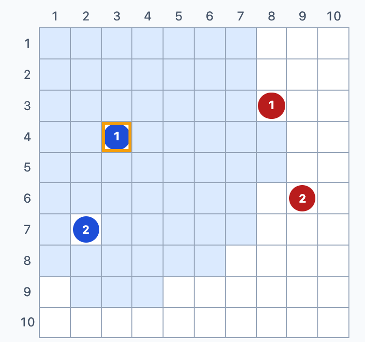
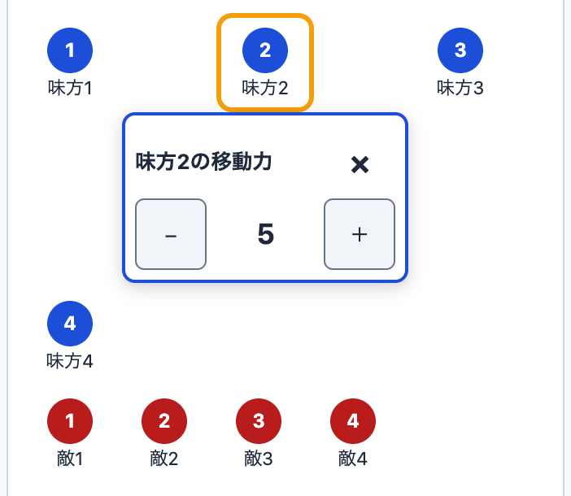
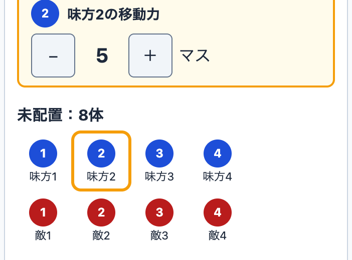

<!-- _class: cover -->
<!-- _paginate: false -->

# エージェント 開発プロセス

Spec × Issue × Orca

agent-dev-template の全体像と役割

<!--
【話すこと】
agent-dev-template というテンプレートが用意している開発プロセスの全体像を紹介します。
最初の数分で「何をするプロセスか」と「登場する役割」を押さえ、そのあと Issue 1本の流れに進みます。

【出典】
- README 冒頭（題名「エージェント開発テンプレート（Spec × Issue × Orca）」）: https://github.com/dyamada-jaki/agent-dev-template/blob/78c72e2a824ef1056e8ecbcae141818acf28ec71/README.md
-->

---

## 何をするプロセスか

人間が判断し、AI エージェント（Claude Code と Codex）が 仕様づくりから実装・レビュー・マージ・ふりかえりまでを進める

  
仕様づくり

  
→

  
実装

  
→

  
レビュー

  
→

  
マージ

  
→

  
ふりかえり

<!--
【話すこと】
agent-dev-template は、このプロセスを一式そろえたテンプレート
一言でいうと、人間が判断し、AI エージェントが仕様づくりからふりかえりまでを進めるためのプロセスです。
エージェントは Claude Code と Codex の2種類を使います。
各工程の細かい手順は、このあと「Issue 1本の流れ」で説明します。ここでは「人間は判断、エージェントは作業」という分担だけ覚えてください。

【出典】
- README 冒頭「人間が判断し、AI エージェント（Claude Code と Codex）が仕様づくりから実装・レビュー・マージ・ふりかえりまでを進めるための、プロセス一式のテンプレートです。」: https://github.com/dyamada-jaki/agent-dev-template/blob/78c72e2a824ef1056e8ecbcae141818acf28ec71/README.md
-->

---

## Spec・Issue・Orca の関係

  

    <h3>Spec</h3>
    <ul>
      <li>作るもの全体の仕様</li>
      <li>「何を・なぜ・どこまで」 を書く</li>
      <li>まだ作らない部分も 書いてよい</li>
    </ul>
    
docs/spec.md

  

  
→

  

    <h3>Issue</h3>
    <ul>
      <li>仕様から今回作る部分 だけを取り出した 作業の単位</li>
      <li>目的・範囲・ 受け入れ条件を書く</li>
      <li>1〜3本ずつ出し、 終わったら次を切る</li>
    </ul>
    
GitHub Issue

  

  
→

  

    <h3>Orca</h3>
    <ul>
      <li>複数の AI エージェントの 端末と worktree を まとめて扱うアプリ</li>
      <li>Issue を1本ずつ 実装する作業環境</li>
    </ul>
    
エージェントの作業場所

  

<!--
【話すこと】
Spec から今回作る部分を Issue に切り出し、Orca で1本ずつ作る
Spec は、作るもの全体について「何を・なぜ・どこまで」作るかを書いた仕様で、まだ作らない部分も書いておけます。
Issue は、その仕様から今回作る部分だけを取り出した作業の単位です。今回実装する作業の目的・範囲（やらないこと）・受け入れ条件を書きます。1〜3本ずつ出して、終わったら次を切ります。
Orca は、複数の AI エージェントの端末と worktree をまとめて扱うアプリで、Issue を1本ずつ実装する作業環境になります。

【出典】
- workflow.md 冒頭（spec.md は作るもの全体の仕様、Issue はそこから今回作る部分だけを取り出したもの、Orca で1本ずつ実装）: https://github.com/dyamada-jaki/agent-dev-template/blob/78c72e2a824ef1056e8ecbcae141818acf28ec71/docs/workflow.md
- workflow.md ステップ2「Issueを切り出す」（Issue に書くこと: 目的、受け入れ条件、スコープ外）: https://github.com/dyamada-jaki/agent-dev-template/blob/78c72e2a824ef1056e8ecbcae141818acf28ec71/docs/workflow.md
- README 冒頭（Orca の説明）: https://github.com/dyamada-jaki/agent-dev-template/blob/78c72e2a824ef1056e8ecbcae141818acf28ec71/README.md
-->

---

## 3つの役割（どれも AI エージェント）

  

    

      
      <h3>PO</h3>
    

    <ul>
      <li>人間と議論して spec.md と Issue を書く</li>
      <li>着手してよい Issue に 「開発可」を付ける</li>
      <li>推薦された PR を 受け入れ確認する （コードは見ない）</li>
    </ul>
    
長く使う

  

  

    

      
      <h3>開発チーム</h3>
    

    <ul>
      <li>Issue 1本を 最後まで進める</li>
      <li>開発者2人の実装を比べ、 採る PR を推薦する</li>
      <li>後片付けとふりかえり</li>
    </ul>
    
Issue ごとに開いて閉じる

  

  

    

      
      
      <h3>開発者</h3>
    

    <ul>
      <li>自分の worktree で 計画・実装・PR・レビュー</li>
      <li>Claude Code と Codex が 1人ずつ</li>
    </ul>
    
実装からマージまで

  

<!--
【話すこと】
人間はこの3つの役割に含めない（次のページ）
絵の人物は AI エージェントの3つの役割を表します。次のページの2人は人間です。
エージェントは3つの役割に分かれます。
PO は人間と議論して仕様と Issue を書き、開発チームが推薦する PR を受け入れ条件・仕様・使う人の目で確かめます。コードは見ません。
開発チームは Issue 1本を最後まで進めます。開発者2人に同じ Issue を別々に実装させ、互いにレビューさせて、どちらを採るかを推薦します。
開発者は自分の worktree で計画・実装・PR・レビューを行います。
PO と開発チームを分けているのは、1つの端末にまとめると文脈がすぐあふれ、開発中にプロダクトの検討を進めにくくなるためです。
（開発チームを自動で開く「起動係」という仕組みもありますが、3つの役割には含めないので後のパートで扱います。）

【出典】
- workflow.md の PO・開発チーム・開発者の担当を表にした節: https://github.com/dyamada-jaki/agent-dev-template/blob/78c72e2a824ef1056e8ecbcae141818acf28ec71/docs/workflow.md
- README の PO・開発チーム・開発者の役割と受け渡しを説明した節（役割の表、PO と開発チームを分ける理由）: https://github.com/dyamada-jaki/agent-dev-template/blob/78c72e2a824ef1056e8ecbcae141818acf28ec71/README.md
-->

---

## 人間は3つの役割に含めず、 判断を担う

  

    <h3>人間</h3>
    <ul>
      <li>PO と議論する</li>
      <li>3つの判断をする</li>
    </ul>
    
役割には数えない

    
  

  
→

  

    
1. 計画を承認する

    
2. 採用する PR を決める

    
3. 改善の採否を決める

  

<!--
【話すこと】
3つの判断は人間が行う。それ以外はエージェントが進める
人間は3つの役割のどれにも含めません。
人間がすることは、PO との議論と、3つの判断です。実装前の計画を承認する、採用する PR を決める、ふりかえりで出た改善の採否を決める。
この3つの判断は人間が行い、それ以外の作業はエージェントが進めます。
それぞれの判断がどのタイミングで来るかは、次の「Issue 1本の流れ」で説明します。

【出典】
- README「Issue 1本の流れ」（「六角形が人間の判断です。それ以外はエージェントが進めます。」「人間がすることは、PO との議論と、④⑥⑧の3つの判断です。」）: https://github.com/dyamada-jaki/agent-dev-template/blob/78c72e2a824ef1056e8ecbcae141818acf28ec71/README.md#issue-1本の流れ
- workflow.md の PO・開発チーム・開発者の担当を表にした節（人間が判断するのは3つの場面: ④計画承認、⑥採用の判断、⑧改善の採否）: https://github.com/dyamada-jaki/agent-dev-template/blob/78c72e2a824ef1056e8ecbcae141818acf28ec71/docs/workflow.md
-->

---

## ここまでのまとめ

<table class="recap">
  <tr><th>何を</th><td>人間が判断し、AI エージェントが仕様からふりかえりまで進める</td></tr>
  <tr><th>何で</th><td>Spec から今回作る部分を Issue に切り出し、Orca で作る</td></tr>
  <tr><th>誰が</th><td>PO・開発チーム・開発者の3つの役割と、判断を担う人間</td></tr>
</table>

次: Issue 1本の流れ ― 仕様から切り出した Issue が、どう進んでいくか

<!--
【話すこと】
ここまでをまとめると、何をするか・何を使うか・誰が担うか、の3点です。
次は、Issue 1本が切り出されてから、計画・実装・レビュー・マージ・ふりかえりへ進む流れを見ていきます。

【出典】
- README 冒頭・役割と受け渡しの節・「Issue 1本の流れ」: https://github.com/dyamada-jaki/agent-dev-template/blob/78c72e2a824ef1056e8ecbcae141818acf28ec71/README.md
- workflow.md 冒頭・3つの役割の節: https://github.com/dyamada-jaki/agent-dev-template/blob/78c72e2a824ef1056e8ecbcae141818acf28ec71/docs/workflow.md
-->

---

## この章の題材: overstrata-board #37

  

    
board #37 の Issue の目的から（要約）

    <table class="duty">
      <tr><th>何の アプリか</th><td>マス目の盤面に駒を並べ、各駒が 動ける範囲の目安を表示するアプリ （スマホ）。使うのはゲームの進行役</td></tr>
      <tr><th>今の 課題</th><td>用意した駒の移動力は、すべて 5マス固定。駒ごとに変えられない</td></tr>
      <tr><th>したい こと</th><td>準備中に駒ごとの移動力を設定し、 その値で範囲の目安を出したい</td></tr>
    </table>
  

  

    <h3>画面と言葉</h3>
    

      

        
        

          
選んだ駒の 範囲の目安 （薄い青）

          
#37 の前の画面 c276d11・全駒5マス

        

      

    

    <ul>
      <li><b>移動力</b>: 1回に動けるマス数</li>
      <li><b>準備中</b>: 駒を並べ、「確定」を押すまで</li>
      <li><b>範囲の目安</b>: 選んだ駒の周りの薄い色。 範囲の外へも動かせる</li>
    </ul>
  

<!--
【話すこと】
ここから Issue 1本の流れを見ていきます。例にするのは、別の開発プロジェクト overstrata-board の Issue #37 です。工程に入る前に、この Issue で何を作りたかったのかを、Issue の目的から抜き出して紹介します。
overstrata-board は、マス目の盤面に駒を並べて、選んだ駒が動ける範囲の目安を表示するスマホ向けのアプリです。使うのはゲームの進行役です。ゲームの種類やルールの話はしません。
右の画面のように、駒を選ぶと周りのマスが薄い色になります。これが「範囲の目安」で、アプリは移動を禁止しません。範囲の外へも動かせます。
この時点の課題は、用意した駒の移動力（1回に動けるマス数）がすべて5マスに固定されていたことです。
したいことは、駒を並べて「確定」を押すまでの準備中に、駒ごとの移動力を設定し、その値で範囲の目安を出すことです。

【元の言葉】
board の仕様・Issue では、このアプリは TRPG「Overstrata」のプレイ中に使う戦闘ボードで、進行役は GM と書かれています。本文では、ゲームそのものの説明に入らないよう、人間の判断で「ゲームの進行役」と言い換えました。

画像: overstrata-board の c276d11（#32 を取り込んだ main、#37 の着手前）を手元で起動し、スマホ幅 375×667（2倍の解像度）で、味方2・敵2を用意して盤面に置き、味方1を選んだ状態の盤面部分を切り抜いたもの。

【時間】約60秒（見積もり）

【出典】
overstrata-board の実例（本文は以下からの要約）:
- Issue #37 の「目的」（GM が準備中に移動力を設定する、全駒5マス固定から駒ごとの値を移動範囲の目安へ反映する）・「前提・着手条件」・「#32からの引き継ぎ」・受け入れ条件1・2・6・8（範囲の外へも動かせ、移動力で移動を禁止しない）: https://github.com/dyamada-jaki/overstrata-board/issues/37
- 条件変更の直前の仕様 d6b5d01 の1章（TRPG のプレイ中に使う戦闘ボード、ルールを強制せず範囲を見せるだけ）: https://github.com/dyamada-jaki/overstrata-board/blob/d6b5d015f79b8324d1a776882c7e1089e2ff1ecc/docs/spec.md#L11-L25
- 同じ版の2.2（#32 は全駒5マス固定で範囲は目安、#37 で GM が準備中に0〜9・初期値5で設定）: https://github.com/dyamada-jaki/overstrata-board/blob/d6b5d015f79b8324d1a776882c7e1089e2ff1ecc/docs/spec.md#L115-L117
- 画像の版（#37 着手前の main、PR #38）: https://github.com/dyamada-jaki/overstrata-board/tree/c276d11e5da42c7664ffa41693d5c9cb762ac7d0
-->

---

## 何を満たせば完成か（受け入れ条件の抜粋）

  

    
board #37 の受け入れ条件（10項目）から（要約）

    <table class="duty">
      <tr><th>設定の 範囲</th><td>準備中に選んだ駒を、0〜9マス （初期値5）で設定する</td></tr>
      <tr><th>操作</th><td>数値は表示だけ。 「−」「＋」で1ずつ変える</td></tr>
      <tr><th>反映</th><td>対象の駒と、範囲の目安へ すぐ反映する</td></tr>
      <tr><th>置き場所 （当初）</th><td>設定欄は<b>対象の駒の近く</b>に出す。 どの駒か分かり、対象だけ変わる</td></tr>
    </table>
  

  

    <h3>この条件への2つの解決案</h3>
    <ul>
      <li>開発者2人が、同じ課題と条件から 別々に作った</li>
      <li>分かれたのは設定欄の置き場所: <b>駒の近く案</b>と<b>操作パネル案</b></li>
      <li>置き場所の条件は、2案を比べた後に 人間の判断で変わる（⑥で説明）</li>
    </ul>
    
置き場所は、条件を変更する前の版

  

<!--
【話すこと】
では、何ができれば完成なのか。Issue の受け入れ条件は10項目ありますが、代表的なものだけ抜き出しました。
準備中に選んだ駒の移動力を0〜9マス、初期値5マスで設定できること。数値は表示だけで、「−」「＋」で1ずつ変えること。変えた値が、その駒と範囲の目安にすぐ反映されること。
そして、最後の行が2案を比べる基準になります。当初の条件では、設定欄は「対象の駒の近く」に出し、どの駒の値を変えているか分かり、変更はその駒だけに反映する、となっていました。
このあと、開発者2人が同じ課題と条件から別々に作り、設定欄の置き場所が「駒の近く案」と「操作パネル案」に分かれます。
なお、現在の Issue のこの条件は「操作パネルに1つ表示する」に変わっています。これは2案を触り比べた後の人間の判断によるもので、最初からの条件ではありません。経緯は⑥のページで説明します。

【抜き出した条件】
- 設定の範囲: 受け入れ条件1（0〜9マスの整数、初期値5マス）・2（未配置・配置済みとも「確定」まで変更できる）
- 操作: 受け入れ条件4（数値は「−」「＋」の間に表示し、直接入力・削除はできない）・5（1ずつ増減、0の「−」と9の「＋」は押せない）
- 反映: 受け入れ条件6（その駒の移動力へすぐ反映）・7（移動範囲の目安にも反映）
- 置き場所（当初）: 変更前の受け入れ条件3「設定欄は対象の駒の近くに表示し、どの駒の値を変更しているか分かる。変更は対象の駒だけに反映する。」
- 抜き出していない条件: 8（範囲外へも移動できる。前のページで紹介）・9（確定後は値を引き継ぎ、変更操作はない）・10（やり直しで値も消える）

【時間】約60秒（見積もり）

【出典】
overstrata-board の実例:
- Issue #37 の受け入れ条件（現在の本文。条件3は人間の判断の後に変更された版）: https://github.com/dyamada-jaki/overstrata-board/issues/37
- 変更前の条件3は、Issue の編集履歴の 2026-10-23 08:30:40 UTC の版（21:41 JST の条件変更の直前）で確認した。固定版では、条件変更の直前の仕様 d6b5d01 の2.2（設定欄は対象の駒の近くに表示し、どの駒か分かり、対象だけに反映）: https://github.com/dyamada-jaki/overstrata-board/blob/d6b5d015f79b8324d1a776882c7e1089e2ff1ecc/docs/spec.md#L127
- 条件変更のコメント（「従来の『対象の駒の近くに表示する』という条件を置き換えました」「受け入れ条件1・2・4〜10は変更していません」）: https://github.com/dyamada-jaki/overstrata-board/issues/37#issuecomment-6365106903
-->

---

<ol class="steps">
  <li class="now">①議論</li>
  <li>②切り出し</li>
  <li>③着手</li>
  <li class="judge">④計画承認</li>
  <li>⑤実装</li>
  <li class="judge">⑥レビュー・採用</li>
  <li>⑦マージ</li>
  <li class="judge">⑧ふりかえり</li>
</ol>

## ① 人間と PO が、作りたいものを仕様にする

  

    
このプロセスでは

    <table class="duty">
      <tr><th>担当</th><td>

        
PO

        
人間

      
</td></tr>
      <tr><th>渡すもの</th><td>spec.md（何を・なぜ・ どこまで作るか）</td></tr>
      <tr><th>人間が 決めること</th><td>作りたいものを PO と議論する （3つの判断の前の段階）</td></tr>
    </table>
  

  

    <h3>実例: overstrata-board #37</h3>
    <ul>
      <li>前の Issue #32 から、移動力の 設定を別の Issue（#37）に分けると、 人間と PO が合意した</li>
      <li>PO が spec.md に記録: 0〜9マス・ 初期値5・設定欄は駒の近く</li>
    </ul>
    
spec.md 2.2・6章、#37 レポート 2章

  

<!--
【話すこと】
ここから、題材の Issue #37 が8つの段階をどう進んだかを見ていきます。
上部の段階の行は元テンプレートの8ステップで、金色の④⑥⑧が人間の判断です。各ページの左が一般的な手順、右が実例です。
① 議論では、PO が人間と議論して、作るもの全体の仕様 spec.md を書きます。会話は消えますが、spec.md は残ります。
ここで人間がするのは議論で、3つの判断はまだ来ません。

【実例】
前提のページで紹介した課題（全駒5マス固定）と、したいこと（準備中に駒ごとに設定）は、この段階で人間（利用者）と PO が議論し、spec.md に書いたものです。
前の Issue #32（駒の準備・配置）から移動力の設定を #37 に分けることを決め、PO が spec.md に記録しました。0〜9マス・初期値5マス、設定欄は「駒の近く」に出す、という合意もこのとき引き継いでいます。

【時間】約35秒（見積もり）

【出典】
一般的な手順:
- README「Issue 1本の流れ」の流れ図（①〜⑧、六角形が人間の判断）: https://github.com/dyamada-jaki/agent-dev-template/blob/78c72e2a824ef1056e8ecbcae141818acf28ec71/README.md#L49-L71
- workflow.md ステップ1「議論する」: https://github.com/dyamada-jaki/agent-dev-template/blob/78c72e2a824ef1056e8ecbcae141818acf28ec71/docs/workflow.md#L132-L143
overstrata-board の実例:
- Issue #37 レポート 2章（全駒5マス固定から、準備中に駒ごとに0〜9マスへ）: https://github.com/dyamada-jaki/overstrata-board/blob/346606809993990ddf3cdb0244b0db9a59e42a7d/docs/issue-reports/issue-37.md
- spec.md 2.2（#32 は全駒5マス固定、駒ごとの設定は #37）と6章の決定の記録（2026-10-23、#32 から #37 へ分離、駒の近くの入力欄などの合意を引き継ぐ）: https://github.com/dyamada-jaki/overstrata-board/blob/346606809993990ddf3cdb0244b0db9a59e42a7d/docs/spec.md#L117-L119 ・ https://github.com/dyamada-jaki/overstrata-board/blob/346606809993990ddf3cdb0244b0db9a59e42a7d/docs/spec.md#L532
-->

---

<ol class="steps">
  <li>①議論</li>
  <li class="now">②切り出し</li>
  <li class="now">③着手</li>
  <li class="judge">④計画承認</li>
  <li>⑤実装</li>
  <li class="judge">⑥レビュー・採用</li>
  <li>⑦マージ</li>
  <li class="judge">⑧ふりかえり</li>
</ol>

## ②③ 今回作る範囲を Issue にし、着手する

  

    
このプロセスでは

    <table class="duty">
      <tr><th>担当</th><td>

        
PO

        →
        
GitHubIssue と「開発可」

        →
        
Orca の起動係定期実行で起動

        →
        
開発チーム

      
</td></tr>
      <tr><th>渡すもの</th><td>Issue（目的・受け入れ条件・ スコープ外）と「開発可」</td></tr>
      <tr><th>人間が 決めること</th><td>なし（着手の順番は PO が決める）</td></tr>
    </table>
  

  

    <h3>実例: overstrata-board #37</h3>
    <ul>
      <li>範囲: 前提で示した条件を含む 受け入れ条件10項目</li>
      <li>スコープ外: 戦闘途中の駒の増減、 倒れた駒の表示（別の Issue）</li>
      <li>#32 の完了後に「開発可」。 Orca の起動係が開発チームを 起動し、19:45 に着手した</li>
    </ul>
    
#37 レポート 2・3章

  

<!--
【話すこと】
② 切り出しでは、PO が spec.md から今すぐ作る部分を Issue にします。目的・受け入れ条件・スコープ外を書き、PR 1本で終わる大きさにします。
PO は GitHub に Issue を書き、着手してよい Issue に「開発可」のラベルを付けます。担当の行の真ん中の GitHub の枠がこれです。
すると ③ 着手です。Orca の定期実行の「起動係」が、「開発可」の Issue があり、動いている開発チームがいないときだけ、開発チームを起動します。担当の行の「Orca の起動係」の枠がこれです。GitHub と起動係は3つの役割に含めない仕組みなので、人物の絵ではなく文字の枠で示しています。
ここでも人間の判断はありません。

【実例】
#37 の範囲は、前提のページで抜き出した条件を含む、受け入れ条件10項目です。
戦闘の途中で駒を増やしたり減らしたりする機能（#33）や、倒れた駒の表示（#34）はスコープ外として別の Issue に分けています。
前提の #32 が取り込まれた後、PO が GitHub の #37 に「開発可」を付けました。Orca の起動係が「着手中」にして開発チームを起動し、2026-10-23 の 19:45 に着手しています。

【時間】約40秒（見積もり）

【出典】
一般的な手順:
- workflow.md ステップ2「Issueを切り出す」（Issue に書くこと、着手の合図）: https://github.com/dyamada-jaki/agent-dev-template/blob/78c72e2a824ef1056e8ecbcae141818acf28ec71/docs/workflow.md#L145-L169
- workflow.md ステップ3「着手する」: https://github.com/dyamada-jaki/agent-dev-template/blob/78c72e2a824ef1056e8ecbcae141818acf28ec71/docs/workflow.md#L171-L175
- README の役割の表（起動係は「開発可」の Issue があり、動いている開発チームがいないときだけ開発チームを開く）: https://github.com/dyamada-jaki/agent-dev-template/blob/78c72e2a824ef1056e8ecbcae141818acf28ec71/README.md#L40-L45
overstrata-board の実例:
- Issue #37 レポート 2章（目的と範囲・前提・スコープ外）・3章（19:45 の着手、起動係による「着手中」）: https://github.com/dyamada-jaki/overstrata-board/blob/346606809993990ddf3cdb0244b0db9a59e42a7d/docs/issue-reports/issue-37.md
- Issue #37: https://github.com/dyamada-jaki/overstrata-board/issues/37
-->

---

<ol class="steps">
  <li>①議論</li>
  <li>②切り出し</li>
  <li>③着手</li>
  <li class="judge now">④計画承認</li>
  <li>⑤実装</li>
  <li class="judge">⑥レビュー・採用</li>
  <li>⑦マージ</li>
  <li class="judge">⑧ふりかえり</li>
</ol>

## ④ 開発者が計画を出し、人間が承認する

  

    
このプロセスでは

    <table class="duty">
      <tr><th>担当</th><td>

        
開発者

        
開発チーム

      
</td></tr>
      <tr><th>渡すもの</th><td>計画（受け入れ条件ごとの 作り方・確かめ方・確認したいこと）</td></tr>
      <tr class="decide"><th>人間が 決めること</th><td>
計画を承認する
</td></tr>
    </table>
  

  

    <h3>実例: overstrata-board #37</h3>
    <ul>
      <li>2人の計画で、設定欄の置き場所が 分かれた: <b>駒の近く案</b>と <b>操作パネル案</b></li>
      <li>人間は「それぞれの案のまま作り、 画面で見比べる」と承認</li>
      <li>操作パネル案は「駒の近く」を 満たさないおそれ → 距離を測らせる</li>
    </ul>
    
#37 レポート 3章

  

<!--
【話すこと】
④ 計画承認は、人間の1つ目の判断です。開発者はすぐにはコードを書かず、受け入れ条件ごとにどう作り、どう確かめるかの計画を出します。開発チームがそれを人間に見せます。
人間は Issue と見比べて、受け入れ条件を全部カバーしているか、スコープ外のことをしようとしていないかを確かめます。仕様に穴が見つかったら、実装を止めて PO に戻します。
Issue の曖昧さは計画に表れるので、コードになる前に見つけるのがいちばん安い、という考え方です。

【実例】
#37 では、同じ Issue を開発者2人が別々に作る進め方をとりました。2人の計画で、移動力の設定欄をどこに出すかが分かれました。
- 駒の近く案（Codex の計画）: 未配置の一覧では選んだ駒のすぐ下、盤面に置いた駒では選んだマスの上か下に重ねて出す
- 操作パネル案（Claude Code の計画）: 盤面の下の操作パネルに1つだけ出す
仕様では設定欄の細かい位置を「作った画面を見ながら調整する」としていたので、人間は 20:01 に「それぞれの案のまま作り、画面で見比べる」と承認しました。
このとき、操作パネル案は「対象の駒の近くに表示する」という受け入れ条件に届かないおそれがありました。そこで、選んだ駒と欄の距離を実際に測って PR に書くよう指示しています。駒の近く案には、重ねた欄で隠れるマスの扱いを書くよう指示しました。
ここで「どちらが優れているか」は決めていません。決めたのは、両方を作って比べる、ということです。

【時間】約50秒（見積もり）

【出典】
一般的な手順:
- workflow.md ステップ4「計画を承認する」（人間が確かめる点と分岐）: https://github.com/dyamada-jaki/agent-dev-template/blob/78c72e2a824ef1056e8ecbcae141818acf28ec71/docs/workflow.md#L177-L195
- README「Issue 1本の流れ」（開発者2人がそれぞれ計画を立て、人間が④で承認）: https://github.com/dyamada-jaki/agent-dev-template/blob/78c72e2a824ef1056e8ecbcae141818acf28ec71/README.md#L49-L71
overstrata-board の実例:
- Issue #37 レポート 3章「計画と承認」（20:01 の人間の承認、設定欄の位置、各案への追加指示）: https://github.com/dyamada-jaki/overstrata-board/blob/346606809993990ddf3cdb0244b0db9a59e42a7d/docs/issue-reports/issue-37.md
-->

---

<ol class="steps">
  <li>①議論</li>
  <li>②切り出し</li>
  <li>③着手</li>
  <li class="judge">④計画承認</li>
  <li class="now">⑤実装</li>
  <li class="judge now">⑥レビュー・採用</li>
  <li>⑦マージ</li>
  <li class="judge">⑧ふりかえり</li>
</ol>

## ⑤⑥ 開発者が実装・検証し、互いにレビューする

  

    
このプロセスでは

    <table class="duty">
      <tr><th>担当</th><td>

        
開発者2人 （それぞれの worktree）

      
</td></tr>
      <tr><th>渡すもの</th><td>PR（何をしたか・ 確認結果）と、相手の PR へのレビュー</td></tr>
      <tr><th>人間が 決めること</th><td>なし（この間は待つ）</td></tr>
    </table>
  

  

    <h3>実例: 同じ操作の直後の2案</h3>
    

      

        
        
欄が一覧の中に入り、 駒の並びが動く

        
駒の近く案 （PR #41・526f8f8）

      

      

        
        
欄は操作パネルに1つ。 並びは動かないが、 盤面の駒からは離れる

        
操作パネル案 （PR #40・b1902c4）

      

    

  

<!--
【話すこと】
⑤ 実装では、開発者が自分の worktree で計画どおりに作り、確認コマンドを通して PR を出します。GitHub Actions でも同じ確認が回ります。この間、人間は待っています。
⑥ レビューでは、開発者2人が互いの PR を、受け入れ条件・仕様・回帰の観点でレビューします。
今回は同じ Issue を2人が別々に作る「二重実装」で進めました。元テンプレートでは任意の進め方で、1本だけ実装する方法もあります。
右は、2つの PR で同じ操作をした直後の画面です。駒を味方4・敵4で用意し、未配置の一覧で「味方2」を選びました。画像の中の文字は読まなくて大丈夫です。
左の駒の近く案では、設定欄が一覧の中に入るので、駒の並びが組み替わり、味方4が次の行へ押し出されます。右の操作パネル案では、欄は一覧の上に1つ出て、並びは変わりません。その代わり、盤面に置いた駒からは離れます。

【実例】
- PR #41（駒の近く案、Codex）は head 526f8f8、PR #40（操作パネル案、Claude Code）は head b1902c4。どちらも確認コマンド・E2E・CI が成功した
- 相互レビュー（20:49〜21:03）の結果、このときの受け入れ条件3（更新前の「対象の駒の近くに表示する」）について:
  - PR #40 は満たさない（必須の指摘）。スマホ幅 375×667 で、盤面の上の方の駒と欄が約488px離れ、同時に見えない
  - PR #41 は満たす。ただし、一覧の並びが組み替わって誤タップにつながる点と、盤面では欄が周りの18マスを覆う点が、推奨の指摘になった
- この画像は比べた時点の版で、採用後の版ではありません。製品名は担当を示すだけで、モデルの優劣を比べたものではありません

画像: overstrata-board の各版（PR #41 は 526f8f8、PR #40 は b1902c4）を手元で起動し、スマホ幅 375×667（2倍の解像度）で、味方4・敵4を用意して未配置の味方2を選んだ直後に撮影。設定欄と未配置一覧を囲む範囲（横351 CSS px、縦は PR #41 が305・PR #40 が260）を切り抜いただけで、注記や色付けはしていない。

【時間】約60秒（見積もり）

【出典】
一般的な手順:
- workflow.md ステップ5「実装」: https://github.com/dyamada-jaki/agent-dev-template/blob/78c72e2a824ef1056e8ecbcae141818acf28ec71/docs/workflow.md#L197-L204
- workflow.md ステップ6「レビュー」（任意: 2つのエージェントで作らせて比べる、相互レビューの担当）: https://github.com/dyamada-jaki/agent-dev-template/blob/78c72e2a824ef1056e8ecbcae141818acf28ec71/docs/workflow.md#L206-L227
overstrata-board の実例:
- Issue #37 レポート 4章（実装の比較）・5章（受け入れ条件と検証、更新前の条件3）・6章（レビューと指摘の裏付け）: https://github.com/dyamada-jaki/overstrata-board/blob/346606809993990ddf3cdb0244b0db9a59e42a7d/docs/issue-reports/issue-37.md
- PR #41 の比較した版（526f8f8）: https://github.com/dyamada-jaki/overstrata-board/tree/526f8f8340fe64b065ee8d618fc8852c237d8c64
- PR #40 の比較した版（b1902c4）: https://github.com/dyamada-jaki/overstrata-board/tree/b1902c451de34eb2725c9da48dc3435bd7cbfa64
- 相互レビュー（PR #40）: https://github.com/dyamada-jaki/overstrata-board/pull/40#issuecomment-6364370949 、（PR #41）: https://github.com/dyamada-jaki/overstrata-board/pull/41#issuecomment-6364435883
-->

---

<ol class="steps">
  <li>①議論</li>
  <li>②切り出し</li>
  <li>③着手</li>
  <li class="judge">④計画承認</li>
  <li>⑤実装</li>
  <li class="judge now">⑥レビュー・採用</li>
  <li>⑦マージ</li>
  <li class="judge">⑧ふりかえり</li>
</ol>

## ⑥ 推薦・PO の受け入れ確認と、人間の採用判断

  

    
実例: #37 の往復（担当とすること）

    <table class="duty loop">
      <tr><th>開発チーム</th><td><b>推薦</b>: PR #41（駒の近く案）</td></tr>
      <tr><th>PO</th><td><b>受け入れ確認</b>: #41 を受け入れ</td></tr>
      <tr class="decide"><th>人間</th><td><b>採用判断</b>: 触り比べて #40 を選ぶ</td></tr>
      <tr><th>PO・開発者</th><td>置き場所の条件を更新／並行して README を修正</td></tr>
      <tr><th>開発者・ 開発チーム</th><td>更新後の条件で再レビュー、推薦を #40 へ</td></tr>
      <tr><th>PO</th><td><b>受け入れ</b>（#40）→ 人間の承認後に⑦へ</td></tr>
    </table>
  

  

    <h3>置き場所の条件の変更</h3>
    <ul>
      <li>変更前: 設定欄は、 対象の駒の近くに表示する</li>
      <li>変更後: 操作パネルに1つ表示し、 駒名・陣営色の丸・番号で 対象を示す</li>
      <li>画面は作り直していない。 #40 の追加の修正は README の1行</li>
    </ul>
    
#37 レポート 6・7章、仕様更新 3bac3e9

  

<!--
【話すこと】
⑥ の後半は、3つの確認を分けて進みます。開発チームの推薦、PO の受け入れ確認、そして人間の採用判断です。
推薦は、開発チームがレビューを踏まえて「どちらを採るか」を推すことです。PO はコードを見ず、受け入れ条件・仕様・使う人の目で確かめます。採用する PR を決めるのは、2つ目の判断として人間です。
#37 は一直線には進みませんでした。開発チームは、当時の受け入れ条件をすべて満たす #41 を推薦し、PO も #41 を受け入れました。ところが人間がスマホで両方を触り比べ、#40 を選びました。
選ばれた #40 は「駒の近く」という条件を満たしていません。そこで、作りを直すのではなく、PO が受け入れ条件3を、目的に照らして「操作パネルに1つ出し、駒名・陣営色・番号で対象を示す」に更新しました。開発者はそれと並行して、レビューで指摘されていた README の1行を直しました。画面そのものは作り直していません。
更新後の条件で再レビューし、推薦を #40 に変え、PO がもう一度確認しています。PO の受け入れは採用の決定ではなく、最後に採用を決めるのは人間です。

【実例】
時刻は #37 レポートの記録（JST）に従う。
- 21:06 まで: 開発チームが #41 を推薦（当時の条件1〜10を満たし、必須の指摘なし）。21:10: PO が #41 を受け入れ（1回目）。PO は、一覧の並びが組み替わる点などを、人間に実機で確かめてほしいこととして渡した
- 〜21:35: 人間がスマホ実機で両 PR を触り比べた。原文:「駒の近くには無いですが、逆に #41 は駒の近くにあるために、駒の位置がズレるのが UI 的に使いにくく感じました。私は今の #40 の UI の方が使いやすいです」
- 21:36〜21:52（並行）: PO が Issue #37 の受け入れ条件3と spec.md を更新（3bac3e9）。開発者が README の「移動力は全駒5マス」を直した（629709a）。#40 の b1902c4 から 629709a への差分は README の1行だけ
- 21:52〜21:56: 相互レビュー担当が 629709a を更新後の条件で再確認。21:56 に開発チームが推薦を #40 に変更
- 21:57〜22:02: PO が #40（629709a）を受け入れ（#40 には初回）
これは PO の差し戻しではなく（差し戻しは0回）、人間が使い勝手を見て判断した変更です。どちらのモデルが優れているかの判断でもありません。

【時間】約75秒（見積もり）

【出典】
一般的な手順:
- README「Issue 1本の流れ」（相互レビュー → 開発チームが推す PR を選ぶ → PO の受け入れ確認 → ⑥ 採用する PR を決める）: https://github.com/dyamada-jaki/agent-dev-template/blob/78c72e2a824ef1056e8ecbcae141818acf28ec71/README.md#L49-L71
- workflow.md ステップ6（推薦後に PO が受け入れの一次判断をする）: https://github.com/dyamada-jaki/agent-dev-template/blob/78c72e2a824ef1056e8ecbcae141818acf28ec71/docs/workflow.md#L206-L227
- workflow.md ステップ4の分岐（仕様の穴は PO に戻し、spec.md・Issue を直してから進める）: https://github.com/dyamada-jaki/agent-dev-template/blob/78c72e2a824ef1056e8ecbcae141818acf28ec71/docs/workflow.md#L177-L195
overstrata-board の実例:
- Issue #37 レポート 6章（最初の推薦と PO の受け入れ確認）・7章（人間の判断、条件更新、README の修正、再確認、推薦の変更、PO の受け入れ2回目）・9章（README の修正と仕様更新は並行、21:36→21:52）: https://github.com/dyamada-jaki/overstrata-board/blob/346606809993990ddf3cdb0244b0db9a59e42a7d/docs/issue-reports/issue-37.md
- 最初の PO の受け入れ（#41）: https://github.com/dyamada-jaki/overstrata-board/pull/41#issuecomment-6364548520
- 人間の判断と条件3の変更前後（Issue のコメント）: https://github.com/dyamada-jaki/overstrata-board/issues/37#issuecomment-6365106903
- 仕様の更新（spec.md 2.2 の変更前後）: https://github.com/dyamada-jaki/overstrata-board/commit/3bac3e9ed1b884765a3519157b634c1bb128e2e3
- 採用版 629709a（b1902c4 との差分は README）: https://github.com/dyamada-jaki/overstrata-board/tree/629709a1f9825a8974f8e4d20cf6208eb6f5c463
- 再レビュー: https://github.com/dyamada-jaki/overstrata-board/pull/40#issuecomment-6365375650 、推薦の変更: https://github.com/dyamada-jaki/overstrata-board/pull/40#issuecomment-6365395577 、変更後の PO の受け入れ: https://github.com/dyamada-jaki/overstrata-board/pull/40#issuecomment-6365485501
- 人間の実機確認の記録（開発チームの代筆）: https://github.com/dyamada-jaki/overstrata-board/pull/40#issuecomment-6365962809
-->

---

<ol class="steps">
  <li>①議論</li>
  <li>②切り出し</li>
  <li>③着手</li>
  <li class="judge">④計画承認</li>
  <li>⑤実装</li>
  <li class="judge">⑥レビュー・採用</li>
  <li class="now">⑦マージ</li>
  <li class="judge now">⑧ふりかえり</li>
</ol>

## ⑦⑧ 採用した成果を取り込み、改善を次へ渡す

  

    
このプロセスでは

    <table class="duty">
      <tr><th>担当</th><td>

        
開発チーム: 承認の後に マージ・後片付け・ふりかえり

      
</td></tr>
      <tr><th>渡すもの</th><td>改善案（根拠・反映先）と、 PO への申し送り</td></tr>
      <tr class="decide"><th>人間が 決めること</th><td>
<ul class="decisions"><li>マージの実行内容を 承認する</li><li>改善の採否を決める</li></ul>
</td></tr>
    </table>
  

  

    <h3>実例: overstrata-board #37</h3>
    <ul>
      <li>人間の承認後、開発チームが #40（629709a）をマージ（e3311d4）。 #41 はブランチを残して閉じた</li>
      <li>改善 F: 実機確認の結果は会話で 聞き、開発チームが PR に代筆する</li>
      <li>改善 G: 条件と合わない作りが 選ばれたら、PO に仕様の更新を頼む</li>
      <li>人間が F・G を採用し、手順書に反映</li>
    </ul>
    
#37 レポート 8〜10章、反映 9b7eae7

  

<!--
【話すこと】
⑦ マージは、人間が採用する PR とマージ・後片付けの実行内容を承認し、そのあと開発チームがマージと後片付けを行います。人間が自分でマージボタンを押すのではありません。
⑧ ふりかえりは、開発チームが記録から「続けること・改善すること」を整理し、改善案ごとに根拠と反映先を示します。採るかどうかを決めるのが、人間の3つ目の判断です。仕様についての発見は PO に申し送り、次の ① 議論につながります。
採用した改善と、その効果を確かめたことは分けて扱います。

【実例】
- 22:22: 人間が実機確認の結果を会話で伝え、開発チームが PR #40 に代筆した。端末・ブラウザ・接続経路・項目ごとの結果は「記載なし」と書いている
- 22:26: 開発チームが PR #40（head 629709a、CI 成功を直前に再確認）を squash でマージし、main e3311d4。PR #41 は「人間がスマホ実機で見比べ、駒の位置がずれない #40 の UI を選んだため」としてクローズし、ブランチは残した。worktree・コンテナなどを片付けた
- ふりかえりの改善案2件を、人間が 22:40 に採用した
  - 改善 F: #32 と #37 の2回続けて、人間は実機確認の結果を会話で伝え、開発チームが代筆した。そこで、会話で聞いて開発チームが代筆する形を標準にする（伝えられた内容だけを書き、未記載の項目は「記載なし」と書く）
  - 改善 G: 人間が受け入れ条件に合わない作りを選んだとき、人間の判断を原文のまま PO に送り、Issue と spec.md の更新を頼む。修正はそれと並行してよい。再確認と PO の確認は更新後の条件で行う（当時の overstrata-board の手順書への反映内容）
- F・G は overstrata-board の dual-implement スキルに反映した（9b7eae7）。効果は次の Issue で確かめることにしており、ここでは効果を確認済みとは扱わない
- PO への申し送り: 後続の候補2つ（使われなくなったサンプルの整理、設定欄の陣営色の自動確認）を1つの Issue にまとめられるよう整理する

【時間】約60秒（見積もり）

【出典】
一般的な手順:
- README「Issue 1本の流れ」（⑦ 開発チームがマージし、後片付けする、⑧ 改善の採否を決める）: https://github.com/dyamada-jaki/agent-dev-template/blob/78c72e2a824ef1056e8ecbcae141818acf28ec71/README.md#L49-L71
- workflow.md ステップ7「マージ」・ステップ8「ふりかえりと還流」: https://github.com/dyamada-jaki/agent-dev-template/blob/78c72e2a824ef1056e8ecbcae141818acf28ec71/docs/workflow.md#L229-L266
- finish-issue 手順3（マージ・後片付けの実行内容を人間に確認する）・手順4（マージする）: https://github.com/dyamada-jaki/agent-dev-template/blob/78c72e2a824ef1056e8ecbcae141818acf28ec71/.claude/skills/finish-issue/SKILL.md#L46-L60
- 記載の不一致: 同じ版の workflow.md ステップ6（225行目）には「マージ（⑦）は人間がする」とある。README の流れ図・ステップ7・finish-issue は、人間の承認後に開発チームがマージする構成で、このスライドは後者で説明する（参照版・元資料は変更していない）: https://github.com/dyamada-jaki/agent-dev-template/blob/78c72e2a824ef1056e8ecbcae141818acf28ec71/docs/workflow.md#L225
overstrata-board の実例:
- Issue #37 レポート 8章（完了処理）・9章（ふりかえりと改善案、人間の判断）・10章（PO への申し送り）: https://github.com/dyamada-jaki/overstrata-board/blob/346606809993990ddf3cdb0244b0db9a59e42a7d/docs/issue-reports/issue-37.md
- 採用のコミット（main e3311d4）: https://github.com/dyamada-jaki/overstrata-board/commit/e3311d43c6f125adec76eafe0d683e6d62fa74bb
- 改善 F・G の反映（9b7eae7）: https://github.com/dyamada-jaki/overstrata-board/commit/9b7eae763cfc199080f09653f65c31a1cf01e072
- 完了と申し送り: https://github.com/dyamada-jaki/overstrata-board/issues/37#issuecomment-6366665330
-->
